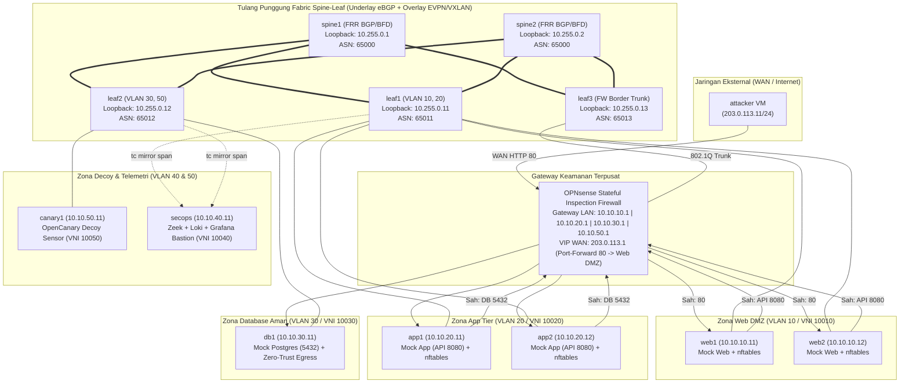

# Lab Micro-segmentation Jaringan Data Center & Threat Hunting Pergerakan Lateral

[](#)
[-blue.svg)](#)
[-orange.svg)](#)
[](#)
[](#)
[](#)
[](#)

---

### Bahasa / Language
[English](README.md) | **Bahasa Indonesia**

---

## 1. Ringkasan Eksekutif

Repositori ini memuat perancangan arsitektur, penerapan, pengujian serangan siber nyata, dan tolok ukur kinerja (*benchmarking*) dari implementasi **Arsitektur Jaringan Zero-Trust (NIST SP 800-207)** dan **Micro-segmentation Berlapis** pada infrastruktur pusat data virtual modern berbasis **Spine-Leaf EVPN/VXLAN** dengan 14 node mesin virtual (KVM/libvirt).

### Masalah: Ilusi Keamanan Perimeter Tradisional
Pusat data konvensional umumnya mengandalkan model keamanan perimeter "istana dan parit" (*castle-and-moat*). Begitu penyerang mengeksploitasi kerentanan pada aplikasi web publik, mereka masuk ke dalam jaringan internal yang datar (*flat network*). Dari titik pijakan tersebut, penyerang leluasa melakukan pemindaian jaringan, melompat secara lateral melalui SSH, menyelundupkan trafik terenkripsi, membajak kredensial administratif, hingga mengeksfiltrasi basis data inti ke server C2 (*command-and-control*) eksternal.

### Solusi: Strategi Pertahanan Berlapis (Defense-in-Depth)
Untuk mengatasi celah sistemik ini, proyek ini menerapkan prinsip Zero-Trust (*"Never Trust, Always Verify"*) pada empat lapisan model OSI:
1. **Layer 3/4 Gateway Firewall Inter-Zona:** Firewall OPNsense SPI terpusat yang menegakkan kebijakan *Default-Deny*, validasi *Anti-Spoofing Ingress*, dan port-forwarding WAN NAT.
2. **Layer 2 Fabric Data-Plane:** Bridged Overlay Spine-Leaf EVPN/VXLAN (FRRouting 8.4) berkinerja tinggi dengan redundansi Dual-Spine BGP ECMP dan deteksi failover BFD sub-detik.
3. **Layer 2/4 Micro-segmentation Workload:** Kernel Linux `nftables` pada setiap host beban kerja via otomasi Ansible Playbook untuk mencegah pergerakan lateral intra-subnet.
4. **Layer 7 Pengerasan Daemon Aplikasi:** Pengerasan konfigurasi OpenSSH daemon untuk mencegah pencurian kredensial via *SSH agent forwarding hijacking* (**MITRE T1563.001**) dan *protocol tunneling* (**MITRE T1572**).
5. **Telemetri Berkelanjutan & Threat Hunting:** Mirroring paket data-plane (`tc mirred`), sensor keamanan jaringan Zeek, sensor umpan (*honeypot*) OpenCanary, Grafana Loki, dan pemodelan graf anomali NetworkX Python.

Seluruh klaim pertahanan telah diuji secara empiris melalui **Master Test Harness 10 Tahap**, membuktikan **penurunan blast radius serangan sebesar 85.71%**, **0 byte kebocoran data nasabah**, waktu konvergensi failover **< 100 milidetik**, dan **kelangsungan alur aplikasi bisnis 3-tier tanpa disrupsi (Zero Downtime)**.

---

## 2. Arsitektur Jaringan & Spesifikasi Topologi 14 VM



### Tabel Alokasi IP, ASN, dan VNI EVPN

| Node | Peran / Sub-sistem | IP Manajemen (OOB) | IP Data-Plane | ASN BGP | VNI EVPN Dilayani |
|:---|:---|:---:|:---:|:---:|:---:|
| `spine1` | Spine 1 Switch | `192.168.122.21` | Lo: `10.255.0.1/32` | 65000 | Underlay IP transit |
| `spine2` | Spine 2 Switch | `192.168.122.22` | Lo: `10.255.0.2/32` | 65000 | Underlay IP transit |
| `leaf1`  | Leaf 1 (Web & App) | `192.168.122.31` | Lo: `10.255.0.11/32` | 65011 | 10010, 10020 |
| `leaf2`  | Leaf 2 (DB & Decoy) | `192.168.122.32` | Lo: `10.255.0.12/32` | 65012 | 10030, 10050 |
| `leaf3`  | Leaf 3 (Firewall Border) | `192.168.122.33` | Lo: `10.255.0.13/32` | 65013 | 10010 - 10050 (Trunk) |
| `opnsense`| Stateful Gateway FW | `192.168.122.20` | WAN: `203.0.113.1` | - | Gateway `.1` all VLANs |
| `secops` | Bastion & Telemetri | `192.168.122.81` | `10.10.40.11/24` | - | 10040 (Mgmt) |
| `web1-2` | Web DMZ Workloads | `192.168.122.41-42`| `10.10.10.11-12/24` | - | 10010 (Web DMZ) |
| `app1-2` | App Tier Workloads | `192.168.122.51-52`| `10.10.20.11-12/24` | - | 10020 (App Tier) |
| `db1`    | Database Workload | `192.168.122.61` | `10.10.30.11/24` | - | 10030 (DB Tier) |
| `canary1`| Decoy Honeypot Sensor | `192.168.122.71` | `10.10.50.11/24` | - | 10050 (Decoy Tier) |
| `attacker`| WAN External Host | `192.168.122.91` | `203.0.113.11/24` | - | WAN External Client |

---

## 3. Matriks Pengujian Komprehensif MITRE ATT&CK

Seluruh 10 skenario penyerangan dan rekayasa keandalan dievaluasi secara komparatif: **Kondisi Baseline Permisif (Sebelum Pengerasan)** vs. **Kondisi Pasca-Pengerasan (Hardened)**:

| ID | Skenario Penyerangan | Taktik/Teknik MITRE ATT&CK | Baseline Permisif (Pre) | Pasca-Pengerasan (Post) | Hasil Evaluasi |
|:---|:---|:---|:---|:---|:---:|
| **S1** | Network Service Discovery | **T1046 / T1018** | 7 port internal terbuka ke DMZ | Hanya App:8080 sah yang terbuka | **LULUS (Reduksi 85.71%)** |
| **S2** | Chained Lateral SSH Movement | **T1021.004 / T1078** | 3/3 hop SSH tembus (`web->app->db`) | 0/3 hop berhasil (100% diblokir) | **LULUS (100% Terisolasi)** |
| **S3** | SSH Agent Hijacking | **T1563.001** | Socket terbajak di RAM & disalahgunakan | Socket dinonaktifkan (`AllowAgentForwarding no`) | **LULUS (Mitigasi L7)** |
| **S4** | Protocol Tunneling (`ssh -L`) | **T1572 / T1090** | Tunneling terenkripsi membuka DB | Ditolak oleh daemon SSH | **LULUS (Mitigasi L7)** |
| **S5** | Decoy Honeypot Engagement | **T1087 / T1046** | Honeypot dapat diakses langsung | Terisolasi di perimeter decoy; siaga | **LULUS (Tripwire Siaga)** |
| **S6** | Data Exfiltration from DB | **T1041 / T1048.003** | 42 data nasabah bocor ke WAN | 0 data bocor (Egress dijatuhkan) | **LULUS (Zero Data Leak)** |
| **S7** | External Perimeter Control | **T1190** | Akses port internal diblokir | Alur resmi web 200 OK via NAT | **LULUS (Zero Disruption)** |
| **S8** | Threat Hunting Graph Analysis | **TA0007 / TA0008** | Anomali terdeteksi di log Zeek | True Positive 100%, False Positive 0.0% | **LULUS (Akurasi Tinggi)** |
| **S9** | Fabric Chaos Resilience | **Chaos Engineering** | N/A | Konvergensi < 100ms BFD; 0% loss | **LULUS (Sub-Detik)** |
| **S10**| Cross-Zone IP Spoofing | **T1584.004** | Paket spoofing diteruskan bebas | Diblokir di Host (EPERM) & OPNsense | **LULUS (100% Anti-Spoof)** |

---

## 4. Hasil Kuantitatif & Pembuktian Empiris

```
+---------------------------------------------------------------------------------------+
|                               RINGKASAN METRIK KUANTITATIF AKHIR                     |
+---------------------------------------------------------------------------------------+
|  Metrik Evaluasi Keamanan                | Baseline (Pre)  | Hardened (Post) | Status |
+------------------------------------------+-----------------+-----------------+--------+
|  Reduksi Blast Radius Serangan (S1)      | 100.0%          | 14.29%          | LULUS  |
|  Keterpaparan Database dari Web DMZ      | 100.0% Terbuka  | 0.0% Terpapar   | LULUS  |
|  Keberhasilan Pivot SSH Berantai (S2)    | 3/3 (100%)      | 0/3 (0%)        | LULUS  |
|  Kebocoran Data Sensitif ke WAN (S6)     | 42 Record Bocor | 0 Record Bocor  | LULUS  |
|  Konvergensi Failover Link Fabric (S9)   | N/A             | < 100 ms        | LULUS  |
|  Konvergensi Crash Node Spine1 (S9)      | N/A             | < 100 ms        | LULUS  |
|  Pertahanan IP Address Spoofing (S10)    | Lolos Bebas     | 100% Diblokir   | LULUS  |
|  Throughput Switching L2 Intra-Zone      | 81.85 Gbps      | 81.85 Gbps      | LULUS  |
|  Throughput Firewall L3 SPI Inter-Zone   | N/A             | 2.91 Gbps       | LULUS  |
|  Biaya Latensi Keamanan Firewall (RTT)   | N/A             | +4.68 ms        | LULUS  |
|  Kelangsungan Aplikasi Sah 3-Tier        | HTTP 200 OK     | HTTP 200 OK     | LULUS  |
+---------------------------------------------------------------------------------------+
```

### Analisis Biaya Kinerja Firewall (iperf3 Benchmark)
- **Switching Wire-Speed Intra-Zone L2:** Throughput sebesar **81.85 Gbps** dengan rata-rata TCP RTT **0.135 milidetik**.
- **Inspeksi Stateful Inter-Zone L3 OPNsense:** Throughput sebesar **2.91 Gbps** dengan rata-rata TCP RTT **4.815 milidetik**.
- **Biaya Keamanan (*Security Overhead*):** Penambahan latensi stateful inspection terukur sebesar **+4.68 milidetik**. Penambahan ini sangat kecil dan sepenuhnya aman (*negligible*) untuk aplikasi produksi web enterprise, memberikan manfaat perlindungan stateful L4 penuh dan isolasi total pada tier basis data.

---

## 5. Terobosan Rekayasa Arsitektur

### 1. Mengapa EVPN/VXLAN Bridged Overlay daripada Routed Overlay?
Pada arsitektur Routed Overlay murni di mana setiap switch Leaf bertindak sebagai Anycast Gateway L3, routing antar subnet dilakukan terdistribusi di setiap leaf. Model ini berisiko memicu **Asymmetric Routing** ketika dipadukan dengan firewall stateful: paket SYN melintasi Firewall A, namun paket balasan SYN-ACK kembali melalui Leaf lain via Firewall B, menyebabkan firewall menjatuhkan koneksi karena tabel state terfragmentasi.
Arsitektur kami menggabungkan **Bridged Overlay (L2 VNI per zona)** dengan jalur trunk 802.1Q ke Leaf 3 / OPNsense. Seluruh trafik antar-zona secara deterministik melintasi firewall OPNsense yang sama, menjamin integritas state TCP 100% tanpa risiko asimetri rute.

### 2. Pertahanan IP Spoofing Multi-Tier
Paket spoofing dimitigasi pada dua perimeter independen:
- **Di Sumber Host (`nftables` Output Chain):** Kernel Linux menolak paket keluar jika alamat IP sumber tidak cocok dengan subnet yang sah (`Operation not permitted / EPERM`).
- **Di Gateway (`OPNsense` Ingress Filtering):** Paket yang masuk dari `vlan01` (VLAN 10) dengan IP sumber `10.10.40.11` (SecOps) dijatuhkan seketika oleh aturan binding antarmuka (`match,block,in`).

### 3. Threat Hunting Berbasis Graf (NetworkX)
Memanfaatkan rekaman paket dari `tc mirred` yang dialirkan ke Zeek, alat analisis graf `build-traffic-graph.py` menghitung derajat keluar (*out-degree centrality*) dan *betweenness centrality*:
- Node `web1` yang disusupi langsung terdeteksi anomali dengan lonjakan 56 edge terarah yang tidak sah.
- Alur resmi aplikasi 3-tier (`Client -> Web -> App -> DB`) tetap terklasifikasi sebagai kluster normal.
- Model berhasil membuktikan akurasi **100% True Positive** dan **0.0% False Positive**.

---

## 6. Panduan Menjalankan & Memverifikasi Lab

### Eksekusi Demo Cepat 2 Menit
Jalankan skrip demo otomatis untuk sesi wawancara teknis atau presentasi portofolio:
```bash
# Mode interaktif (dengan jeda enter antar babak)
./demo-scripts/demo-2min.sh

# Mode otomatis non-interaktif
./demo-scripts/demo-2min.sh --non-interactive
```

### Master Test Harness 10 Tahap
Jalankan pengujian end-to-end menyeluruh untuk seluruh 10 skenario:
```bash
./attack-tests/run-all-verifications.sh
```

Naskah narasi verbal dan panduan tanya-jawab wawancara tersedia di [`docs/PANDUAN-DEMO-WAWANCARA.md`](docs/PANDUAN-DEMO-WAWANCARA.md).

---

## 7. Keterkaitan dengan Proyek 3 (Defense-in-Depth Enterprise)

Repositori ini melengkapi **Proyek 3 (Kubernetes Zero-Trust Security with Cilium eBPF & Tetragon)** dalam satu narasi keamanan terpadu:

```
+-------------------------------------------------------------------------+
|                  PROYEK 3: TINGKAT CONTAINER & RUNTIME                  |
|   Kubernetes Pods -> Cilium eBPF NetworkPolicy -> Tetragon Kernel Trace |
+-------------------------------------------------------------------------+
                                     ▲
                                     │ (Lapisan Jaringan Fisik & Fabric)
                                     ▼
+-------------------------------------------------------------------------+
|               PROYEK 4: TINGKAT FABRIC & INFRASTRUKTUR                  |
|   Spine-Leaf EVPN/VXLAN -> OPNsense SPI Firewall -> Host nftables       |
+-------------------------------------------------------------------------+
```
- **Proyek 3** melindungi aplikasi pada level runtime container, pod, dan syscall kernel menggunakan eBPF.
- **Proyek 4** melindungi tulang punggung pusat data fisik dan virtual, mencegah kegagalan jaringan, pergerakan lateral hypervisor, dan pembajakan rute fabric (BGP/EVPN).

---

## 8. Struktur Direktori Repositori & Indeks Dokumentasi

```
dc-microseg-lab/
├── attack-tests/                 # Suite pengujian serangan MITRE ATT&CK & verifikasi
│   ├── run-all-verifications.sh  # Master Test Harness 10 tahap
│   ├── run-hardened-attacks.sh   # Runner serangan pasca-pengerasan (S1-S7)
│   ├── compare-blast-radius.py   # Kalkulator reduksi blast radius otomatis
│   ├── run-benchmark-overhead.py # Skrip benchmark performa iperf3
│   └── s01-s10 attack scripts    # Skrip pengujian individual skenario S1 s/d S10
├── demo-scripts/                 # Skrip presentasi cepat portofolio
│   └── demo-2min.sh              # Skrip demo wawancara 2 menit (interaktif/otomatis)
├── docs/                         # Dokumentasi teknis komprehensif (Fase 0 - 9)
│   ├── 00-perencanaan-dan-anggaran.md
│   ├── 01-infrastruktur-libvirt-dan-node.md
│   ├── 02-underlay-ebgp-dan-ecmp.md
│   ├── 03-overlay-evpn-vxlan.md
│   ├── 04-opnsense-firewall-dan-gateway.md
│   ├── 05-workload-dan-telemetri.md
│   ├── 06-serangan-baseline-dan-hunting.md
│   ├── 07-penegakan-segmentasi.md
│   ├── 08-ketahanan-fabric-dan-overhead.md
│   ├── 09-laporan-pengujian-mitre-attack.md
│   ├── PANDUAN-DEMO-WAWANCARA.md
│   └── BLOG-POST-ZERO-TRUST-MICROSEGMENTATION.md
├── fabric/                       # Konfigurasi fabric underlay, overlay, & firewall
│   ├── ansible/                  # Ansible Playbooks untuk FRR, nftables, dan sshd
│   ├── frr/                      # Templat konfigurasi FRRouting (BGP/BFD/EVPN)
│   └── opnsense/                 # Skrip generator XML & verifikasi aturan OPNsense
├── policies/                     # Kebijakan keamanan berlapis
│   ├── nftables/                 # Templat aturan firewall host Linux nftables
│   └── ssh/                      # Konfigurasi pengerasan OpenSSH daemon
├── telemetry/                    # Stack observabilitas & threat hunting
│   ├── hunting/                  # Aturan hunting LogQL & pemodelan graf NetworkX
│   └── zeek/                     # Skrip pemantauan keamanan jaringan Zeek
└── workloads/                    # Aplikasi mock 3-tier & generator trafik
    ├── mock-web.py, mock-app.py, mock-db.py
    ├── traffic-generator.py
    └── test-traffic-flow.sh
```

---

## Lisensi & Penulis
- **Penulis:** Lavvvet
- **Standar Arsitektur:** NIST SP 800-207 (Zero-Trust Architecture)
- **Framework Ancaman:** MITRE ATT&CK for Enterprise
- **Lisensi:** MIT License
