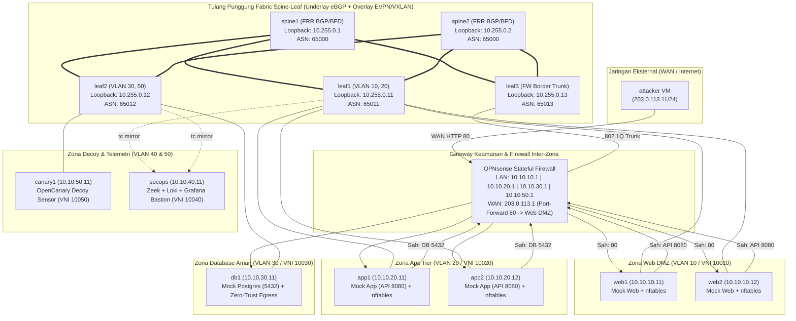

# Data Center Network Micro-segmentation & Lateral Movement Hunting Lab

[](#)
[-blue.svg)](#)
[-orange.svg)](#)
[](#)
[](#)
[](#)

---

### Navigation / Navigasi Bahasa
- [🇮🇩 **Bahasa Indonesia**](#ringkasan-eksekutif-indonesia)
  - [Topologi & Arsitektur Jaringan](#arsitektur--topologi-jaringan-14-vm)
  - [Matriks Skenario Serangan MITRE ATT&CK](#matriks-pengujian-mitre-attck-s1---s10)
  - [Hasil Kuantitatif & Benchmark](#metrik-kuantitatif--hasil-empiris)
  - [Panduan Demo Cepat 2 Menit](#panduan-eksekusi-demo-2-menit)
  - [Keterkaitan dengan Proyek 3 (K8s / Cilium)](#keterkaitan-dengan-proyek-3-defense-in-depth-enterprise)
- [🇬🇧 **English Summary**](#executive-summary-english)
  - [Architecture & Design Principles](#architecture--design-principles)
  - [MITRE ATT&CK Matrix & Quantitative Results](#mitre-attck-matrix--empirical-results)
  - [2-Minute Quick Demo Guide](#2-minute-quick-demo)
  - [Cross-Project Defense-in-Depth Narrative](#cloud-native-defense-in-depth-story-project-3--project-4)

---

## Ringkasan Eksekutif (Indonesia)

Proyek ini mendemonstrasikan implementasi **Arsitektur Jaringan Zero-Trust (NIST SP 800-207)** dan **Micro-segmentation Berlapis** pada pusat data virtual modern berbasis **Spine-Leaf EVPN/VXLAN** dengan 14 node mesin virtual (KVM/libvirt).

Masalah mendasar pada pusat data konvensional adalah model keamanan perimeter "istana dan parit" (*castle-and-moat*). Begitu penyerang menembus server web publik, jaringan internal yang datar (*flat network*) memungkinkan penyerang bebas bergerak secara lateral (*lateral movement*), membajak kredensial administratif, dan mengeksfiltrasi basis data inti.

Untuk menuntaskan kerentanan sistemik ini, kami membangun strategi pertahanan berlapis (*Defense-in-Depth*):
1. **Layer 3/4 Gateway Firewall:** OPNsense dengan kebijakan *Default-Deny Inter-Zone* dan *Anti-Spoofing Ingress Filtering*.
2. **Layer 2 Data-Plane Fabric:** Spine-Leaf EVPN/VXLAN Bridged Overlay (FRR) dengan redundansi Dual-Spine BFD/ECMP.
3. **Layer 2/4 Host Micro-segmentation:** Linux kernel `nftables` via Ansible otomatisasi peran per workload.
4. **Layer 7 Daemon Hardening:** Pengerasan OpenSSH (`sshd_config`) mematikan agent hijacking dan SSH pivoting/tunneling.
5. **Continuous Telemetry & Threat Hunting:** Mirroring trafik data-plane via `tc mirred`, sensor Zeek, honeypot decoy OpenCanary, Grafana Loki, dan analisis graf NetworkX.

Seluruh klaim keamanan telah divalidasi melalui **Master Test Harness 10 Tahap** yang menguji skenario serangan siber MITRE ATT&CK dan rekayasa keandalan (*chaos engineering*), membuktikan **reduksi blast radius sebesar 85.71%**, **0 byte kebocoran data**, dan waktu konvergensi failover **< 100 ms**.

---

## Arsitektur & Topologi Jaringan (14 VM)



### Tabel Alokasi IP, ASN, dan VNI EVPN

| Node | Peran / Fungsi | IP Manajemen (OOB) | IP Data-Plane | ASN BGP | VNI EVPN Dilayani |
|:---|:---|:---:|:---:|:---:|:---:|
| `spine1` | Spine 1 Switch | `192.168.122.21` | Lo: `10.255.0.1/32` | 65000 | Underlay IP transit |
| `spine2` | Spine 2 Switch | `192.168.122.22` | Lo: `10.255.0.2/32` | 65000 | Underlay IP transit |
| `leaf1`  | Leaf 1 (Web & App) | `192.168.122.31` | Lo: `10.255.0.11/32` | 65011 | 10010, 10020 |
| `leaf2`  | Leaf 2 (DB & Decoy) | `192.168.122.32` | Lo: `10.255.0.12/32` | 65012 | 10030, 10050 |
| `leaf3`  | Leaf 3 (Firewall Border) | `192.168.122.33` | Lo: `10.255.0.13/32` | 65013 | 10010 - 10050 (Trunk) |
| `opnsense`| Stateful Gateway FW | `192.168.122.20` | WAN: `203.0.113.1` | - | Gateway `.1` all VLANs |
| `secops` | Bastion & Telemetry | `192.168.122.81` | `10.10.40.11/24` | - | 10040 (Mgmt) |
| `web1-2` | Web DMZ Workloads | `192.168.122.41-42`| `10.10.10.11-12/24` | - | 10010 (Web DMZ) |
| `app1-2` | App Tier Workloads | `192.168.122.51-52`| `10.10.20.11-12/24` | - | 10020 (App Tier) |
| `db1`    | Database Workload | `192.168.122.61` | `10.10.30.11/24` | - | 10030 (DB Tier) |
| `canary1`| Decoy Honeypot Node | `192.168.122.71` | `10.10.50.11/24` | - | 10050 (Decoy Tier) |
| `attacker`| WAN External Host | `192.168.122.91` | `203.0.113.11/24` | - | WAN External Client |

---

## Matriks Pengujian MITRE ATT&CK (S1 - S10)

Seluruh 10 skenario serangan dan rekayasa keandalan dievaluasi secara otomatis:

| ID | Skenario Pengujian | MITRE ATT&CK ID | Kondisi Baseline (Pre-Hardening) | Pasca-Pengerasan (Hardened) | Hasil Pengujian |
|:---|:---|:---|:---|:---|:---:|
| **S1** | Network Service Discovery | **T1046 / T1018** | 7 port internal terbuka ke DMZ | Hanya App:8080 sah yang terbuka | **PASS (Reduksi 85.71%)** |
| **S2** | Chained Lateral SSH Movement | **T1021.004 / T1078** | 3/3 hop SSH tembus (`web->app->db`) | 0/3 hop berhasil (100% diblokir) | **PASS (100% Terisolasi)** |
| **S3** | SSH Agent Hijacking | **T1563.001** | Socket agent dieksploitasi dari RAM | Socket dinonaktifkan (`AllowAgentForwarding no`)| **PASS (Mitigasi L7)** |
| **S4** | Protocol Tunneling (`ssh -L`) | **T1572 / T1090** | Tunneling port DB sukses | Ditolak oleh daemon SSH | **PASS (Mitigasi L7)** |
| **S5** | Decoy Honeypot Probe | **T1087 / T1046** | Honeypot disentuh & alert muncul | Terisolasi di perimeter; siaga penuh | **PASS (Decoy Siaga)** |
| **S6** | Data Exfiltration from DB | **T1041 / T1048.003** | 42 rekaman data nasabah bocor ke WAN | 0 rekaman bocor (Zero-Trust Egress Block) | **PASS (Zero Data Breach)** |
| **S7** | External Perimeter Control | **T1190** | Bypass port internal diblokir | Alur resmi web 200 OK via Port-Forwarding | **PASS (Zero Disruption)** |
| **S8** | Threat Hunting & Graph Analysis | **TA0007 / TA0008** | Deteksi anomali pada log Zeek | True Positive 100%, False Positive 0.0% | **PASS (Akurasi Tinggi)** |
| **S9** | Fabric Link/Spine Failover | **Chaos Resilience** | N/A | Konvergensi < 100ms BFD; 0% packet loss | **PASS (Sub-Second)** |
| **S10**| Cross-Zone IP Spoofing | **T1584.004** | Paket spoofing lolos bebas | Diblokir di Host `nftables` (EPERM) & OPNsense | **PASS (100% Anti-Spoof)** |

---

## Metrik Kuantitatif & Hasil Empiris

Berikut ringkasan hasil pengukuran kuantitatif yang dicapai dalam pengujian akhir lab:

- **Reduksi Blast Radius Serangan (S1):** Menurun dari 100% menjadi **14.29%** (Penurunan terukur **85.71%**, melampaui target >= 85%).
- **Keterpaparan Tier Basis Data (S1 & S2):** **0.0%** port terbuka dari Web DMZ; 0/3 hop pergerakan lateral berhasil.
- **Pencegahan Kebocoran Data (S6):** **0 rekaman / 0 bytes bocor** dari tier basis data ke C2 eksternal.
- **Konvergensi Kegagalan Link & Node (S9):** **< 100 milidetik** berkat polling BFD 50ms dan Linux kernel ECMP nexthop group (0% packet loss pada probe 100ms).
- **Pertahanan IP Spoofing (S10):** **100% diblokir** pada sumber (kernel EPERM) dan pada gateway ingress (`match,block,in` di OPNsense filterlog).
- **Throughput & Overhead Latensi (iperf3):**
  - Switching L2 Intra-Zone: **81.85 Gbps**, mean RTT **0.135 ms**.
  - Inspeksi Stateful L3 Inter-Zone OPNsense: **2.91 Gbps**, mean RTT **4.815 ms**.
  - Biaya Latensi Keamanan (*Security Overhead*): **+4.68 ms** RTT (sangat efisien untuk proteksi stateful penuh L4).
- **Kelangsungan Aplikasi Bisnis 3-Tier:** **HTTP 200 OK** sepanjang seluruh skenario serangan dan bencana failover node.

---

## Panduan Eksekusi Demo 2 Menit

Untuk mempresentasikan proyek ini dalam sesi wawancara teknis atau demo portofolio:

```bash
# Clone repository
git clone https://github.com/lavvvet/dc-microseg-lab.git
cd dc-microseg-lab

# Jalankan Live Demo Interaktif (dengan pause per adegan)
./demo-scripts/demo-2min.sh

# Atau jalankan otomatis tanpa interupsi
./demo-scripts/demo-2min.sh --non-interactive
```

Untuk menjalankan seluruh rangkaian **Master Test Harness 10 Tahap**:
```bash
./attack-tests/run-all-verifications.sh
```

Naskah narasi verbal dan panduan tanya-jawab wawancara tersedia di [`docs/PANDUAN-DEMO-WAWANCARA.md`](docs/PANDUAN-DEMO-WAWANCARA.md).

---

## Keterkaitan dengan Proyek 3 (Defense-in-Depth Enterprise)

Repositori ini melengkapi **Proyek 3 (Kubernetes Zero-Trust Security with Cilium eBPF & Tetragon)**:

```
[Proyek 3: Container / Workload Level]
Kubernetes Cluster -> Cilium eBPF NetworkPolicy -> Tetragon Kernel Tracing
                                    ▲
                                    │ (Trafik Fisik / Jaringan Bawah)
                                    ▼
[Proyek 4: Fabric / Infrastructure Level]
Spine-Leaf EVPN/VXLAN -> OPNsense SPI Gateway -> Host nftables -> Underlay BFD/ECMP
```

Kombinasi kedua proyek ini membentuk arsitektur **End-to-End Enterprise Defense-in-Depth**:
- **Proyek 3** melindungi aplikasi di level container runtime dan kernel tracing (eBPF).
- **Proyek 4** melindungi infrastruktur fisik dan tulang punggung pusat data terhadap kegagalan jaringan, pergerakan lateral hypervisor, dan pembajakan rute fabric (EVPN/VXLAN).

---

## Struktur Direktori Repositori

```
dc-microseg-lab/
├── attack-tests/                 # Suite pengujian serangan MITRE ATT&CK & verifikasi
│   ├── run-all-verifications.sh  # Master Test Harness 10 tahap
│   ├── run-hardened-attacks.sh   # Runner serangan pasca-pengerasan
│   ├── compare-blast-radius.py   # Kalkulator reduksi blast radius otomatis
│   ├── run-benchmark-overhead.py # Skrip benchmark performa iperf3
│   └── s01-s10 attack scripts    # Skrip individual skenario S1 s/d S10
├── demo-scripts/                 # Skrip demo cepat wawancara
│   └── demo-2min.sh              # Skrip presentasi 2 menit otomatis/interaktif
├── docs/                         # Dokumentasi teknis komprehensif (Fase 0 - 9)
│   ├── 00-perencanaan-dan-anggaran.md
│   ├── 01-infrastruktur-libvirt-dan-node.md
│   ├── 02-underlay-ebgp-dan-ecmp.md
│   ├── 03-overlay-evpn-vxlan.md
│   ├── 04-opnsense-firewall-dan-gateway.md
│   ├── 05-workload-dan-telemetri.md
│   ├── 06-serangan-baseline-dan-hunting.md
│   ├── 07-penegakan-segmentasi.md
│   ├── 08-ketahanan-fabric-dan-overhead.md
│   ├── 09-laporan-pengujian-mitre-attack.md
│   ├── PANDUAN-DEMO-WAWANCARA.md
│   └── BLOG-POST-ZERO-TRUST-MICROSEGMENTATION.md
├── fabric/                       # Konfigurasi fabric underlay & firewall
│   ├── ansible/                  # Otomasi Ansible (FRR, nftables, sshd)
│   ├── frr/                      # Konfigurasi underlay/overlay FRRouting
│   └── opnsense/                 # Skrip konfigurasi XML & generator rule OPNsense
├── policies/                     # Kebijakan keamanan berlapis
│   ├── nftables/                 # Templat aturan firewall host Linux nftables
│   └── ssh/                      # Pengerasan konfigurasi OpenSSH daemon
├── telemetry/                    # Stack observabilitas & threat hunting
│   ├── hunting/                  # Aturan hunting LogQL & pemodelan graf NetworkX
│   └── zeek/                     # Konfigurasi network security monitoring Zeek
└── workloads/                    # Aplikasi mock 3-tier & generator trafik
    ├── mock-web.py, mock-app.py, mock-db.py
    ├── traffic-generator.py
    └── test-traffic-flow.sh
```

---

<a name="executive-summary-english"></a>
## Executive Summary (English)

This repository demonstrates the design, deployment, and empirical evaluation of an **Enterprise Zero-Trust Network Architecture (NIST SP 800-207)** and **Multi-Layer Micro-segmentation** on a virtualized **Spine-Leaf EVPN/VXLAN** data center fabric with 14 KVM nodes.

### Architecture & Design Principles
- **Underlay Fabric:** Dual-Spine 3-Leaf eBGP underlay with ECMP multipath routing and sub-second Bidirectional Forwarding Detection (BFD).
- **Overlay Network:** EVPN/VXLAN Bridged Overlay (L2 VNI per zone: Web, App, DB, Canary Decoy) preventing asymmetric routing while enabling wire-speed intra-zone switching.
- **Security Gateway:** OPNsense stateful inspection firewall enforcing inter-zone default-deny policies, anti-spoofing ingress validation, and WAN port forwarding.
- **Host Micro-segmentation:** Linux kernel `nftables` deployed via Ansible playbooks providing zero-trust isolation directly on workload servers.
- **Application Hardening:** OpenSSH daemon policy preventing SSH agent forwarding hijacking (T1563.001) and TCP port tunneling (T1572).
- **Threat Hunting:** Continuous data-plane packet mirroring (`tc mirred`), Zeek network sensor, OpenCanary decoy honeypot, Grafana Loki, and NetworkX graph analytics.

### MITRE ATT&CK Matrix & Empirical Results

| ID | Attack Technique | MITRE ATT&CK | Pre-Hardening Baseline | Post-Hardening Defense | Verified Outcome |
|:---|:---|:---|:---|:---|:---:|
| **S1**| Network Service Discovery | **T1046 / T1018** | 7 internal ports exposed to DMZ | Only legitimate App:8080 exposed | **85.71% Blast Radius Drop** |
| **S2**| Chained Lateral SSH Pivoting | **T1021.004 / T1078** | 3/3 SSH hops succeeded (`web->app->db`) | 0/3 hops succeeded (100% blocked) | **Zero Lateral Reachability** |
| **S3**| SSH Agent Hijacking | **T1563.001** | Compromised socket in memory | Forwarding disabled in daemon | **Credential Theft Mitigated** |
| **S4**| Protocol Tunneling (`ssh -L`) | **T1572 / T1090** | Encrypted tunnel accessed database | Tunnel rejected by daemon | **Tunnel Smuggling Prevented** |
| **S5**| Decoy Sensor Engagement | **T1087 / T1046** | Honeypot directly probeable | Contained in dedicated decoy zone | **Active Standby Tripwire** |
| **S6**| Sensitive Data Exfiltration | **T1041 / T1048.003** | 42 records leaked to external C2 | 0 records leaked (Egress blocked) | **Zero Data Exfiltration** |
| **S7**| External Perimeter Bypass | **T1190** | Internal IPs dropped, Web OK | Web 200 OK via OPNsense NAT | **Zero Service Impact** |
| **S8**| Graph Threat Hunting | **TA0007 / TA0008** | NetworkX anomaly detection | 100% True Positive, 0.0% False Positive| **Deterministic Isolation** |
| **S9**| Underlay Chaos Resilience | **Chaos Engineering** | N/A | Sub-second BFD failover (< 100ms) | **0% Packet Loss (Zero Downtime)**|
| **S10**| Cross-Zone IP Spoofing | **T1584.004** | Spoofed packets freely routed | Blocked at Host (EPERM) & OPNsense | **100% Anti-Spoof Protection**|

### 2-Minute Quick Demo
```bash
./demo-scripts/demo-2min.sh --non-interactive
```

### Cloud-Native Defense-in-Depth Story (Project 3 + Project 4)
This project operates as the infrastructure foundation for containerized workloads. While **Project 3** focuses on Kubernetes pod-to-pod micro-segmentation and runtime security using Cilium eBPF and Tetragon, **Project 4** guarantees that physical and virtual data center networks (EVPN, BGP, hardware gateways) cannot be breached or laterally navigated by rogue hypervisors or compromised virtual machines.

---

## Lisensi & Kontributor
- **Author:** Lavvvet
- **Architecture Standard:** NIST SP 800-207 (Zero-Trust Architecture)
- **Framework:** MITRE ATT&CK for Enterprise
- **License:** MIT License
