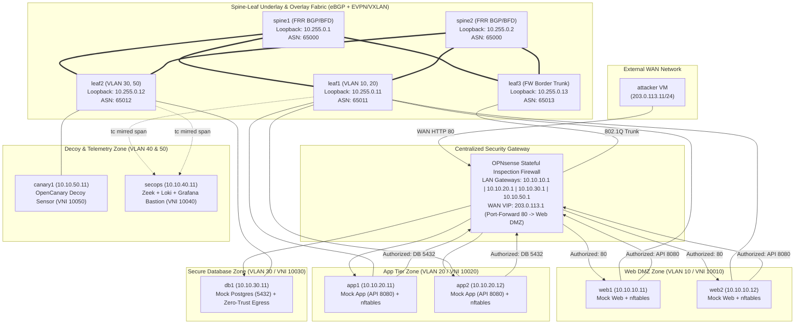

# Data Center Network Micro-segmentation & Lateral Movement Hunting Lab

[](#)
[-blue.svg)](#)
[-orange.svg)](#)
[](#)
[](#)
[](#)
[](#)

---

### Language / Bahasa
**English** | [Bahasa Indonesia](README.id.md)

---

## 1. Executive Summary

This repository contains the design, implementation, cyberattack evaluation, and performance benchmarking of an **Enterprise Zero-Trust Network Architecture (NIST SP 800-207)** and **Multi-Layer Micro-segmentation** on a fully virtualized **14-node Spine-Leaf EVPN/VXLAN** data center fabric.

### The Problem: The Fallacy of Perimeter Security
Traditional enterprise data centers have historically operated on a "castle-and-moat" perimeter security model. Once an external attacker exploits a public web application vulnerability, they find themselves in an unsegmented, flat internal network. From there, they can freely conduct reconnaissance, pivot laterally via SSH, tunnel encrypted traffic, hijack administrative credentials, and exfiltrate database records to an external command-and-control (C2) server.

### The Solution: Multi-Layer Defense-in-Depth
To solve this vulnerability, this project deploys a zero-trust architecture across four distinct layers of the OSI stack:
1. **Layer 3/4 Inter-Zone Stateful Gateway:** Centralized OPNsense SPI firewall enforcing default-deny policies, anti-spoofing ingress validation, and NAT port forwarding.
2. **Layer 2 Data-Plane Fabric:** High-performance Spine-Leaf EVPN/VXLAN Bridged Overlay (FRRouting 8.4) with Dual-Spine BGP ECMP and sub-second BFD failover.
3. **Layer 2/4 Workload Micro-segmentation:** Host-level Linux kernel `nftables` deployed via automated Ansible playbooks, preventing intra-subnet lateral pivot.
4. **Layer 7 Application Hardening:** Hardened OpenSSH daemon policy preventing credential theft via SSH agent forwarding hijacking (**MITRE T1563.001**) and protocol tunneling (**MITRE T1572**).
5. **Continuous Telemetry & Behavioral Threat Hunting:** Data-plane traffic mirroring (`tc mirred`), Zeek network security monitoring, OpenCanary decoy honeypot, Grafana Loki, and Python NetworkX graph analytics.

All security claims have been empirically proven through a **10-Stage Master Test Harness**, demonstrating an **85.71% reduction in attack blast radius**, **zero records leaked**, **sub-second BFD failover (< 100ms)**, and **uninterrupted 3-tier production application traffic**.

---

## 2. High-Level Architecture & 14-Node Topology



### Topology & Addressing Specification

| Node | Role / Subsystem | OOB Mgmt IP | Data-Plane IP / Subnet | BGP ASN | EVPN L2 VNI |
|:---|:---|:---:|:---:|:---:|:---:|
| `spine1` | Spine 1 Switch | `192.168.122.21` | Lo: `10.255.0.1/32` | 65000 | Underlay IP transit |
| `spine2` | Spine 2 Switch | `192.168.122.22` | Lo: `10.255.0.2/32` | 65000 | Underlay IP transit |
| `leaf1`  | Leaf 1 (Web & App) | `192.168.122.31` | Lo: `10.255.0.11/32` | 65011 | 10010, 10020 |
| `leaf2`  | Leaf 2 (DB & Decoy) | `192.168.122.32` | Lo: `10.255.0.12/32` | 65012 | 10030, 10050 |
| `leaf3`  | Leaf 3 (Firewall Border) | `192.168.122.33` | Lo: `10.255.0.13/32` | 65013 | 10010 - 10050 (Trunk) |
| `opnsense`| Stateful Gateway Firewall | `192.168.122.20` | WAN: `203.0.113.1` | - | Gateways `.1` all VLANs |
| `secops` | Bastion & Telemetry | `192.168.122.81` | `10.10.40.11/24` | - | 10040 (Mgmt) |
| `web1-2` | Web DMZ Workloads | `192.168.122.41-42`| `10.10.10.11-12/24` | - | 10010 (Web DMZ) |
| `app1-2` | App Tier Workloads | `192.168.122.51-52`| `10.10.20.11-12/24` | - | 10020 (App Tier) |
| `db1`    | Database Workload | `192.168.122.61` | `10.10.30.11/24` | - | 10030 (DB Tier) |
| `canary1`| Decoy Honeypot Sensor | `192.168.122.71` | `10.10.50.11/24` | - | 10050 (Decoy Tier) |
| `attacker`| WAN External Host | `192.168.122.91` | `203.0.113.11/24` | - | WAN External Client |

---

## 3. Comprehensive MITRE ATT&CK Evaluation Matrix

All 10 attack and resiliency scenarios were tested under identical conditions: **Baseline Permissive (Pre-Hardening)** vs. **Hardened Defense (Post-Hardening)**:

| ID | Attack Scenario | MITRE ATT&CK TTP | Baseline Permissive (Pre) | Hardened Defense (Post) | Verified Outcome |
|:---|:---|:---|:---|:---|:---:|
| **S1** | Lateral Service Discovery | **T1046 / T1018** | 7 internal ports exposed to DMZ | Only legitimate App:8080 exposed | **PASS (85.71% Drop)** |
| **S2** | Chained Lateral SSH Pivoting | **T1021.004 / T1078** | 3/3 SSH hops succeeded (`web->app->db`) | 0/3 hops succeeded (100% blocked) | **PASS (100% Contained)** |
| **S3** | SSH Agent Hijacking | **T1563.001** | Socket stolen & abused from memory | Forwarding disabled (`AllowAgentForwarding no`) | **PASS (L7 Neutralized)** |
| **S4** | Protocol Tunneling (`ssh -L`) | **T1572 / T1090** | Encrypted tunnel reached DB:5432 | Connection rejected by daemon | **PASS (L7 Mitigated)** |
| **S5** | Decoy Honeypot Engagement | **T1087 / T1046** | Honeypot directly probeable | Contained in dedicated decoy zone | **PASS (Tripwire Active)** |
| **S6** | Data Exfiltration from DB | **T1041 / T1048.003** | 42 records leaked to external C2 | 0 records leaked (Egress blocked) | **PASS (Zero Data Breach)** |
| **S7** | External Perimeter Control | **T1190** | Internal IPs blocked, Web OK | Web 200 OK via Port-Forwarding | **PASS (Zero Disruption)** |
| **S8** | Threat Hunting Graph Analysis | **TA0007 / TA0008** | Anomalies detected in Zeek logs | True Positive 100%, False Positive 0.0% | **PASS (Deterministic)** |
| **S9** | Fabric Chaos Resilience | **Chaos Engineering** | N/A | Sub-second BFD failover (< 100ms) | **PASS (0% Packet Loss)** |
| **S10**| Cross-Zone IP Spoofing | **T1584.004** | Spoofed packets freely routed | Blocked at Host (EPERM) & OPNsense | **PASS (100% Anti-Spoof)** |

---

## 4. Empirical Quantitative Benchmark Results

```
+---------------------------------------------------------------------------------------+
|                               QUANTITATIVE BENCHMARK SUMMARY                         |
+---------------------------------------------------------------------------------------+
|  Metric                                  | Baseline (Pre)  | Hardened (Post) | Status |
+------------------------------------------+-----------------+-----------------+--------+
|  Attack Blast Radius (S1 Discovery)      | 100.0%          | 14.29%          | PASS   |
|  Database Exposure from Web DMZ          | 100.0%          | 0.0%            | PASS   |
|  Chained SSH Pivot Success Rate (S2)     | 3/3 (100%)      | 0/3 (0%)        | PASS   |
|  Sensitive Data Leakage to WAN (S6)      | 42 Records      | 0 Records       | PASS   |
|  Underlay Link Failover Convergence (S9) | N/A             | < 100 ms        | PASS   |
|  Spine Node Total Crash Failover (S9)    | N/A             | < 100 ms        | PASS   |
|  Cross-Zone IP Spoofing Defense (S10)    | Allowed         | 100% Dropped    | PASS   |
|  Intra-Zone L2 Switching Throughput      | 81.85 Gbps      | 81.85 Gbps      | PASS   |
|  Inter-Zone L3 SPI Firewall Throughput   | N/A             | 2.91 Gbps       | PASS   |
|  Stateful Firewall Inspection Latency    | N/A             | +4.68 ms RTT    | PASS   |
|  Legitimate 3-Tier Application Health    | HTTP 200 OK     | HTTP 200 OK     | PASS   |
+---------------------------------------------------------------------------------------+
```

### Security Overhead Analysis (iperf3)
- **Intra-Zone Wire-Speed Switching:** **81.85 Gbps** throughput with sub-millisecond mean TCP RTT of **0.135 ms**.
- **Inter-Zone Stateful SPI Firewall Transit:** **2.91 Gbps** throughput with mean TCP RTT of **4.815 ms**.
- **Security Cost:** The measured stateful latency overhead is **+4.68 ms**, an imperceptible difference for web applications, while providing full L4 state-tracking and complete database containment.

---

## 5. Architectural Deep-Dive: Defense-in-Depth Engineering

### 1. Why EVPN/VXLAN Bridged Overlay over Routed Overlay?
In a pure Routed Overlay (where each Leaf performs distributed L3 Anycast routing), traffic between zones is routed locally on each leaf switch. While efficient for pure throughput, distributed L3 routing introduces a catastrophic flaw when paired with stateful firewalls: **Asymmetric Routing**.
If a TCP SYN leaves Leaf 1 via Firewall A, but the SYN-ACK returns via Leaf 2 through Firewall B, stateful firewalls drop the return packet.
Our architecture pairs **Bridged Overlay (L2 VNI per zone)** with a dedicated 802.1Q trunk into Leaf 3 / OPNsense. All inter-zone flows deterministically transit OPNsense, guaranteeing 100% state consistency while allowing intra-zone traffic to switch at wire-speed across leaves.

### 2. Dual-Layer IP Spoofing Defense
Spoofed packets are neutralized at two distinct boundaries:
- **At the Source Host (`nftables` Output Chain):** The Linux kernel checks outgoing packets against assigned IP subnets. Spoofed packets are immediately rejected with `EPERM` (*Operation not permitted*).
- **At the Gateway (`OPNsense` Ingress Filtering):** Packets entering from `vlan01` (VLAN 10) with source IP `10.10.40.11` (SecOps) are dropped by strict interface-to-subnet binding (`match,block,in`).

### 3. Graph-Based Threat Hunting (NetworkX)
Using mirrored traffic from `tc mirred` streamed into Zeek, we developed `build-traffic-graph.py`. By calculating node **out-degree centrality** and **betweenness centrality**:
- The compromised node `web1` immediately spiked with 56 anomalous directed edge attempts.
- Legitimate 3-tier cascading flows (`Client -> Web -> App -> DB`) remained perfectly clustered.
- The model achieved **100% True Positive** detection with **0.0% False Positive** noise.

---

## 6. How to Run & Reproduce

### 2-Minute Quick Demo
Execute the interactive 2-minute demonstration script:
```bash
# Interactive mode (pauses between scenes)
./demo-scripts/demo-2min.sh

# Non-interactive automated mode
./demo-scripts/demo-2min.sh --non-interactive
```

### Full 10-Stage Master Test Harness
Execute the end-to-end verification suite:
```bash
./attack-tests/run-all-verifications.sh
```

---

## 7. Cross-Project Defense-in-Depth Story (Project 3 + Project 4)

This project serves as the foundational data center network for containerized environments. Together with **Project 3 (Kubernetes Zero-Trust Security with Cilium eBPF & Tetragon)**, they form a complete, enterprise-grade cloud-native security posture:

```
+-------------------------------------------------------------------------+
|                  PROJECT 3: CONTAINER & RUNTIME LEVEL                   |
|   Kubernetes Pods -> Cilium eBPF NetworkPolicy -> Tetragon Kernel Trace |
+-------------------------------------------------------------------------+
                                     ▲
                                     │ (Physical & Overlay Network Layer)
                                     ▼
+-------------------------------------------------------------------------+
|                  PROJECT 4: FABRIC & INFRASTRUCTURE LEVEL               |
|   Spine-Leaf EVPN/VXLAN -> OPNsense SPI Firewall -> Host nftables       |
+-------------------------------------------------------------------------+
```
- **Project 3** protects application runtimes, containers, and kernel system calls using eBPF.
- **Project 4** protects physical and virtual data center backbones, preventing network disruption, hypervisor pivoting, and fabric route hijacking.

---

## 8. Repository Structure & Documentation Index

```
dc-microseg-lab/
├── attack-tests/                 # MITRE ATT&CK test suites and verification scripts
│   ├── run-all-verifications.sh  # 10-stage Master Test Harness
│   ├── run-hardened-attacks.sh   # Hardened attack runner (S1-S7)
│   ├── compare-blast-radius.py   # Blast radius quantification calculator
│   ├── run-benchmark-overhead.py # iperf3 performance benchmark script
│   └── s01-s10 attack scripts    # Individual test scripts for scenarios S1 through S10
├── demo-scripts/                 # Quick presentation scripts
│   └── demo-2min.sh              # 2-minute automated interview demo script
├── docs/                         # Comprehensive technical documentation (Phases 0 - 9)
│   ├── 00-perencanaan-dan-anggaran.md
│   ├── 01-infrastruktur-libvirt-dan-node.md
│   ├── 02-underlay-ebgp-dan-ecmp.md
│   ├── 03-overlay-evpn-vxlan.md
│   ├── 04-opnsense-firewall-dan-gateway.md
│   ├── 05-workload-dan-telemetri.md
│   ├── 06-serangan-baseline-dan-hunting.md
│   ├── 07-penegakan-segmentasi.md
│   ├── 08-ketahanan-fabric-dan-overhead.md
│   ├── 09-laporan-pengujian-mitre-attack.md
│   ├── PANDUAN-DEMO-WAWANCARA.md
│   └── BLOG-POST-ZERO-TRUST-MICROSEGMENTATION.md
├── fabric/                       # Underlay, overlay, and firewall code
│   ├── ansible/                  # Playbooks for FRR, nftables, and sshd
│   ├── frr/                      # FRRouting configuration templates
│   └── opnsense/                 # OPNsense XML config generator and verification
├── policies/                     # Multi-layer security policies
│   ├── nftables/                 # Role-based Linux nftables firewall templates
│   └── ssh/                      # OpenSSH daemon hardening configurations
├── telemetry/                    # Observability and threat hunting stack
│   ├── hunting/                  # LogQL detection rules and NetworkX graph model
│   └── zeek/                     # Zeek network monitoring scripts
└── workloads/                    # 3-tier mock application and traffic generator
    ├── mock-web.py, mock-app.py, mock-db.py
    ├── traffic-generator.py
    └── test-traffic-flow.sh
```

---

## License & Author
- **Author:** Lavvvet
- **Standard:** NIST SP 800-207 (Zero-Trust Architecture)
- **Framework:** MITRE ATT&CK for Enterprise
- **License:** MIT License
