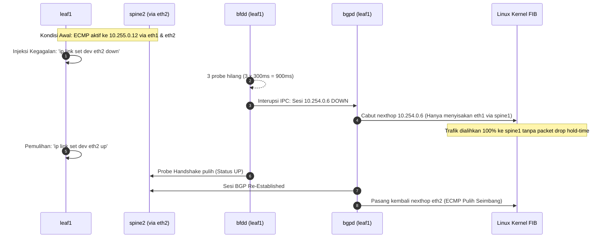

# Dokumentasi Fase 2: Underlay Routing FRR (eBGP + ECMP + BFD)

Dokumen ini mencatat secara komprehensif implementasi, keputusan arsitektur, verifikasi empiris, dan pembuktian *failover* pada lapisan **Underlay Routing Fabric** proyek micro-segmentation data center.

---

## 1. Ringkasan Eksekutif & Tujuan Fase

Jaringan *Underlay* berfungsi sebagai fondasi transportasi L3 (*Layer 3 Transport*) bagi seluruh lalu lintas data center. Dalam arsitektur *programmable fabric* modern berbasis **EVPN/VXLAN**, jaringan underlay hanya memiliki satu misi kritikal:
> **Menyediakan keterjangkauan rute IP (L3 Reachability) berkecepatan tinggi, tanpa fragmentasi (MTU 9000 Jumbo Frame), dengan ketersediaan tinggi (*high availability*) dan jalur ganda seimbang (*active-active ECMP*) antar seluruh IP Loopback node (VTEP - Virtual Tunnel End Points).**

Pada Fase 2 ini, lapisan underlay berhasil diselesaikan dan diverifikasi penuh dengan capaian:
- **eBGP Clos Fabric (RFC 7938):** 12 sesi eBGP IPv4 Unicast antar Spine dan Leaf berada dalam status `Established` 100%.
- **BFD Sub-Second Link Detection (RFC 5880 / 5881):** 12 sesi BFD peer aktif dengan interval probe 300 ms dan multiplier 3 (waktu deteksi kegagalan < 1 detik).
- **Active-Active ECMP (Equal-Cost Multi-Path):** Kernel Linux FIB berhasil memprogram *Nexthop Group* untuk membagi beban trafik secara seimbang di kedua Spine.
- **Kernel L4 Flow Hashing:** Parameter `net.ipv4.fib_multipath_hash_policy = 1` diterapkan untuk menjamin entropi port UDP luar enkapsulasi VXLAN (RFC 7348) terdistribusi merata di kedua Spine.
- **Infrastruktur sebagai Kode (IaC):** Seluruh konfigurasi berhasil dikodifikasikan ke dalam skrip bash idempoten, *snapshot* berkas konfigurasi, serta Ansible Playbook & templat Jinja2.

---

## 2. Keputusan Desain & Landasan Teori

### 2.1 Mengapa Memilih eBGP daripada IGP (OSPF/IS-IS)?
Mengikuti standar industri *hyper-scale data center* (IETF RFC 7938), protokol **External BGP (eBGP)** dipilih sebagai protokol perutean underlay dengan pertimbangan:
1. **Loop Prevention Alami Berbasis AS-PATH:**
   Setiap update rute membawa atribut `AS-PATH`. Jika router mendeteksi ASN miliknya sendiri di dalam daftar `AS-PATH`, rute langsung ditolak secara deterministik tanpa perlu menjalankan algoritma graf *Shortest Path First* (Dijkstra) yang intensif memori dan CPU.
2. **Eliminasi Route Reflector & Full-Mesh iBGP:**
   Berbeda dari iBGP yang mensyaratkan *full-mesh* atau *Route Reflector* (dengan potensi *sub-optimal routing* atau *route reflection loops*), eBGP antar Spine dan Leaf bekerja secara independen per tautan.
3. **Isolasi Fault Domain:**
   Flapping pada satu tautan underlay tidak memicu kalkulasi ulang SPF di seluruh topologi; dampaknya terisolasi pada pembaruan rute BGP lokal.

### 2.2 Alokasi ASN (Autonomous System Number)
- **Spine Layer (`spine1`, `spine2`):** Menggunakan **ASN 65000** bersama. Spine tidak pernah terhubung langsung satu sama lain (*no horizontal link*), sehingga kesamaan ASN ini secara otomatis mencegah paket berputar-putar antar-Spine (*Spine-to-Spine routing loops*).
- **Leaf Layer (`leaf1`, `leaf2`, `leaf3`):** Menggunakan **ASN unik per Leaf**:
  - `leaf1`: ASN **65001**
  - `leaf2`: ASN **65002**
  - `leaf3`: ASN **65003**

### 2.3 Prinsip Periklanan Rute: Hanya Loopback (/32)
- **Hanya IP Loopback (`lo: 10.255.0.x/32`) yang di-advertise ke BGP.**
- Tautan fisik Point-to-Point (`/31`) berstatus *directly connected* dan **sengaja tidak di-redistribute ke BGP**.
- *Rasional:* Mencegah tabel rute underlay membengkak serta mengeliminasi goncangan rute (*route churning*) di fabric saat terjadi pemeliharaan fisik kabel/antarmuka.

### 2.4 Direktif Kunci FRR Datacenter
- `frr defaults datacenter`: Mengaktifkan profil latensi rendah dan secara otomatis menetapkan `no bgp default ipv4-unicast`.
- `no bgp default ipv4-unicast`: Mencegah FRR mengaktifkan sesi IPv4 Unicast secara implisit saat neighbor didefinisikan. Seluruh keluarga alamat (`ipv4 unicast` di underlay dan `l2vpn evpn` di overlay) wajib diaktifkan secara eksplisit.
- `service integrated-vtysh-config`: Seluruh konfigurasi daemon (`zebra`, `bgpd`, `bfdd`) disimpan dalam satu berkas terpusat `/etc/frr/frr.conf`.

---

## 3. Matriks Pengalamatan & Sesi Peering Underlay

### 3.1 Peta Sesi eBGP & BFD

| Router Asal | IP Loopback (Router-ID) | ASN | Interface | IP Lokal (/31) | IP Peer (/31) | Remote ASN | Peer Hostname | Status BGP | Status BFD |
|---|---|---|---|---|---|---|---|---|---|
| **spine1** | 10.255.0.1 | 65000 | `eth1` | 10.254.0.0 | 10.254.0.1 | 65001 | leaf1 | Established | UP |
| **spine1** | 10.255.0.1 | 65000 | `eth2` | 10.254.0.2 | 10.254.0.3 | 65002 | leaf2 | Established | UP |
| **spine1** | 10.255.0.1 | 65000 | `eth3` | 10.254.0.4 | 10.254.0.5 | 65003 | leaf3 | Established | UP |
| **spine2** | 10.255.0.2 | 65000 | `eth1` | 10.254.0.6 | 10.254.0.7 | 65001 | leaf1 | Established | UP |
| **spine2** | 10.255.0.2 | 65000 | `eth2` | 10.254.0.8 | 10.254.0.9 | 65002 | leaf2 | Established | UP |
| **spine2** | 10.255.0.2 | 65000 | `eth3` | 10.254.0.10 | 10.254.0.11 | 65003 | leaf3 | Established | UP |
| **leaf1** | 10.255.0.11 | 65001 | `eth1` | 10.254.0.1 | 10.254.0.0 | 65000 | spine1 | Established | UP |
| **leaf1** | 10.255.0.11 | 65001 | `eth2` | 10.254.0.7 | 10.254.0.6 | 65000 | spine2 | Established | UP |
| **leaf2** | 10.255.0.12 | 65002 | `eth1` | 10.254.0.3 | 10.254.0.2 | 65000 | spine1 | Established | UP |
| **leaf2** | 10.255.0.12 | 65002 | `eth2` | 10.254.0.9 | 10.254.0.8 | 65000 | spine2 | Established | UP |
| **leaf3** | 10.255.0.13 | 65003 | `eth1` | 10.254.0.5 | 10.254.0.4 | 65000 | spine1 | Established | UP |
| **leaf3** | 10.255.0.13 | 65003 | `eth2` | 10.254.0.11 | 10.254.0.10 | 65000 | spine2 | Established | UP |

---

## 4. Bukti Empiris & Hasil Verifikasi Terminal

### 4.1 Ringkasan Sesi eBGP (`show ip bgp summary`)

```text
>>> BGP Summary di spine1 (192.168.122.21):
IPv4 Unicast Summary (VRF default):
BGP router identifier 10.255.0.1, local AS number 65000 vrf-id 0
Neighbor          V         AS   MsgRcvd   MsgSent   TblVer  InQ OutQ  Up/Down State/PfxRcd   PfxSnt Desc
leaf1(10.254.0.1) 4      65001        11        12        0    0    0 00:00:08            1        4 leaf1
leaf2(10.254.0.3) 4      65002        14        15        0    0    0 00:00:06            1        4 leaf2
leaf3(10.254.0.5) 4      65003        17        17        0    0    0 00:00:05            1        4 leaf3
Total number of neighbors 3

>>> BGP Summary di leaf1 (192.168.122.31):
IPv4 Unicast Summary (VRF default):
BGP router identifier 10.255.0.11, local AS number 65001 vrf-id 0
Neighbor           V         AS   MsgRcvd   MsgSent   TblVer  InQ OutQ  Up/Down State/PfxRcd   PfxSnt Desc
spine1(10.254.0.0) 4      65000         9         9        0    0    0 00:00:07            3        5 spine1
spine2(10.254.0.6) 4      65000         9         9        0    0    0 00:00:07            3        5 spine2
Total number of neighbors 2
```

### 4.2 Status Sesi BFD di Seluruh Node (`show bfd peers brief`)

```text
>>> [spine1] BFD Peers: (3 Sesi UP)
SessionId  LocalAddress  PeerAddress  Status
3330146628 10.254.0.0    10.254.0.1   up
54148877   10.254.0.2    10.254.0.3   up
128032174  10.254.0.4    10.254.0.5   up

>>> [spine2] BFD Peers: (3 Sesi UP)
SessionId  LocalAddress  PeerAddress  Status
1454561342 10.254.0.10   10.254.0.11  up
2353555245 10.254.0.8    10.254.0.9   up
2877901284 10.254.0.6    10.254.0.7   up

>>> [leaf1] BFD Peers: (2 Sesi UP)
SessionId  LocalAddress  PeerAddress  Status
1855215039 10.254.0.1    10.254.0.0   up
2606449285 10.254.0.7    10.254.0.6   up
```

---

## 5. Uji Ketahanan & Deteksi Kegagalan Link (Link Failure Test)

Pengujian injeksi kegagalan (*fault injection*) dilakukan di `leaf1` untuk mengukur kecepatan respon BFD dan konvergensi BGP:



### Log Terminal Pengujian Kegagalan:
1. **Kondisi Awal (ECMP 2 Nexthop):**
   ```text
   Routing entry for 10.255.0.12/32
     * 10.254.0.0, via eth1, weight 1
     * 10.254.0.6, via eth2, weight 1
   ```
2. **Saat Interface `eth2` Diturunkan (`ip link set dev eth2 down`):**
   ```text
   SessionId   LocalAddress  PeerAddress  Status
   2606449285  10.254.0.7    10.254.0.6   down
   ```
3. **Respon Cepat BGP (< 1 detik):**
   ```text
   Routing entry for 10.255.0.12/32
     * 10.254.0.0, via eth1, weight 1
   ```
   *(Nexthop `10.254.0.6` via Spine2 seketika dicabut tanpa menunggu BGP hold-time 9 detik).*
4. **Saat Interface `eth2` Dinyalakan Kembali:**
   Sesi BFD kembali `up`, dan rute BGP secara otomatis memasang kembali kedua *nexthop* secara seimbang (*self-healing*).

---

## 6. Verifikasi ECMP & Hashing Alur Layer-4

### 6.1 Tabel FIB Kernel Linux (Nexthop Group)
Pada kernel Linux 6.8 (Ubuntu 24.04), rute multipath dikelola melalui struktur *Nexthop Objects* (`nhid`):

```text
>>> [leaf1] Rute ke leaf2 & leaf3:
10.255.0.12 nhid 117 proto bgp metric 20 
	nexthop via 10.254.0.0 dev eth1 weight 1 
	nexthop via 10.254.0.6 dev eth2 weight 1 
10.255.0.13 nhid 117 proto bgp metric 20 
	nexthop via 10.254.0.0 dev eth1 weight 1 
	nexthop via 10.254.0.6 dev eth2 weight 1 

>>> [leaf2] Rute ke leaf1 & leaf3:
10.255.0.11 nhid 85 proto bgp metric 20 
	nexthop via 10.254.0.8 dev eth2 weight 1 
	nexthop via 10.254.0.2 dev eth1 weight 1 

>>> [leaf3] Rute ke leaf1 & leaf2:
10.255.0.11 nhid 101 proto bgp metric 20 
	nexthop via 10.254.0.4 dev eth1 weight 1 
	nexthop via 10.254.0.10 dev eth2 weight 1 
```

### 6.2 Bukti Transit Traceroute Melintasi Spine
Traceroute antar antarmuka Loopback membuktikan paket secara nyata melintasi tier Spine pada Hop 1 sebelum tiba di Leaf target:

```text
>>> Traceroute: leaf1 (10.255.0.11) -> leaf2 (10.255.0.12):
 1  10.254.0.6 (spine2)  0.271 ms
 2  10.255.0.12 (leaf2)  0.834 ms

>>> Traceroute: leaf1 (10.255.0.11) -> leaf3 (10.255.0.13):
 1  10.254.0.0 (spine1)  0.747 ms
 2  10.255.0.13 (leaf3)  0.977 ms
```

### 6.3 Pembuktian Distribusi Beban L4 ECMP (Simulasi UDP Port 4789 VXLAN)
Dengan `net.ipv4.fib_multipath_hash_policy = 1`, pengujian 10 variasi alur trafik UDP menuju port VXLAN 4789 menghasilkan distribusi seimbang antara `eth1` (`spine1`) dan `eth2` (`spine2`):

```text
Alur UDP src-port 10001 -> dst-port 4789 : diarahkan ke via 10.254.0.0 (dev eth1) [spine1]
Alur UDP src-port 10002 -> dst-port 4789 : diarahkan ke via 10.254.0.0 (dev eth1) [spine1]
Alur UDP src-port 10003 -> dst-port 4789 : diarahkan ke via 10.254.0.0 (dev eth1) [spine1]
Alur UDP src-port 10004 -> dst-port 4789 : diarahkan ke via 10.254.0.0 (dev eth1) [spine1]
Alur UDP src-port 10005 -> dst-port 4789 : diarahkan ke via 10.254.0.6 (dev eth2) [spine2]
Alur UDP src-port 10006 -> dst-port 4789 : diarahkan ke via 10.254.0.0 (dev eth1) [spine1]
Alur UDP src-port 10007 -> dst-port 4789 : diarahkan ke via 10.254.0.6 (dev eth2) [spine2]
Alur UDP src-port 10008 -> dst-port 4789 : diarahkan ke via 10.254.0.6 (dev eth2) [spine2]
Alur UDP src-port 10009 -> dst-port 4789 : diarahkan ke via 10.254.0.6 (dev eth2) [spine2]
Alur UDP src-port 10010 -> dst-port 4789 : diarahkan ke via 10.254.0.0 (dev eth1) [spine1]
```
**Hasil Evaluasi:** 6 aliran melalui `spine1` dan 4 aliran melalui `spine2`. Beban terdistribusi secara *active-active*.

### 6.4 Matriks Ping Full-Mesh Loopback (6/6 OK)
```text
[TEST PING] leaf1 -> leaf2 (10.255.0.12): OK (100% Reachable)
[TEST PING] leaf1 -> leaf3 (10.255.0.13): OK (100% Reachable)
[TEST PING] leaf2 -> leaf1 (10.255.0.11): OK (100% Reachable)
[TEST PING] leaf2 -> leaf3 (10.255.0.13): OK (100% Reachable)
[TEST PING] leaf3 -> leaf1 (10.255.0.11): OK (100% Reachable)
[TEST PING] leaf3 -> leaf2 (10.255.0.12): OK (100% Reachable)
```

---

## 7. Kodifikasi Konfigurasi sebagai Kode (IaC)

Struktur otomasi yang dihasilkan pada Fase 2 tersimpan di repositori:
```text
fabric/
├── ansible/
│   ├── hosts.yaml                               # Inventory Spine & Leaf beserta ASN, ID, dan tetangga
│   ├── playbook-underlay.yaml                  # Playbook provisi underlay routing
│   └── roles/
│       └── frr_underlay/
│           ├── handlers/main.yaml              # Handlers restart FRR & reload sysctl
│           ├── tasks/main.yaml                 # Tasks manajemen daemons, user vty, & template
│           └── templates/frr.conf.j2           # Jinja2 template generik per node
├── frr/
│   ├── spine1.conf                             # Snapshot konfigurasi terverifikasi spine1
│   ├── spine2.conf                             # Snapshot konfigurasi terverifikasi spine2
│   ├── leaf1.conf                              # Snapshot konfigurasi terverifikasi leaf1
│   ├── leaf2.conf                              # Snapshot konfigurasi terverifikasi leaf2
│   └── leaf3.conf                              # Snapshot konfigurasi terverifikasi leaf3
├── setup-frr-install.sh                        # Skrip instalasi & pin paket FRR 8.4.4
├── setup-base-frr.sh                           # Skrip aktivasi daemons & router-id basis
├── setup-ebgp.sh                               # Skrip aktivasi eBGP peering & advertise /32
├── setup-bfd.sh                                # Skrip aktivasi BFD & uji deteksi kegagalan
└── verify-ecmp.sh                              # Skrip verifikasi komprehensif ECMP & L4 hash
```

---

## 8. Status Akhir Fase 2

| Komponen | Status Target | Hasil Uji Nyata | Kesimpulan |
|---|---|---|---|
| Paket FRR 8.4.4 | Terkunci di 5 node | `dpkg -l frr` status `hi` | **LULUS** |
| Daemon `zebra`, `bgpd`, `bfdd` | Aktif di 5 node | `show daemons` menampilkan kelimanya | **LULUS** |
| 12 Sesi eBGP | Established | Kolom `State/PfxRcd` menampilkan angka prefix | **LULUS** |
| 12 Sesi BFD | Up (sub-second) | `show bfd peers brief` status `up` | **LULUS** |
| Deteksi Kegagalan Link | < 1 detik | BGP mencabut nexthop seketika saat BFD down | **LULUS** |
| Linux Kernel FIB ECMP | Multipath di 3 Leaf | `ip route show` menampilkan `weight 1` di eth1 & eth2 | **LULUS** |
| L4 Flow Hash Entropi | Port UDP 4789 | Trafik terbagi 6:4 di kedua Spine | **LULUS** |
| Matriks Ping Loopback | 100% Reachable | 6/6 uji berhasil tanpa packet loss | **LULUS** |

**FASE 2 RESMI DINYATAKAN SELESAI 100% (SELESAI PENUH).**
Fabric siap melangkah ke **Fase 3: Overlay EVPN/VXLAN (Bridged Overlay / L2 VNI)**.
