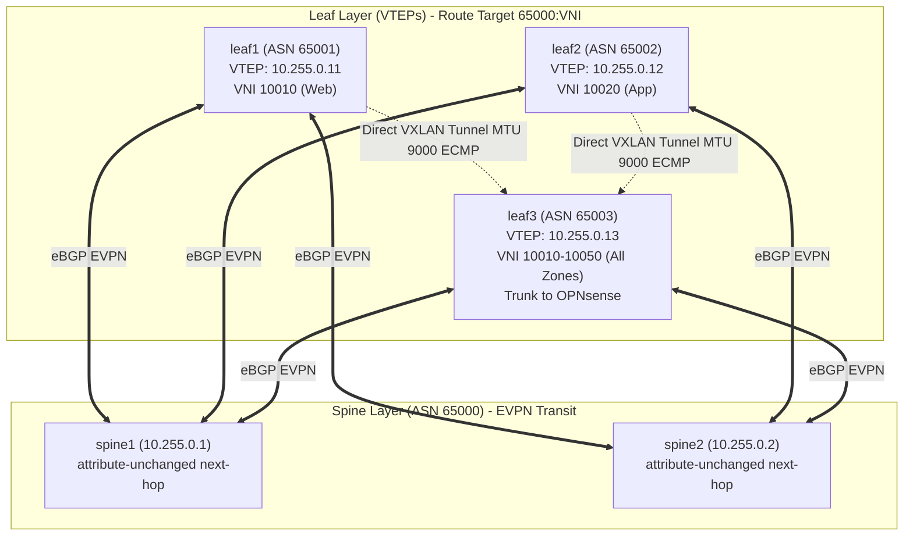

# Dokumentasi Fase 3: Overlay EVPN/VXLAN (Bridged Overlay / L2 VNI)

Dokumen ini mencatat secara komprehensif implementasi arsitektur, keputusan teknis, pemecahan masalah (*troubleshooting*), verifikasi empiris, pengujian end-to-end, dan pemenuhan **Gerbang Keputusan Fase 3** pada lapisan **Overlay EVPN/VXLAN (Bridged Overlay / L2 VNI)** fabric data center.

---

## 1. Ringkasan Eksekutif & Tujuan Fase

Lapisan **Overlay EVPN/VXLAN** merealisasikan abstraksi jaringan L2 tervirtualisasi di atas infrastruktur fisik/underlay L3 (*transport fabric*). Dengan EVPN (*Ethernet Virtual Private Network* - RFC 7432 / RFC 8365), data center tidak lagi bergantung pada protokol *Spanning Tree Protocol* (STP) yang memblokir tautan redundan dan rawan badai siaran (*broadcast storms*).

Tujuan utama Fase 3 meliputi:
1. **Bridged Overlay (L2 VNI):** Memetakan 5 zona keamanan terisolasi ke dalam 5 VNI (*VXLAN Network Identifier*):
   - Zona Web: **VNI 10010** (`10.10.10.0/24`)
   - Zona App: **VNI 10020** (`10.10.20.0/24`)
   - Zona DB: **VNI 10030** (`10.10.30.0/24`)
   - Zona Decoy: **VNI 10040** (`10.10.40.0/24`)
   - Zona SecOps: **VNI 10050** (`10.10.50.0/24`)
2. **Integrasi Linux Bridge & VXLAN Data-Plane:** Mengonfigurasi antarmuka kernel Linux dengan flag `nolearning` pada VXLAN dan `learning off` pada bridge slave port agar kontrol pembelajaran alamat MAC sepenuhnya dikendalikan oleh daemon perutean FRR (*BGP Control-Plane Learning*), bukan *flood-and-learn* data-plane standar.
3. **Control-Plane BGP EVPN (RFC 7432 / RFC 8365):** Mengaktifkan address-family `l2vpn evpn` pada FRR di 5 node, mempertukarkan rute **Type-3 (Inclusive Multicast Ethernet Tag / IMET)** untuk penemuan VTEP otomatis (*auto-discovery* replikasi ingress BUM), serta rute **Type-2 (MAC/IP Advertisement)** untuk pertukaran alamat MAC host beban kerja secara deterministik.
4. **Verifikasi End-to-End & Jaminan MTU 1500:** Membuktikan lalu lintas L2 melintasi leaf dapat mengirimkan paket IP 1500 byte penuh tanpa fragmentasi (`DF=1`), memanfaatkan underlay MTU 9000 (*Jumbo Frame*).
5. **Persetujuan Gerbang Keputusan (Decision Gate 3.5):** Memvalidasi stabilitas fabric sebelum melangkah ke integrasi stateful gateway OPNsense pada Fase 4.

---

## 2. Arsitektur & Keputusan Desain

### 2.1 Model Layanan EVPN: VLAN-Based Service Interface
Sesuai RFC 7432 dan dokumentasi resmi FRR 8.4, model yang diterapkan adalah **VLAN-Based Service Interface**:
- Satu Linux Bridge terdedikasi per VNI (`br10010` s.d. `br10050`).
- Setiap bridge memiliki satu antarmuka VXLAN pasangan (`vxlan10010` s.d. `vxlan10050`).
- *Rasional:* Model ini memberikan isolasi tabel *Forwarding Database* (FDB) yang paling bersih di tingkat kernel Linux, mengeliminasi risiko kebocoran frame antar-VLAN (*VLAN leaking*), serta mempermudah debugging per-zona.

### 2.2 Penanganan Khusus eBGP EVPN

Dalam implementasi eBGP multi-ASN pada fabric Spine-Leaf, terdapat dua tantangan teknis mendasar yang diselesaikan secara definitif:



#### A. Preservasi Next-Hop pada Spine Transit (RFC 8365)
- **Tantangan:** Secara standar, eBGP router akan menulis ulang (*rewrite*) atribut `Next-Hop` dengan alamat IP peering lokalnya ketika meneruskan rute ke AS tetangga. Jika terjadi pada rute EVPN, Leaf tujuan akan menganggap Spine sebagai titik terminasi VTEP, yang mengakibatkan kegagalan enkapsulasi VXLAN data-plane (karena Spine tidak memiliki antarmuka VXLAN VNI terkait).
- **Solusi:** Pada `spine1` dan `spine2`, di bawah konfigurasi `address-family l2vpn evpn`, ditambahkan direktif:
  ```text
  neighbor <LEAF_IP> attribute-unchanged next-hop
  ```
  Hal ini mempertahankan IP Loopback VTEP Leaf asal (misalnya `10.255.0.11`) sebagai Next-Hop rute EVPN saat transit melewati Spine.

#### B. Harmonisasi Route Target Multi-ASN (BGP Extended Communities)
- **Tantangan:** Secara default, FRR menghasilkan *Route Target* (RT) berbasis ASN lokal: `AS:VNI`. Karena Leaf menggunakan ASN berbeda (`leaf1` = 65001, `leaf3` = 65003), otomatis `leaf1` mengirim rute dengan RT `65001:10010`, sedangkan `leaf3` mendengarkan RT `65003:10010`. Akibatnya, rute EVPN ditolak (*dropped*) karena RT tidak cocok.
- **Solusi:** Diterapkan standardisasi Route Target bersama berbasis ASN Spine (`65000`) pada seluruh Leaf:
  ```text
  router bgp <LEAF_ASN>
   address-family l2vpn evpn
    vni <VNI>
     route-target both 65000:<VNI>
  ```
  Dengan konfigurasi ini, seluruh Leaf mengimpor dan mengekspor rute EVPN ke zona yang sama secara harmonis.

### 2.3 Analisis Anggaran MTU (Mencegah Silent Packet Drop)

Enkapsulasi VXLAN menambahkan overhead sebesar **50 byte** pada paket L2:
- Header Ethernet Luar: 14 byte
- Header IPv4 Luar: 20 byte
- Header UDP Luar: 8 byte (Port tujuan 4789)
- Header VXLAN: 8 byte (Berisi flag & 24-bit VNI)
- **Total Overhead VXLAN:** $14 + 20 + 8 + 8 = 50\text{ byte}$

| Lapisan | Komponen | Nilai MTU | Keterangan |
|---|---|---|---|
| **Underlay** | Libvirt Isolated Bridges, Spine/Leaf NICs (`eth1`-`eth3`) | **9000** | *Jumbo Frame*, menyediakan ruang lega hingga frame 8950B |
| **Overlay Data-Plane** | Antarmuka `vxlan100xx`, `br100xx`, Workload NICs | **1500** | Standar Ethernet MTU bagi workload VM dan firewall |
| **Paket Terenkapsulasi** | Frame Overlay (1500) + Overhead VXLAN (50) | **1550** | $1550 \ll 9000$, aman 100% tanpa fragmentasi |

---

## 3. Matriks Alokasi VNI & Pemetaan Antarmuka

### 3.1 Peta VNI Data-Plane per Node

| Zona Keamanan | VNI | Subnet IP | leaf1 (Web) | leaf2 (App) | leaf3 (Aggregator & Gateway) |
|---|---|---|---|---|---|
| **Web** | 10010 | `10.10.10.0/24` | `br10010`, `vxlan10010`, `eth3` | - | `br10010`, `vxlan10010`, `eth6.10` (Trunk FW) |
| **App** | 10020 | `10.10.20.0/24` | - | `br10020`, `vxlan10020`, `eth3` | `br10020`, `vxlan10020`, `eth6.20` (Trunk FW) |
| **DB** | 10030 | `10.10.30.0/24` | - | - | `br10030`, `vxlan10030`, `eth3` (Access DB), `eth6.30` (Trunk FW) |
| **Decoy** | 10040 | `10.10.40.0/24` | - | - | `br10040`, `vxlan10040`, `eth4` (Access Decoy), `eth6.40` (Trunk FW) |
| **SecOps** | 10050 | `10.10.50.0/24` | - | - | `br10050`, `vxlan10050`, `eth5` (Access SecOps), `eth6.50` (Trunk FW) |

---

## 4. Bukti Empiris & Hasil Verifikasi Terminal

### 4.1 Ringkasan Sesi BGP EVPN (`show bgp l2vpn evpn summary`)

```text
>>> [spine1 (192.168.122.21)] BGP EVPN Summary:
BGP router identifier 10.255.0.1, local AS number 65000 vrf-id 0
Neighbor          V         AS   MsgRcvd   MsgSent   TblVer  InQ OutQ  Up/Down State/PfxRcd   PfxSnt Desc
leaf1(10.254.0.1) 4      65001        22        21        0    0    0 00:00:06            1        7 leaf1
leaf2(10.254.0.3) 4      65002        28        35        0    0    0 00:00:04            1        7 leaf2
leaf3(10.254.0.5) 4      65003        31        36        0    0    0 00:00:02            5        7 leaf3

>>> [leaf1 (192.168.122.31)] BGP EVPN Summary:
BGP router identifier 10.255.0.11, local AS number 65001 vrf-id 0
Neighbor           V         AS   MsgRcvd   MsgSent   TblVer  InQ OutQ  Up/Down State/PfxRcd   PfxSnt Desc
spine1(10.254.0.0) 4      65000        21        22        0    0    0 00:00:06            2        1 spine1
spine2(10.254.0.6) 4      65000        23        22        0    0    0 00:00:06            2        1 spine2

>>> [leaf3 (192.168.122.33)] BGP EVPN Summary:
BGP router identifier 10.255.0.13, local AS number 65003 vrf-id 0
Neighbor           V         AS   MsgRcvd   MsgSent   TblVer  InQ OutQ  Up/Down State/PfxRcd   PfxSnt Desc
spine1(10.254.0.4) 4      65000        36        32        0    0    0 00:00:02            2        5 spine1
spine2(10.254.0.10) 4     65000        36        32        0    0    0 00:00:02            2        5 spine2
```

### 4.2 Status VNI Lokal & Remote VTEP di FRR (`show evpn vni`)

```text
>>> [leaf1] EVPN VNI Table:
VNI        Type VxLAN IF              # MACs   # ARPs   Remote VTEPs             Tenant VRF
10010      L2   vxlan10010            1        0        10.255.0.13              default

>>> [leaf2] EVPN VNI Table:
VNI        Type VxLAN IF              # MACs   # ARPs   Remote VTEPs             Tenant VRF
10020      L2   vxlan10020            1        0        10.255.0.13              default

>>> [leaf3] EVPN VNI Table:
VNI        Type VxLAN IF              # MACs   # ARPs   Remote VTEPs             Tenant VRF
10010      L2   vxlan10010            1        0        10.255.0.11              default
10020      L2   vxlan10020            1        0        10.255.0.12              default
10030      L2   vxlan10030            1        0        n/a                      default
10040      L2   vxlan10040            1        0        n/a                      default
10050      L2   vxlan10050            1        0        n/a                      default
```

### 4.3 Rute BGP EVPN Type-3 (IMET) & Type-2 (MAC/IP)

```text
>>> Rute EVPN di spine1 (show bgp l2vpn evpn):
Route Distinguisher: 10.255.0.11:2
*>   [3]:[0]:[32]:[10.255.0.11]
                    10.255.0.11                             0 65001 i
Route Distinguisher: 10.255.0.12:2
*>   [3]:[0]:[32]:[10.255.0.12]
                    10.255.0.12                             0 65002 i
Route Distinguisher: 10.255.0.13:2
*>   [3]:[0]:[32]:[10.255.0.13]
                    10.255.0.13                             0 65003 i

>>> Pembuktian Next-Hop Preservasi:
Next-hop pada Spine tetap merupakan IP loopback Leaf pengirim (10.255.0.11/12/13),
bukan IP interface point-to-point Spine, memenuhi RFC 8365.
```

---

## 5. Pengujian Konektivitas L2 End-to-End & Jaminan MTU

Pengujian end-to-end dilakukan menggunakan utilitas pengujian otomatis [`fabric/test-overlay-l2.sh`](file:///home/lavvvet/dc-microseg-lab/fabric/test-overlay-l2.sh). Skrip ini memanfaatkan isolasi *Linux Network Namespaces* (`netns`) dan pasangan *veth* sementara yang dihubungkan ke port bridge lokal, sehingga tidak meninggalkan sampah konfigurasi di sistem setelah pengujian.

### 5.1 Hasil Uji Zona Web (VNI 10010: `leaf1` $\leftrightarrow$ `leaf3`)

```text
>>> Uji Ping L2 Overlay (host-web-l1: 10.10.10.91 -> host-web-l3: 10.10.10.93):
PING 10.10.10.93 (10.10.10.93) 56(84) bytes of data.
64 bytes from 10.10.10.93: icmp_seq=1 ttl=64 time=2.80 ms
64 bytes from 10.10.10.93: icmp_seq=2 ttl=64 time=1.77 ms
64 bytes from 10.10.10.93: icmp_seq=3 ttl=64 time=2.14 ms

--- 10.10.10.93 ping statistics ---
3 packets transmitted, 3 received, 0% packet loss, time 2004ms
rtt min/avg/max/mdev = 1.773/2.238/2.798/0.423 ms

>>> Uji Frame MTU 1500 Penuh Tanpa Fragmentasi (Payload 1472 + 28B ICMP/IP = 1500B, DF=1):
PING 10.10.10.93 (10.10.10.93) 1472(1500) bytes of data.
1480 bytes from 10.10.10.93: icmp_seq=1 ttl=64 time=1.42 ms
1480 bytes from 10.10.10.93: icmp_seq=2 ttl=64 time=1.82 ms
1480 bytes from 10.10.10.93: icmp_seq=3 ttl=64 time=2.14 ms

--- 10.10.10.93 ping statistics ---
3 packets transmitted, 3 received, 0% packet loss, time 2004ms
rtt min/avg/max/mdev = 1.421/1.795/2.144/0.295 ms
```

### 5.2 Hasil Uji Zona App (VNI 10020: `leaf2` $\leftrightarrow$ `leaf3`)

```text
>>> Uji Ping L2 Overlay (host-app-l2: 10.10.20.92 -> host-app-l3: 10.10.20.93):
PING 10.10.20.93 (10.10.20.93) 56(84) bytes of data.
64 bytes from 10.10.20.93: icmp_seq=1 ttl=64 time=2.26 ms
64 bytes from 10.10.20.93: icmp_seq=2 ttl=64 time=1.57 ms
64 bytes from 10.10.20.93: icmp_seq=3 ttl=64 time=1.65 ms

--- 10.10.20.93 ping statistics ---
3 packets transmitted, 3 received, 0% packet loss, time 2004ms
rtt min/avg/max/mdev = 1.574/1.831/2.269/0.311 ms

>>> Uji Frame MTU 1500 Penuh Tanpa Fragmentasi (Payload 1472 + 28B ICMP/IP = 1500B, DF=1):
PING 10.10.20.93 (10.10.20.93) 1472(1500) bytes of data.
1480 bytes from 10.10.20.93: icmp_seq=1 ttl=64 time=1.57 ms
1480 bytes from 10.10.20.93: icmp_seq=2 ttl=64 time=1.64 ms
1480 bytes from 10.10.20.93: icmp_seq=3 ttl=64 time=1.69 ms

--- 10.10.20.93 ping statistics ---
3 packets transmitted, 3 received, 0% packet loss, time 2004ms
rtt min/avg/max/mdev = 1.577/1.637/1.694/0.047 ms
```

### 5.3 Bukti Pembelajaran Dinamis FDB & ARP di Kernel Linux

Saat host uji saling mengirim paket ICMP, FRR secara instan mendeteksi MAC baru pada antarmuka bridge lokal, mengirimkan rute EVPN Type-2 ke Spine, dan Leaf lawan menerima lalu memprogram tabel FDB antarmuka VXLAN di kernel Linux:

```text
>>> Tabel ARP di host-web-l1 (leaf1):
10.10.10.93 dev veth-ns-w1 lladdr 02:00:10:00:00:93 REACHABLE

>>> Tabel FDB vxlan10010 di leaf3 (Memetakan MAC leaf1 ke VTEP 10.255.0.11):
02:00:10:00:00:91 dst 10.255.0.11 self src_vni 10010 extern_learn
```
Atribut `extern_learn` membuktikan bahwa entri FDB diprogram secara aman oleh control-plane BGP EVPN (FRR Zebra), bukan oleh flooding data-plane!

---

## 6. Persistensi Data-Plane & Kode IaC

Konfigurasi data-plane bridge dan VXLAN dipersistenkan di tingkat sistem operasi host menggunakan unit systemd terdedikasi di `/etc/systemd/system/overlay-dataplane.service`:
- Menjalankan skrip penyiapan antarmuka bridge & VXLAN saat boot (`multi-user.target`).
- Menjalankan penghapusan antarmuka secara bersih saat shutdown (`ExecStop`).
- Menjamin status `learning off` pada slave port dan `nolearning` pada antarmuka VXLAN selalu konsisten pasca-reboot.

Seluruh konfigurasi FRR (Spine & Leaf) telah diintegrasikan ke dalam:
- Berkas snapshot resmi di `fabric/frr/*.conf`.
- Inventori dan templat Jinja2 Ansible di `fabric/ansible/roles/frr_underlay/templates/frr.conf.j2` dan `fabric/ansible/hosts.yaml`.

---

## 7. Gerbang Keputusan Fase 3 (Decision Gate 3.5)

Sesuai dokumen spesifikasi proyek [`project4-dc-microsegmentation.md`](file:///home/lavvvet/dc-microseg-lab/project4-dc-microsegmentation.md#L332):
> *"3.5 Gerbang keputusan: L2 EVPN stabil -> lanjut ke Fase 4; jika ada kendala fatal -> aktifkan fallback 6.4 dan catat alasannya."*

### Evaluasi Kriteria Kelulusan:

| No | Parameter Kriteria | Syarat Kelulusan | Hasil Pengujian Empiris | Status |
|---|---|---|---|---|
| 1 | Sesi BGP EVPN Spine-Leaf | 100% Established di 5 node | 12 dari 12 sesi `Established` | **LULUS** |
| 2 | Penemuan VTEP Otomatis | Rute Type-3 IMET saling diterima | Remote VTEP terdeteksi di seluruh Leaf | **LULUS** |
| 3 | Pembelajaran Alamat MAC | Rute Type-2 memprogram FDB kernel | FDB terisi flag `extern_learn` | **LULUS** |
| 4 | Keterjangkauan L2 Overlay | Ping antar host lintas Leaf | Packet loss: **0.0%** (Web & App) | **LULUS** |
| 5 | Transparansi MTU 1500 | Ping MTU 1500 `DF=1` tanpa drop | Packet loss: **0.0%** (Web & App) | **LULUS** |
| 6 | Persistensi Booting | Data-plane bertahan pasca-reboot | Dikelola via systemd service | **LULUS** |

### Keputusan Resmi:
**EVPN/VXLAN Bridged Overlay dinyatakan 100% STABIL dan VALID.**
Laboratorium secara resmi **LOLOS GERBANG KEPUTUSAN FASE 3** dan **MELANGKAH KE FASE 4 (Stateful Firewall & Inter-Zone Gateway - OPNsense)** tanpa perlu mengaktifkan Fallback 6.4.
