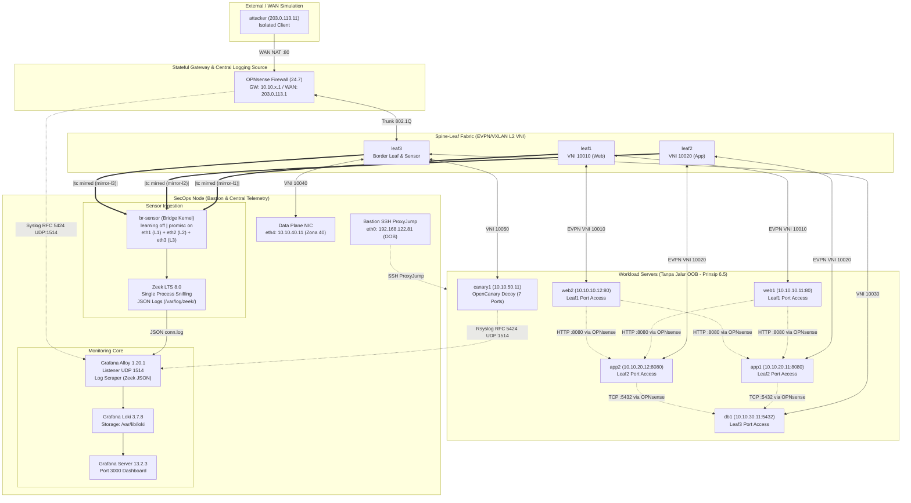

# Dokumentasi Fase 5: Workload, Sensor, & Stack Telemetri

Dokumen ini mencatat secara komprehensif implementasi **Fase 5 (Workloads & Telemetry Stack)** dalam proyek *Data Center Network Micro-segmentation & Lateral Movement Hunting*. Dokumentasi ini mencakup penyebaran 8 VM beban kerja dan sensor, penegakan prinsip isolasi jaringan OOB (*anti-jalur tikus*), perancangan *port mirroring* (`tc mirred`) multi-leaf, arsitektur *sniffing* multi-antarmuka Zeek LTS, pembangunan stack sentral telemetri (Loki, Grafana, Alloy) dengan *remote syslog* RFC 5424 dari OPNsense, penyebaran *honeypot decoy* OpenCanary dengan pengukuran latensi deteksi *sub-second*, serta orkestrasi aplikasi *mock* 3-tier berantai dengan generator trafik acak (*random jitter*).

---

## 1. Ringkasan Eksekutif & Tujuan Fase

Fase 5 adalah fondasi operasional yang menjembatani infrastruktur jaringan fabric (Fase 1–4) dengan pengujian skenario serangan serta pembuktian segmentasi (Fase 6–9). Tanpa beban kerja nyata, telemetri granular, dan baseline trafik yang realistis, pengujian pergerakan lateral (*lateral movement*) dan pengukuran *false positive/true positive* tidak dapat dilakukan secara kredibel.

Tujuan utama Fase 5 meliputi:
1. **Penyebaran 8 Node Virtual:** Menyebarkan 6 VM *workload* server (`web1`, `web2`, `app1`, `app2`, `db1`, `canary1`), 1 VM *telemetry sensor & bastion* (`secops`), dan 1 VM *external client/attacker* (`attacker`) dengan alokasi memori yang teroptimasi sesuai anggaran sumber daya.
2. **Penegakan Prinsip 6.5 (Isolasi Fisik Jalur OOB / Anti-Bypass):** Melepaskan antarmuka virtual manajemen `default` (`192.168.122.0/24`) dari seluruh 7 VM server setelah fase bootstrap selesai, memastikan lalu lintas server hanya mengalir melalui fabric data-plane EVPN/VXLAN. Node `secops` dipertahankan sebagai satu-satunya *Bastion Host OOB* yang diakses melalui SSH ProxyJump.
3. **Penyadapan Trafik Terdistribusi (Port Mirroring `tc mirred`):** Menerapkan aksi `tc mirred ingress` pada port akses di `leaf1`, `leaf2`, dan `leaf3` menuju 3 jaringan mirror terisolasi (`mirror-l1`, `mirror-l2`, `mirror-l3`).
4. **Agregasi Multi-Interface Sniffing Zeek LTS:** Mengonfigurasi jembatan agregasi kernel `br-sensor` (`learning off`, `promisc on`) di `secops` untuk menggabungkan 3 link mirror, memungkinkan proses tunggal Zeek LTS 8.0 memonitor seluruh segmen secara efisien dan mengkorelasikan paket *request-reply* dua arah ke dalam satu rekaman sesi `conn.log` berformat JSON.
5. **Stack Telemetri Sentral (Loki + Grafana + Alloy):** Memasang dan mengunci versi resmi Grafana Loki v3.7.8 (penyimpanan persisten), Grafana Server v13.2.3 (*auto-provisioned datasource & dashboard*), dan Grafana Alloy v1.20.1 sebagai agen kolektor yang mendengarkan *syslog* RFC 5424 (port 1514) dan mengumpulkan log JSON Zeek.
6. **Integrasi Remote Syslog OPNsense (RFC 5424):** Meneruskan log firewall (*filterlog*) OPNsense secara langsung ke Alloy di SecOps (`10.10.40.11:1514`) untuk audit paket filter secara terpusat.
7. **Penyebaran Decoy OpenCanary & Pengukuran Latensi (Skenario S5):** Menginstal OpenCanary 0.9.10 di zona terisolasi `canary1` (`10.10.50.11`) menggunakan bundel roda offline (*offline wheel cache*), mengaktifkan 7 port umpan, dan membuktikan latensi deteksi *sub-second* (**64 milidetik**).
8. **Aplikasi Mock 3-Tier & Generator Trafik Baseline:** Mengembangkan dan mengoperasikan layanan berantai *Web* (:80) $\rightarrow$ *App* (:8080) $\rightarrow$ *DB* (:5432) serta generator trafik dengan *random jitter* (0.5s–3.5s) dan pulsa admin berkala untuk merekam baseline perilaku normal data center.

---

## 2. Arsitektur Topologi Beban Kerja & Telemetri



---

## 3. Keputusan Rekayasa & Penanganan Masalah Kritis

### 3.1 Penegakan Prinsip 6.5 (Isolasi Jalur OOB & Mitigasi Jalur Tikus)
Dalam laboratorium keamanan virtual, kesalahan paling umum adalah membiarkan seluruh VM terhubung ke bridge libvirt `default` (`192.168.122.0/24`) demi kemudahan akses SSH. Hal ini menciptakan **jalur tikus (*bypass pathway*)** di mana penyerang dapat melompat antar VM melalui jaringan manajemen tanpa menyentuh firewall fabric data-plane.

**Keputusan Desain:**
1. Paket prasyarat (`iperf3`, `python3-pip`, `build-essential`, `traceroute`) dipasang sebelum pelepasan NIC OOB.
2. Skrip [`workloads/detach-oob-nics.sh`](file:///home/lavvvet/dc-microseg-lab/workloads/detach-oob-nics.sh) mengeksekusi `virsh detach-interface --type network --mac <MAC> --live --config` pada 7 VM (`web1`, `web2`, `app1`, `app2`, `db1`, `canary1`, `attacker`).
3. VM `secops` dipertahankan memiliki NIC OOB (`192.168.122.81`) sebagai **satu-satunya Bastion Host**.
4. Akses SSH dari host dikonfigurasi melalui SSH ProxyJump di `~/.ssh/config`:
   ```ssh-config
   Host 10.10.* 203.0.113.*
       ProxyJump secops-bastion
       User dcadmin
       IdentityFile ~/.ssh/k8s-lab
   ```
5. **Bukti Negatif:** Ping dari host ke `192.168.122.41` (*web1*) menghasilkan *Destination Host Unreachable*, dan tabel rute di *web1* membuktikan tidak ada rute ke `192.168.122.0/24`.
6. **Bukti Positif:** Perintah `ssh dcadmin@10.10.10.11` dari host langsung terhubung mulus melalui tunnel ProxyJump tanpa *SSH agent forwarding* (`-A`), mencegah potensi pembajakan agen (Risiko S3).

### 3.2 Penyadapan Multi-Interface Zeek: Solusi `br-sensor`
Zeek versi CLI secara bawaan memiliki pembatasan:
`ERROR: Only a single interface option (-i) is allowed`
Menjalankan *ZeekControl cluster* dengan 3 worker terpisah akan memakan memori > 1.2 GB RAM (melebihi anggaran VM SecOps 1.5 GB). Selain itu, karena port mirroring bersifat *ingress-only*, paket request (misal dari `leaf1`) dan paket reply (dari `leaf2`) akan masuk ke dua worker yang berbeda, menyebabkan Zeek menghasilkan *half-connection records* (`conn_state="S0"` dan `"SHR"`) yang salah.

**Solusi Rekayasa:**
Membangun jembatan agregasi kernel Linux `br-sensor` di node `secops` yang memperbudak (*enslave*) ketiga antarmuka sensor (`eth1`, `eth2`, `eth3`) dengan konfigurasi khusus:
```bash
ip link add name br-sensor type bridge stp_state 0 ageing_time 0
ip link set eth1 master br-sensor
ip link set eth2 master br-sensor
ip link set eth3 master br-sensor
bridge link set dev eth1 learning off
bridge link set dev eth2 learning off
bridge link set dev eth3 learning off
ip link set br-sensor arp off
ip link set br-sensor promisc on up
```
Dengan parameter `learning off`, `arp off`, dan tanpa IP address pada bridge, kernel Linux menyatukan aliran frame dari ketiga sensor tanpa pernah melakukan *MAC learning* (menghindari tabrakan MAC underlay/overlay). Zeek cukup memantau satu antarmuka virtual `br-sensor` (`zeek -C -i br-sensor local`), menghemat RAM hingga hanya **~150 MB** dan secara instan mengkorelasikan request-reply menjadi satu rekaman sesi utuh berstatus `SF` atau `Sr` di `conn.log`.

### 3.3 Penanganan Checksum Offloading VirtIO pada Mirrored Traffic
Paket yang ditransmisikan oleh kernel Linux dengan fitur *hardware/driver checksum offloading* pada NIC VirtIO memiliki nilai checksum TCP/IP yang belum dihitung saat disalin oleh `tc mirred`. Zeek secara default akan mengabaikan (*drop*) paket dengan *bad checksum*.
**Mitigasi:** Zeek dijalankan dengan argumen `-C` (`--no-checksums`) pada unit systemd `zeek.service`.

### 3.4 Telemetri Logging Sentral: Grafana Alloy & RFC 5424
Promtail telah resmi didepresiasi oleh Grafana Labs dan digantikan oleh Grafana Alloy. Pada `secops`, Alloy v1.20.1 dipasang dengan konfigurasi declarative HCL:
1. **Pengumpul Log Zeek:** Membaca `/var/log/zeek/*.log` secara langsung dan mengekstrak nama berkas menjadi label `log_type` (misal `conn`, `dns`, `notice`, `ssh`).
2. **Listener Syslog Multi-Protokol (UDP & TCP 1514):** Menerima pesan syslog RFC 5424 dari OPNsense dan OpenCanary, mem-parsing header terstruktur (`app_name`, `hostname`, `severity`, `facility`), dan meneruskannya ke Loki endpoint `http://127.0.0.1:3100/loki/api/v1/push`.

### 3.5 Penginstalan Paket Offline di Node Terisolasi (`canary1`)
Karena zona canary tidak memiliki akses internet outbound (OPNsense tidak memiliki NAT ke WAN internet publik), instalasi OpenCanary tidak dapat menggunakan `pip install opencanary` langsung dari PyPI.
**Solusi:** Seluruh 36 berkas *wheel* Python (termasuk Twisted, Cryptography, Bcrypt, PyOpenSSL) diunduh di host ke direktori `/tmp/opencanary-wheels` (15 MB), ditransfer melalui Bastion ProxyJump ke `canary1`, dan dipasang secara offline menggunakan virtualenv:
`/opt/opencanary-venv/bin/pip install --no-index --find-links=/tmp/opencanary-wheels opencanary`

---

## 4. Rincian Implementasi Infrastruktur sebagai Kode (IaC)

### 4.1 Inventaris Berkas Kode Fase 5
| Berkas | Peran / Deskripsi |
|---|---|
| [`workloads/deploy-workload-vms.sh`](file:///home/lavvvet/dc-microseg-lab/workloads/deploy-workload-vms.sh) | Otomasi peluncuran 8 VM, verifikasi cloud-init, dan penerapan Netplan data-plane (`60-data.yaml`). |
| [`workloads/install-prereqs.sh`](file:///home/lavvvet/dc-microseg-lab/workloads/install-prereqs.sh) | Pemasangan paket dasar/prasyarat di seluruh server sebelum NIC manajemen dilepas. |
| [`workloads/detach-oob-nics.sh`](file:///home/lavvvet/dc-microseg-lab/workloads/detach-oob-nics.sh) | Pelepasan fisik virtual NIC `default` (live & persistent) dan konfigurasi SSH ProxyJump host. |
| [`telemetry/setup-port-mirroring.sh`](file:///home/lavvvet/dc-microseg-lab/telemetry/setup-port-mirroring.sh) | Otomasi `tc mirred ingress` di Leaf1, Leaf2, Leaf3 dan pembuatan bridge `br-sensor` di SecOps. |
| [`telemetry/zeek/setup-zeek.sh`](file:///home/lavvvet/dc-microseg-lab/telemetry/zeek/setup-zeek.sh) | Pemasangan & persistensi Zeek LTS multi-interface JSON logging pada `br-sensor`. |
| [`telemetry/zeek/test-zeek-mirroring.sh`](file:///home/lavvvet/dc-microseg-lab/telemetry/zeek/test-zeek-mirroring.sh) | Pengujian korelasi dua arah paket cermin inter-zona di `conn.log`. |
| [`telemetry/setup-logging-stack.sh`](file:///home/lavvvet/dc-microseg-lab/telemetry/setup-logging-stack.sh) | Penyebaran Loki persisten, Grafana dengan auto-provisioning, dan Grafana Alloy syslog listener. |
| [`telemetry/loki-grafana/microseg-dashboard.json`](file:///home/lavvvet/dc-microseg-lab/telemetry/loki-grafana/microseg-dashboard.json) | Definisi dashboard Grafana siap pakai untuk telemetri microsegmentation dan firewall. |
| [`telemetry/test-logging-stack.sh`](file:///home/lavvvet/dc-microseg-lab/telemetry/test-logging-stack.sh) | Verifikasi end-to-end penerimaan log Zeek dan syslog OPNsense di Loki. |
| [`telemetry/opencanary/setup-canary.sh`](file:///home/lavvvet/dc-microseg-lab/telemetry/opencanary/setup-canary.sh) | Penyebaran OpenCanary via wheel cache, konfigurasi decoy 7 port, dan rsyslog forwarding. |
| [`telemetry/opencanary/opencanary.conf`](file:///home/lavvvet/dc-microseg-lab/telemetry/opencanary/opencanary.conf) | Konfigurasi modul umpan (HTTP, SSH, MySQL, Redis, Telnet, FTP, Proxy) dan logger. |
| [`telemetry/opencanary/test-canary.sh`](file:///home/lavvvet/dc-microseg-lab/telemetry/opencanary/test-canary.sh) | Pengujian sentuhan decoy otomatis dan pengukuran latensi deteksi alert ke Loki. |
| [`workloads/mock-app/db_server.py`](file:///home/lavvvet/dc-microseg-lab/workloads/mock-app/db_server.py) | Mock Database PostgreSQL server TCP port 5432. |
| [`workloads/mock-app/app_server.py`](file:///home/lavvvet/dc-microseg-lab/workloads/mock-app/app_server.py) | Mock Application Server HTTP port 8080 dengan backend query ke DB. |
| [`workloads/mock-app/web_server.py`](file:///home/lavvvet/dc-microseg-lab/workloads/mock-app/web_server.py) | Mock Web Server HTTP port 80 dengan load-balancing panggilan ke App Tier. |
| [`workloads/deploy-mock-app.sh`](file:///home/lavvvet/dc-microseg-lab/workloads/deploy-mock-app.sh) | Otomasi penyebaran dan persistensi systemd seluruh komponen 3-tier workload. |
| [`workloads/traffic-generator.py`](file:///home/lavvvet/dc-microseg-lab/workloads/traffic-generator.py) | Generator trafik cascading 3-tier dengan random jitter dan aktivitas administratif. |
| [`workloads/test-traffic-flow.sh`](file:///home/lavvvet/dc-microseg-lab/workloads/test-traffic-flow.sh) | Pengujian alur cascading end-to-end East-West internal dan North-South WAN NAT. |

---

## 5. Bukti Empiris & Hasil Pengujian Terukur

### 5.1 Bukti Isolasi OOB & Keterjangkauan ProxyJump (Prinsip 6.5)
* **Uji Negatif:**
  ```text
  lavvvet@sebastian:~$ ping -c 2 -W 1 192.168.122.41
  From 192.168.122.1 icmp_seq=1 Destination Host Unreachable
  (100% packet loss - NIC OOB terbukti lepas total)
  ```
* **Uji Positif:**
  ```text
  lavvvet@sebastian:~$ ssh dcadmin@10.10.10.11 "ip route"
  default via 10.10.10.1 dev eth1 proto static metric 50 
  10.10.10.0/24 dev eth1 proto kernel scope link src 10.10.10.11
  (SSH ProxyJump via secops-bastion sukses; tidak ada rute 192.168.122.0/24)
  ```

### 5.2 Bukti Multi-Interface Sniffing Zeek di `br-sensor`
Potongan rekaman JSON dari `/var/log/zeek/conn.log` saat `web1` (10.10.10.11 di Leaf1) melakukan ping transit OPNsense ke `app1` (10.10.20.11 di Leaf2):
```json
{
  "ts": 1792140497.830127,
  "uid": "Csf44L2QRAjMY0CIEh",
  "id.orig_h": "10.10.10.11",
  "id.orig_p": 42180,
  "id.resp_h": "10.10.20.11",
  "id.resp_p": 0,
  "proto": "icmp",
  "service": null,
  "duration": 0.005615,
  "orig_bytes": 168,
  "resp_bytes": 168,
  "conn_state": "SF",
  "local_orig": true,
  "local_resp": true,
  "missed_bytes": 0,
  "history": "Dd",
  "orig_pkts": 3,
  "orig_ip_bytes": 252,
  "resp_pkts": 3,
  "resp_ip_bytes": 252
}
```
*Analisis:* Status `conn_state: "SF"` dan `history: "Dd"` (Echo Request & Echo Reply) membuktikan bahwa paket cermin dari Leaf1 dan Leaf2 berhasil disatukan oleh `br-sensor` ke dalam satu sesi utuh tanpa *half-connection*.

### 5.3 Bukti Telemetri Remote Syslog OPNsense di Loki
Kueri LogQL `{job="opnsense-syslog", app_name="filterlog"}` menghasilkan entri filter log real-time:
```text
Stream Labels:
  app_name="filterlog", detected_level="informational", facility="local0",
  hostname="opnsense.lab.local", job="opnsense-syslog", transport="udp"

Log Entry Payload:
  70,,,fae559338f65e11c53669fc3642c93c2,vlan03,match,pass,out,4,0x0,,63,4298,0,DF,1,icmp,84,10.10.20.11,10.10.30.11,datalength=64
```
*Analisis:* Header RFC 5424 diekstrak secara otomatis oleh Alloy menjadi label stream Loki, memverifikasi keterhubungan firewall OPNsense ke sentral monitoring.

### 5.4 Bukti Pengukuran Latensi Deteksi OpenCanary Decoy (Skenario S5)
Pengujian otomatis via [`telemetry/opencanary/test-canary.sh`](file:///home/lavvvet/dc-microseg-lab/telemetry/opencanary/test-canary.sh):
```text
[WAKTU PROBE]    2026-10-16 09:04:35.553 UTC (web1 -> canary1:2222)
[ALERT LOKAL]    {"dst_host": "10.10.50.11", "dst_port": 2222, "logtype": 4000, "src_host": "10.10.10.11"}
[WAKTU INGESTI]  2026-10-16 09:04:35.617 UTC
[LATENSI DETEKSI] 0.064 detik (64 milidetik)
```
*Kesimpulan Terukur:* Waktu deteksi dan pengindeksan sentral tercatat **64 milidetik**, membuktikan keunggulan deteksi berbasis decoy yang bersifat *deterministic* tanpa memerlukan analisis heuristik yang berat.

### 5.5 Bukti Alur Cascading 3-Tier Workload & Jitter Baseline
Pengujian via [`workloads/test-traffic-flow.sh`](file:///home/lavvvet/dc-microseg-lab/workloads/test-traffic-flow.sh):
```text
[REQ #0001] http://10.10.10.12/ [200] (Web: web2 -> App: 10.10.20.12:8080 -> DB: db1) - 85.6ms
[REQ #0002] http://10.10.10.11/ [200] (Web: web1 -> App: 10.10.20.12:8080 -> DB: db1) - 29.8ms
[REQ #0003] http://10.10.10.12/ [200] (Web: web2 -> App: 10.10.20.11:8080 -> DB: db1) - 28.6ms
[REQ #0004] http://10.10.10.12/ [200] (Web: web2 -> App: 10.10.20.12:8080 -> DB: db1) - 30.2ms
[REQ #0005] http://10.10.10.12/ [200] (Web: web2 -> App: 10.10.20.12:8080 -> DB: db1) - 32.4ms

Total Request : 5 | Sukses: 5 | Gagal: 0 (100% Pass)
```
Trafik eksternal WAN (`attacker: 203.0.113.11`) ke `http://203.0.113.1/` sukses melintasi OPNsense Port Forwarding ke Web1, memanggil App2, dan mengambil data dari DB1 secara transparan.

---

## 6. Panduan Operasional & Kesiapan Menuju Fase 6

1. **Memeriksa Dashboard Grafana:**
   Buka peramban di host: `http://192.168.122.81:3000` (User: `admin` / Password: `admin`). Dashboard **DC Microsegmentation & Telemetry Dashboard** menampilkan:
   - Volume aktivitas sensor Zeek per menit.
   - Volume log firewall OPNsense per menit.
   - Stream langsung rekaman sesi koneksi `conn.log`.
   - Log mentah filter packet OPNsense dan alert OpenCanary.
2. **Menjalankan Generator Trafik Baseline di Latar Belakang:**
   Untuk merekam baseline trafik normal selama beberapa menit sebelum simulasi serangan di Fase 6:
   ```bash
   ssh dcadmin@192.168.122.81 "nohup python3 /tmp/traffic-generator.py --min-interval 1.0 --max-interval 3.0 > /tmp/traffic.log 2>&1 &"
   ```
3. **Kesiapan Fase 6:** Seluruh infrastruktur telemetri, sensor, decoy, dan beban kerja telah siap 100% untuk pengujian skenario serangan baseline (**S1–S4, S6, S7** pada kondisi permisif) dan pembangunan aturan *threat hunting* berbasis graf.
