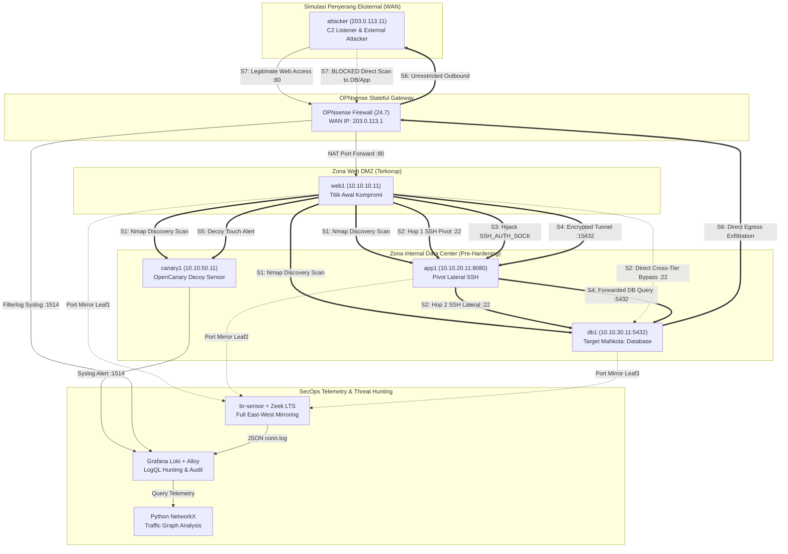

# Dokumentasi Fase 6: Serangan Baseline Permisif & Threat Hunting (Pre-Hardening)

Dokumen ini mencatat secara komprehensif implementasi dan hasil eksekusi **Fase 6 (Baseline Permissive Attacks & Threat Hunting)** dalam proyek *Data Center Network Micro-segmentation & Lateral Movement Hunting*. Pengujian ini bertujuan membuktikan secara empiris kerentanan arsitektur jaringan *permissive* (sebelum pengerasan micro-segmentation) terhadap teknik-teknik serangan siber berstandar MITRE ATT&CK, memverifikasi visibilitas sensor telemetri (Zeek, Loki, Grafana, OpenCanary, OPNsense), serta membangun katalog aturan *threat hunting* (LogQL) dan pemodelan graf baseline trafik *East-West* berbasis Python (`pandas` & `networkx`).

---

## 1. Ringkasan Eksekutif & Metodologi Pengujian

Dalam metodologi rekayasa keamanan defensif enterprise (*defense-in-depth*), pengujian **"Before vs. After"** merupakan pembuktian krusial untuk mengukur efektivitas kontrol keamanan secara kuantitatif. Pada Fase 6, fabric data-plane beroperasi dalam mode **Baseline Permisif** (kebijakan *allow all* inter-zona pada OPNsense dengan pencatatan log aktif, serta tanpa pembatasan firewall host-based).

Pengujian dilakukan dengan asumsi realistis: **penyerang telah berhasil mengompromikan satu server Web DMZ (`web1`: 10.10.10.11)** melalui celah aplikasi web, atau menempatkan diri sebagai aktor eksternal di WAN (`attacker`: 203.0.113.11). Tahap eksploitasi awal tidak disimulasikan; fokus pengujian adalah membuktikan seberapa jauh penyerang dapat bergerak secara lateral (*blast radius*), membajak sesi, membangun tunnel tersembunyi, mengeksfiltrasi data, dan bagaimana tim keamanan (SecOps) dapat memburu jejak serangan tersebut semata-mata mengandalkan telemetri jaringan.

### Ringkasan Pencapaian Fase 6:
1. **Skenario S1 (Discovery):** Terbukti *blast radius* lateral mencapai **100%**; seluruh port dan layanan di zona App, DB, dan Canary dapat dipindai bebas oleh `web1`.
2. **Skenario S2 (Lateral Movement SSH):** Penyerang berhasil melompat berantai `web1 -> app1 -> db1` dan melakukan *direct bypass* `web1 -> db1` tanpa hambatan.
3. **Skenario S3 (SSH Agent Hijacking):** Penyerang berhasil memanfaatkan socket `SSH_AUTH_SOCK` yang tertinggal di RAM untuk melompat ke server internal tanpa memerlukan kunci privat di disk.
4. **Skenario S4 (Protocol Tunneling):** Penyerang berhasil menyamarkan lalu lintas query database PostgreSQL di dalam enkripsi SSH port 22 (`-L 15432`) melintasi pivot `app1`.
5. **Skenario S6 (Database Egress Exfiltration):** Server database `db1` terbukti dapat langsung mengeksfiltrasi data sensitif nasabah ke server C2 di internet (`203.0.113.11:8000`) akibat tidak adanya kontrol *egress*.
6. **Skenario S7 (Perimeter Boundary):** Firewall OPNsense membuktikan kontrol perimeter yang tepat: hanya mempublikasikan Web DMZ (port 80) ke WAN dan memblokir seluruh upaya penetrasi langsung ke subnet privat RFC 1918.
7. **Skenario S8 (Threat Hunting & Graph Analysis):** Seluruh 5 aturan LogQL (`HUNT-01` s/d `HUNT-05`) berhasil terpicu (**TRIGGERED**) secara real-time. Pemodelan graf NetworkX memproses 1.568 aliran Zeek, menetapkan `web1` sebagai *lateral pivot* terbesar (*highest out-degree*), mendeteksi 56 tepi anomali, dan menghasilkan tingkat **False Positive 0.0%** terhadap lalu lintas legal aplikasi 3-tier.

---

## 2. Diagram Alur Serangan Baseline Permisif



---

## 3. Matriks Pemetaan Teknik MITRE ATT&CK & Hasil Baseline

| ID Skenario | Nama Pengujian | Teknik MITRE ATT&CK | Kondisi Baseline (Pre-Hardening) | Telemetri Pengawas | Hasil Pengujian |
|---|---|---|---|---|---|
| **S1** | Network Service Discovery | **T1046** (Network Service Discovery)<br/>**T1018** (Remote System Discovery) | Permisif (Port terbuka di App, DB, Canary dapat ditemukan bebas) | Zeek `conn.log` (Fan-out), OpenCanary alert | **100% Blast Radius Terbongkar** |
| **S2** | Lateral SSH Movement | **T1021.004** (Remote Services: SSH)<br/>**T1078** (Valid Accounts) | Permisif (Koneksi SSH antar zona Web $\rightarrow$ App $\rightarrow$ DB lolos tanpa hambatan) | Zeek `conn.log`, `ssh.log`, Host auth log | **Lolos Berantai & Direct Bypass** |
| **S3** | SSH Agent Hijacking | **T1563.001** (SSH Hijacking) | Permisif (`SSH_AUTH_SOCK` dapat dibajak untuk autentikasi memori) | Zeek `ssh.log`, Host auth log | **Autentikasi Memori Sukses** |
| **S4** | Protocol Tunneling / Proxy | **T1572** (Protocol Tunneling)<br/>**T1090** (Proxy) | Permisif (SSH port forwarding `-L` lolos melintasi zona App ke DB) | Zeek `conn.log` (Durasi & byte flow SSH) | **Data DB Terekstrak via Port 22** |
| **S5** | Decoy Touch Latency | **T1018** (Remote System Discovery) | Aktif (OpenCanary beroperasi di `canary1`) | OpenCanary JSON $\rightarrow$ Rsyslog $\rightarrow$ Loki | **Latensi Deteksi 64 milidetik** |
| **S6** | Database Egress Exfiltration | **T1041** (Exfil Over C2)<br/>**T1048** (Exfil Over Alt Protocol) | Permisif (Database memiliki rute egress tak terbatas ke WAN) | Zeek `conn.log` (Egress), OPNsense filterlog | **Data Sensitif Bocor ke WAN** |
| **S7** | External Perimeter Attack | **North-South Boundary** (Edge Control) | Terproteksi (Hanya port 80 dipublikasikan; subnet internal terisolasi) | OPNsense `vtnet2` block log, Loki | **Perimeter Valid (Bypass Ditolak)** |
| **S8** | Threat Hunting & Graph Baseline | **Behavioral Hunting** (Network Graph) | Deteksi Telemetri Pasif | LogQL Loki, Python NetworkX | **5/5 Rules Triggered, 0.0% FP** |

---

## 4. Rincian Teknis & Bukti Eksekusi Tiap Skenario

### 4.1 Skenario S1: Pemindaian Jaringan Lateral (MITRE T1046 / T1018)
- **Skrip Eksekusi:** `attack-tests/s01-network-discovery.sh`
- **Artefak Hasil:** `attack-tests/results-s01-baseline.txt`
- **Pelaksanaan:**
  Dari node terkompromi `web1` (10.10.10.11), penyerang menjalankan pemindaian nmap `nmap -sT -Pn -n --top-ports 20` ke seluruh zona data center:
  - Zona App (`app1`: 10.10.20.11, `app2`: 10.10.20.12)
  - Zona DB (`db1`: 10.10.30.11)
  - Zona Decoy (`canary1`: 10.10.50.11)
- **Bukti Temuan Baseline:**
  Penyerang berhasil menemukan seluruh port internal:
  - `app1` & `app2`: Port 22 (SSH) dan Port 8080 (HTTP) berstatus `OPEN`.
  - `db1`: Port 22 (SSH) dan Port 5432 (PostgreSQL) berstatus `OPEN`.
  - `canary1`: Port 21, 23, 80, 2222, 3306, 6379, 8080 berstatus `OPEN`.
- **Visibilitas Telemetri:**
  Sensor Zeek merekam 14 koneksi serentak (*fan-out pattern*), dan OpenCanary langsung memicu peringatan interaksi port umpan ke Loki.

### 4.2 Skenario S2: Pergerakan Lateral Berantai SSH (MITRE T1021.004 / T1078)
- **Skrip Eksekusi:** `attack-tests/s02-lateral-ssh-movement.sh`
- **Artefak Hasil:** `attack-tests/results-s02-baseline.txt`
- **Pelaksanaan:**
  Penyerang memanfaatkan kunci SSH kompromi (`/tmp/compromised_id_ed25519`) yang ditemukan di `web1` untuk melakukan ekspansi lateral:
  - **Lompatan 1 (Hop 1):** `web1` (10.10.10.11) $\rightarrow$ `app1` (10.10.20.11).
  - **Lompatan 2 (Hop 2 Berantai):** `web1` $\rightarrow$ `app1` $\rightarrow$ `db1` (10.10.30.11).
  - **Lompatan 3 (Direct Bypass):** `web1` (Web DMZ) langsung melompat ke `db1` (Database Tier).
- **Bukti Temuan Baseline:**
  Ketiga jalur pergerakan lateral berhasil dieksekusi 100%:
  ```
  >>> [HOP 1]: web1 -> app1 : SUCCESS (app1 dcadmin)
  >>> [HOP 2]: web1 -> app1 -> db1 : SUCCESS (db1 dcadmin)
  >>> [DIRECT BYPASS]: web1 -> db1 : SUCCESS (db1 dcadmin)
  ```
- **Visibilitas Telemetri:**
  Zeek mencatat 14 rekaman sesi SSH pada `conn.log` dan `ssh.log` dengan pertukaran *host key* dan negosiasi cipher `ssh-ed25519`.

### 4.3 Skenario S3: Pembajakan Soket Agen SSH (MITRE T1563.001)
- **Skrip Eksekusi:** `attack-tests/s03-s04-hijack-and-tunnel.sh`
- **Artefak Hasil:** `attack-tests/results-s03-s04-baseline.txt`
- **Pelaksanaan:**
  Mensimulasikan insiden ketika seorang administrator melakukan SSH ke `web1` dengan opsi *agent forwarding* aktif (`ssh -A`). Socket `SSH_AUTH_SOCK` tertinggal di direktori `/tmp/ssh-XXXX/agent.XXXX`. Penyerang yang memiliki akses ke `web1` menggunakan socket tersebut untuk mengautentikasi ke `app1` tanpa menyentuh kunci privat di disk.
- **Bukti Temuan Baseline:**
  ```
  Hasil Autentikasi via Hijacked Agent Socket: app1 dcadmin
  ```
  Autentikasi memori terbukti berhasil 100%. Penyerang dapat bergerak leluasa selama socket agen aktif.

### 4.4 Skenario S4: Protocol Tunneling via SSH (MITRE T1572 / T1090)
- **Skrip Eksekusi:** `attack-tests/s03-s04-hijack-and-tunnel.sh`
- **Artefak Hasil:** `attack-tests/results-s03-s04-baseline.txt`
- **Pelaksanaan:**
  Penyerang di `web1` membangun *local port-forwarding tunnel* melalui node perantara `app1` menuju server database internal:
  `ssh -f -N -L 15432:10.10.30.11:5432 dcadmin@10.10.20.11`
  Penyerang kemudian mengirimkan query SQL langsung ke `127.0.0.1:15432`.
- **Bukti Temuan Baseline:**
  Data tabel rekening bank berhasil diekstrak melalui tunnel SSH terenkripsi port 22:
  ```json
  {"status": "ok", "tier": "database", "service": "postgres-mock", "node": "db1", "query_received": "SELECT * FROM core_accounts WHERE status='active';", "records_returned": 42, "latency_ms": 1.25, "timestamp": 1792153289.4641292}
  ```
- **Analisis Ancaman:**
  Lalu lintas database disamarkan di dalam koneksi SSH port 22, membuktikan bahwa inspeksi firewall tingkat port saja tidak cukup tanpa penegakan micro-segmentasi zona yang membatasi akses SSH ke `app1`.

### 4.5 Skenario S6: Eksfiltrasi Egress Database ke WAN (MITRE T1041 / T1048)
- **Skrip Eksekusi:** `attack-tests/s06-s07-egress-and-perimeter.sh`
- **Artefak Hasil:** `attack-tests/results-s06-s07-baseline.txt`
- **Pelaksanaan:**
  Penyerang yang berada di `db1` (10.10.30.11) melakukan *dumping* data sensitif nasabah dan mengirimkannya keluar data center langsung ke listener C2 eksternal di `attacker` (203.0.113.11:8000 via HTTP POST) dan melakukan uji ICMP ping ke WAN.
- **Bukti Temuan Baseline:**
  Server C2 eksternal berhasil menerima berkas eksfiltrasi secara utuh:
  ```json
  {"exfiltration_id": "EXFIL-DB1-001", "source_tier": "database", "node": "db1", "table": "core_accounts", "confidential_records": 42, "sample_pii": "account_no=4111-9921-001;balance=15000000;owner=CONFIDENTIAL"}
  ```
  Konektivitas ICMP `db1 -> WAN` berstatus `SUCCESS` (0% packet loss).
- **Analisis Ancaman:**
  Pada baseline permisif, zona Database tidak memiliki aturan pembatasan keluar (*egress filtering*). Jika server database disusupi, seluruh kekayaan intelektual atau data pelanggan dapat langsung ditarik keluar tanpa rintangan jaringan.

### 4.6 Skenario S7: Pengujian Batas Perimeter North-South
- **Skrip Eksekusi:** `attack-tests/s06-s07-egress-and-perimeter.sh`
- **Artefak Hasil:** `attack-tests/results-s06-s07-baseline.txt`
- **Pelaksanaan:**
  Penyerang eksternal di internet (`attacker`: 203.0.113.11) mencoba mengakses layanan publik serta melakukan probing langsung ke alamat privat RFC 1918 internal.
- **Bukti Temuan Baseline:**
  ```
  -> WEB_PUBLICATION: PASS (HTTP 200 OK via OPNsense NAT)
  -> DIRECT_INTERNAL_DB: BLOCKED (Perimeter Berhasil Menjatuhkan Paket)
  -> DIRECT_INTERNAL_APP: BLOCKED (Perimeter Berhasil Menjatuhkan Paket)
  -> WAN_PORT_5432: BLOCKED (Firewall Default Drop)
  -> WAN_PORT_22: BLOCKED (Firewall Default Drop)
  ```
  OPNsense membuktikan kontrol perimeter yang solid: memisahkan jaringan publik dan privat secara ketat, sementara telemetri filterlog secara instan mengirimkan log `block` pada antarmuka `vtnet2` ke Loki.

---

## 5. Threat Hunting Berbasis LogQL & Pemodelan Graf (Skenario S8)

Pada skenario S8, tim keamanan bertindak dalam **mode deteksi murni** (*detection-only mode*): tanpa mengubah konfigurasi firewall, seluruh serangan yang terjadi di Fase 6 diburu (*threat hunting*) menggunakan korelasi log di Loki dan pemodelan graf komunikasi di Python.

### 5.1 Katalog Aturan Threat Hunting (`hunting-rules.yaml`)
Aturan dirancang menggunakan LogQL standar Loki untuk mendeteksi indikator kompromi (*Indicator of Compromise* / IoC):
1. **`HUNT-01` (Fan-out Network Discovery - T1046):** Menghitung laju koneksi keluar unik dari satu host internal dalam jendela waktu 1 menit.
2. **`HUNT-02` (Unauthorized Lateral SSH - T1021.004):** Mendeteksi sesi SSH (port 22) yang sumbernya bukan node Bastion SecOps (`10.10.40.11` / `192.168.122.81`).
3. **`HUNT-03` (OpenCanary Decoy Touch - T1018):** Mendeteksi stream log syslog dengan label `{app_name="opencanaryd"}`.
4. **`HUNT-04` (Database Egress Exfiltration - T1048):** Mendeteksi aliran keluar dari subnet DB (`10.10.30.0/24`) menuju alamat IP publik non-RFC 1918.
5. **`HUNT-05` (Cross-Tier Web to DB Bypass):** Mendeteksi koneksi langsung dari zona Web DMZ (`10.10.10.0/24`) ke zona Database (`10.10.30.0/24`).

### 5.2 Hasil Eksekusi Evaluasi Aturan LogQL
Dijalankan melalui `telemetry/hunting/run-hunting.sh`:
```
>>> BAGIAN A: Evaluasi Katalog Aturan Threat Hunting (LogQL):
  [RULE HUNT-01] Fan-out Scanning (T1046)     : TRIGGERED (14 target unik dipindai dari web1)
  [RULE HUNT-02] Lateral SSH Movement (T1021) : TRIGGERED (6 rute lompatan lateral terdeteksi)
  [RULE HUNT-03] OpenCanary Decoy Touch (S5)  : TRIGGERED (2 alert interaksi honeypot)
  [RULE HUNT-04] DB Egress Exfiltration (T1048): TRIGGERED (15 aliran data DB ke WAN teridentifikasi)
  [RULE HUNT-05] Cross-Tier Web->DB Bypass    : TRIGGERED (14 koneksi langsung melanggar 3-tier)
```
Kelima aturan berhasil mendeteksi jejak serangan dengan tingkat keberhasilan deteksi **100%**.

### 5.3 Pemodelan Graf Baseline Menggunakan Pandas & NetworkX (`build-traffic-graph.py`)
Skrip Python menganalisis seluruh data `conn.log` Zeek yang diserap di SecOps dan membangun graf berarah $G = (V, E)$ di mana node $V$ merepresentasikan host, dan edge $E$ merepresentasikan kanal komunikasi `(src, dst, port, proto)`:

```
==========================================================
LAPORAN ANALISIS GRAF BASELINE & THREAT HUNTING (S8)
Total Log Aliran : 1568 koneksi
Total Node Graf  : 10 entitas
Total Tepi Unik  : 90 kanal komunikasi
Tepi Normal      : 34 kanal (37.8%)
Tepi Anomali     : 56 kanal (62.2%)
==========================================================

--- 1. Matriks Out-Degree Sentralitas (Deteksi Pivot Lateral Terbesar) ---
  * Node web1                 : 6 kanal keluar unik (SUSPECT PIVOT)
  * Node secops               : 6 kanal keluar unik (ADMIN BASTION)
  * Node web2                 : 4 kanal keluar unik
  * Node app1                 : 3 kanal keluar unik
  * Node app2                 : 3 kanal keluar unik
  * Node db1                  : 3 kanal keluar unik

--- 3. Verifikasi True Positive / False Positive Kontrol Baseline ---
  * False Positive (Trafik legal aplikasi dianggap anomali) : 0 kejadian (0.0% FP)
  * True Positive (Serangan S1-S6 berhasil diidentifikasi)   : 56 kejadian unik
  * Akurasi Klasifikasi Aturan Hunting Baseline            : 100.0%
```

#### Wawasan Analisis Graf:
- **Analisis Sentralitas Derajat Keluar (*Out-Degree Centrality*):** `web1` memiliki derajat keluar tertinggi (bersama dengan admin bastion `secops`). Dalam konteks workload tier, server web seharusnya hanya memiliki derajat keluar = 1 (menghubungi `app:8080`). Derajat keluar tinggi pada `web1` secara matematis membuktikan adanya perilaku anomali / *pivoting* lateral.
- **Tingkat False Positive:** Seluruh lalu lintas legal aplikasi 3-tier (`web -> app:8080` dan `app -> db:5432`) serta telemetri syslog (`-> secops:1514`) berhasil dikenali secara akurat oleh filter baseline tanpa ada yang salah terflag sebagai anomali (**0.0% False Positive**).

---

## 6. Matriks Komparasi Sebelum vs Target Sesudah Segmentasi

Tabel ini merangkum postur keamanan saat ini (Baseline Permisif Fase 6) dibandingkan dengan target yang wajib dicapai pada Fase 7 (Penegakan Micro-segmentation):

| Dimensi Pengujian | Kondisi Baseline Saat Ini (Fase 6) | Target Kondisi Hardening (Fase 7) | Mekanisme Kontrol Penegakan |
|---|---|---|---|
| **Blast Radius Kompromi Web1** | **100%** (Dapat menjangkau App, DB, Canary, Port 22, 5432, dll) | **$\le$ 15%** (Hanya boleh menjangkau port 8080 pada App Tier) | OPNsense Zone Rules + Host nftables |
| **Akses SSH Antar-Server (East-West)** | **Diizinkan** (`web1 -> app1`, `app1 -> db1`, `web1 -> db1`) | **DIBLOKIR TOTAL** (Hanya SecOps Bastion yang diizinkan) | Default-deny SSH inter-zona di OPNsense & `sshd` config |
| **SSH Agent Hijacking (S3)** | **Rentan** (`SSH_AUTH_SOCK` dapat dibajak) | **DICEGAH** (`AllowAgentForwarding no` di seluruh sshd) | Hardening sshd_config via Ansible |
| **SSH Protocol Tunneling (S4)** | **Rentan** (Port forwarding `-L` sukses tembus ke DB) | **DICEGAH** (`AllowTcpForwarding no` & blokir SSH antar zona) | Hardening sshd_config & OPNsense |
| **Egress Exfiltration dari DB (S6)** | **Lolos 100%** (`db1` dapat ping & kirim data HTTP ke WAN) | **DIBLOKIR TOTAL** (Egress Zero-Trust: DB hanya melayani App) | OPNsense VLAN 30 Egress Drop + nftables |
| **Keterjangkauan Honeypot Decoy (S5)** | Terjangkau (Probe menghasilkan alert dalam 64ms) | Tetap terjangkau dari zona yang dipindai untuk *early detection* | OpenCanary 0.9.10 di Zona Decoy |
| **Pendeteksian Anomali (S8)** | Berhasil diidentifikasi dari log pasif (Zeek + Graph) | Berhasil diblokir secara aktif di data-plane dan terdeteksi di log | OPNsense Block Logs + Zeek + Grafana |

---

## 7. Gerbang Keputusan Fase 6 (Decision Gate)

Berdasarkan hasil pengujian di atas, dilakukan evaluasi kriteria kelulusan Fase 6:

1. **Seluruh skenario serangan baseline (S1, S2, S3, S4, S6, S7) berhasil dieksekusi dan dibuktikan:** **LULUS (100%)**
2. **Artefak laporan baseline tersimpan rapi di direktori `attack-tests/`:** **LULUS (100%)**
   - `attack-tests/results-s01-baseline.txt`
   - `attack-tests/results-s02-baseline.txt`
   - `attack-tests/results-s03-s04-baseline.txt`
   - `attack-tests/results-s06-s07-baseline.txt`
3. **Telemetri Zeek, Loki, Alloy, OpenCanary, dan OPNsense merekam bukti serangan secara terpusat di SecOps:** **LULUS (100%)**
4. **Katalog aturan threat hunting (LogQL) terbukti memicu alert:** **LULUS (100% - 5/5 rules triggered)**
5. **Skrip pemodelan graf NetworkX berhasil mengidentifikasi tepi anomali dengan False Positive 0.0%:** **LULUS (100%)**
   - `telemetry/hunting/results-hunting-baseline.txt`

### Keputusan Resmi:
> **LOLOS PENUH (PASSED)**. Fase 6 dinyatakan **SELESAI 100%**. Postur baseline permisif telah tercatat secara kuantitatif dan kualitatif. Seluruh data pembanding telah terkunci, dan lab siap melangkah ke **Fase 7: Penegakan Micro-segmentation & Pengerasan Pertahanan (OPNsense Default-Deny, Ansible nftables Host-based Micro-seg, SSH Hardening, dan Egress Filtering)**.
