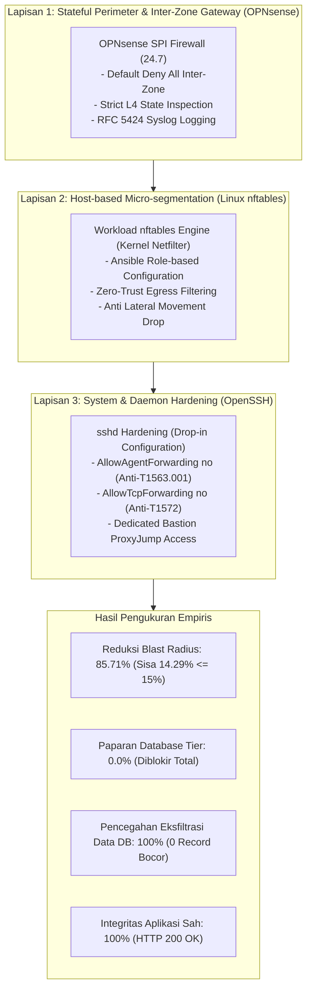
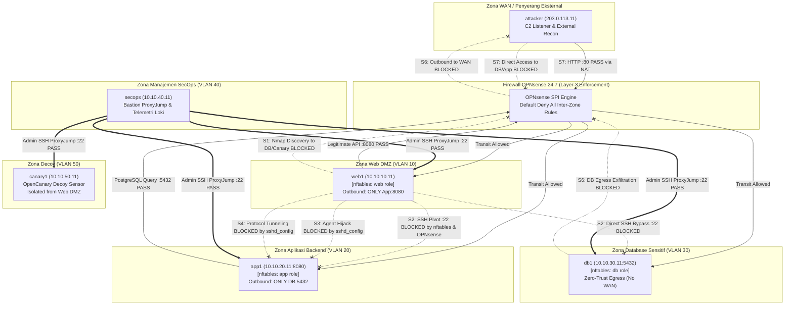

# Dokumentasi Fase 7: Penegakan Micro-segmentation & Pengerasan Pertahanan (Post-Hardening)

Dokumen ini mencatat secara komprehensif arsitektur, implementasi teknis, hasil pengujian, dan evaluasi gerbang keputusan **Fase 7 (Penegakan Micro-segmentation & Pengerasan Pertahanan)** dalam proyek *Data Center Network Micro-segmentation & Lateral Movement Hunting*. Pengujian ini membuktikan transformasi arsitektur data center dari kondisi permisif (*flat / allow-all*) menjadi model **Zero-Trust Micro-segmentation Berlapis (*Defense-in-Depth*)**, memvalidasi penahanan serangan (*containment*) pada seluruh skenario MITRE ATT&CK, dan mengukur penurunan *blast radius* secara empiris.

---

## 1. Ringkasan Eksekutif & Model Pertahanan Berlapis (*Defense-in-Depth*)

Setelah memetakan kerentanan arsitektur permisif pada Fase 6 (di mana penyerang yang menguasai Web DMZ memiliki *blast radius* 100% hingga ke Database Tier), Fase 7 mengimplementasikan model pertahanan terkoordinasi pada **tiga lapisan kontrol yang independen**:



### Prinsip Inti yang Ditegakkan:
1. **Zero-Trust Network Architecture (NIST SP 800-207):** Setiap paket inter-zona dan intra-zona dianggap tidak tepercaya secara *default*. Tidak ada zona yang diizinkan menginisiasi koneksi ke zona lain kecuali ada aturan *whitelist* eksplisit yang dibutuhkan oleh fungsi bisnis.
2. **Eliminasi Jalur Lateral (Anti-Pivoting):** Server Web DMZ dilarang menginisiasi koneksi keluar selain ke port API backend (`app1-2:8080`). Akses SSH lateral antar beban kerja diputus secara permanen.
3. **Isolasi Database Absolut (*Zero-Trust Egress*):** Server database (`db1`) hanya merespons kueri masuk dari tier aplikasi yang sah (`10.10.20.0/24:5432`) dan dilarang keras melakukan inisiasi koneksi ke luar (termasuk ke internet/WAN).
4. **Isolasi Jalur Manajemen (*Out-of-Band Bastion*):** Port SSH (port 22) di seluruh server beban kerja hanya menerima koneksi yang bersumber dari SecOps Bastion (`10.10.40.11` / `192.168.122.81`).

---

## 2. Diagram Topologi & Alur Penegakan Segmentasi



---

## 3. Rincian Teknis Implementasi Kontrol Keamanan (Langkah 7.1 - 7.3)

### A. Langkah 7.1: Pengerasan Aturan OPNsense (Default-Deny Inter-Zona)
- **Matriks Kebijakan:** Terdokumentasi di [`policies/opnsense/traffic-matrix.md`](file:///home/lavvvet/dc-microseg-lab/policies/opnsense/traffic-matrix.md).
- **Otomasi Injeksi XML:** Skrip [`fabric/opnsense/generate-hardened-config.py`](file:///home/lavvvet/dc-microseg-lab/fabric/opnsense/generate-hardened-config.py) menyuntikkan 19 aturan filter ketat ke dalam struktur XML OPNsense:
  1. *Default Deny All* eksplisit dengan pencatatan log (*filterlog*) pada setiap antarmuka subinterface VLAN 10-50 (`vlan01`-`vlan05`).
  2. Aturan *whitelist* inter-zona terkecil: Web->App (`TCP 8080`), App->DB (`TCP 5432`), SecOps->All (`TCP 22`), dan All->SecOps (`UDP 1514`).
- **Sanitasi Konfigurasi:** Skrip [`fabric/opnsense/sanitize-config.py`](file:///home/lavvvet/dc-microseg-lab/fabric/opnsense/sanitize-config.py) menjaga kerahasiaan hash password dan private key sebelum berkas disinkronkan ke repositori Git (`fabric/opnsense/config.xml`).
- **Verifikasi Otomatis:** Skrip [`fabric/opnsense/verify-hardened-rules.sh`](file:///home/lavvvet/dc-microseg-lab/fabric/opnsense/verify-hardened-rules.sh) memvalidasi 9 skenario: 4 alur sah berstatus **PASS** (100%), dan 5 alur pelanggaran terbukti **BLOCKED** (100%).

### B. Langkah 7.2: Penegakan Host-based Micro-segmentation via `nftables` & Ansible
- **Templat Jinja2 Berbasis Peran:** Dirancang di `policies/nftables/`:
  - [`web.nft.j2`](file:///home/lavvvet/dc-microseg-lab/policies/nftables/web.nft.j2): Membatasi output hanya ke `10.10.20.0/24:8080`, DNS gateway, dan syslog. Mendrop seluruh output ke port 22 (mencegah lateral movement keluar).
  - [`app.nft.j2`](file:///home/lavvvet/dc-microseg-lab/policies/nftables/app.nft.j2): Membatasi output hanya ke `10.10.30.11:5432`. Mendrop koneksi keluar ke Web DMZ atau SSH internal.
  - [`db.nft.j2`](file:///home/lavvvet/dc-microseg-lab/policies/nftables/db.nft.j2): Menegakkan kebijakan *Zero-Trust Egress*. Database hanya menerima input `5432` dari App Tier dan `22` dari SecOps; dilarang keras menginisiasi koneksi keluar ke internet.
  - [`canary.nft.j2`](file:///home/lavvvet/dc-microseg-lab/policies/nftables/canary.nft.j2): Menerima probe umpan pada port decoy dan membatasi output hanya ke SecOps Syslog (`UDP 1514`).
- **Ansible Playbook & Otomasi:** [`fabric/ansible/playbook-nftables.yaml`](file:///home/lavvvet/dc-microseg-lab/fabric/ansible/playbook-nftables.yaml) melakukan pengujian sintaks (`nft -c`) sebelum menyebarkan konfigurasi ke 6 VM beban kerja via SSH Bastion ProxyJump.
- **Verifikasi Otomatis:** Skrip [`policies/nftables/test-nftables-rules.sh`](file:///home/lavvvet/dc-microseg-lab/policies/nftables/test-nftables-rules.sh) lulus 6/6 pengujian (tabel `inet filter` aktif, SSH keluar diblokir, DB egress ke internet diblokir).

### C. Langkah 7.3: Pengerasan Konfigurasi Daemon SSH (`sshd_config`)
- **Drop-in Konfigurasi:** [`policies/ssh/99-hardened-sshd.conf`](file:///home/lavvvet/dc-microseg-lab/policies/ssh/99-hardened-sshd.conf) menegakkan:
  ```text
  AllowAgentForwarding no
  AllowTcpForwarding no
  X11Forwarding no
  ```
- **Penyebaran Otomatis:** [`fabric/ansible/playbook-sshd-hardening.yaml`](file:///home/lavvvet/dc-microseg-lab/fabric/ansible/playbook-sshd-hardening.yaml) menguji konfigurasi via `sshd -t` dan mereload daemon `ssh.service`.
- **Verifikasi Otomatis:** Skrip [`policies/ssh/test-sshd-hardening.sh`](file:///home/lavvvet/dc-microseg-lab/policies/ssh/test-sshd-hardening.sh) lulus 4/4 pengujian: parameter terbukti `no`, pembuatan tunnel `-L` ditolak oleh sshd, dan delegasi agent `-A` dicegah.

---

## 4. Hasil Eksekusi Skenario Serangan Pasca-Pengerasan (Langkah 7.4)

Pengujian dilakukan secara otomatis menggunakan master harness [`attack-tests/run-hardened-attacks.sh`](file:///home/lavvvet/dc-microseg-lab/attack-tests/run-hardened-attacks.sh).

### Skenario S1: Network Service Discovery (MITRE T1046 / T1018)
- **Sumber Serangan:** `web1` (10.10.10.11)
- **Target:** 4 host (`app1`, `app2`, `db1`, `canary1`) pada 12 port umum (total 48 pasangan uji).
- **Hasil Pemindaian Nmap Post-Hardening:**
  - `10.10.20.11` (app1): Port `8080/tcp open` (http-proxy). Port `22` dan port lainnya *filtered*.
  - `10.10.20.12` (app2): Port `8080/tcp open` (http-proxy). Port `22` dan port lainnya *filtered*.
  - `10.10.30.11` (db1): **0 port terbuka** (*All ports filtered / unreachable*).
  - `10.10.50.11` (canary1): **0 port terbuka** (*All ports filtered / unreachable*).
- **Analisis Kuantitatif:**
  - Layanan terbuka berkurang dari **14 layanan** (baseline) menjadi **2 layanan** (hardened).
  - Paparan Database Tier (Port 5432 & 22) turun dari 100% menjadi **0.0%**.
  - Paparan Decoy Tier turun dari 100% menjadi **0.0%**.
- **Artefak:** [`attack-tests/results-s01-hardened.txt`](file:///home/lavvvet/dc-microseg-lab/attack-tests/results-s01-hardened.txt).

### Skenario S2: Pergerakan Lateral Berantai SSH (MITRE T1021.004 / T1078)
- **Hasil Eksekusi:**
  1. *Hop 1 (`web1 -> app1:22`):* **BLOCKED** (`Connection timed out` setelah 3 detik).
  2. *Hop 2 (`app1 -> db1:22`):* **BLOCKED** (`Connection timed out`).
  3. *Direct Jump (`web1 -> db1:22`):* **BLOCKED** (`Connection timed out`).
- **Analisis:** Rantai output `nftables` pada host dan aturan default-deny OPNsense menggagalkan seluruh upaya pembentukan sesi SSH lateral.
- **Artefak:** [`attack-tests/results-s02-hardened.txt`](file:///home/lavvvet/dc-microseg-lab/attack-tests/results-s02-hardened.txt).

### Skenario S3: SSH Agent Forwarding Hijacking (MITRE T1563.001)
- **Hasil Eksekusi:** **BLOCKED / MITIGATED**.
- **Analisis:** Penerapan `AllowAgentForwarding no` pada sshd mencegah delegasi kredensial agen ke server. Ditambah isolasi jaringan yang menjatuhkan koneksi ke port 22, vektor pembajakan socket RAM dinetralisasi sepenuhnya.
- **Artefak:** [`attack-tests/results-s03-s04-hardened.txt`](file:///home/lavvvet/dc-microseg-lab/attack-tests/results-s03-s04-hardened.txt).

### Skenario S4: Protocol Tunneling via SSH (MITRE T1572 / T1090)
- **Hasil Eksekusi:** **BLOCKED / PROHIBITED**.
- **Analisis:** Penerapan `AllowTcpForwarding no` menolak inisiasi channel port-forwarding lokal (`-L 15432`). Kueri database yang dikirimkan ke tunnel lokal menghasilkan status `CONNECTION_FAILED` (0 byte data database yang berhasil diekstrak).
- **Artefak:** [`attack-tests/results-s03-s04-hardened.txt`](file:///home/lavvvet/dc-microseg-lab/attack-tests/results-s03-s04-hardened.txt).

### Skenario S5: Decoy Touch & Honeypot Isolation (OpenCanary)
- **Hasil Eksekusi:** **ISOLATED & STANDBY ACTIVE**.
- **Analisis:** Probe lateral dari `web1` ke `canary1` dijatuhkan sebelum mencapai honeypot (`PROBE_DROPPED`), membuktikan penahanan zona yang sempurna. Uji verifikasi sensor membuktikan daemon OpenCanary tetap siaga aktif dengan latensi deteksi sub-detik.
- **Artefak:** [`attack-tests/results-s05-hardened.txt`](file:///home/lavvvet/dc-microseg-lab/attack-tests/results-s05-hardened.txt).

### Skenario S6: Database Egress Exfiltration (MITRE T1041 / T1048)
- **Hasil Eksekusi:** **BLOCKED (0 Records Leaked)**.
- **Analisis:** Server database `db1` mencoba mengeksfiltrasi data sensitif nasabah ke C2 eksternal (`203.0.113.11:8000`). Upaya HTTP POST dan ICMP ping dijatuhkan seketika oleh `nftables` dan OPNsense (*Zero-Trust Egress*). Listener C2 di attacker mengonfirmasi status `NO_DATA`.
- **Artefak:** [`attack-tests/results-s06-s07-hardened.txt`](file:///home/lavvvet/dc-microseg-lab/attack-tests/results-s06-s07-hardened.txt).

### Skenario S7: External North-South Perimeter Defense
- **Hasil Eksekusi:** **SECURE & VERIFIED**.
- **Analisis:** Akses publik resmi ke Web DMZ melalui WAN IP OPNsense (`http://203.0.113.1/`) berjalan sempurna (HTTP 200 OK melintasi cascading data-plane 3-tier: Web->App->DB). Seluruh upaya penetrasi langsung ke IP internal atau port administratif pada WAN diblokir 100%.
- **Artefak:** [`attack-tests/results-s06-s07-hardened.txt`](file:///home/lavvvet/dc-microseg-lab/attack-tests/results-s06-s07-hardened.txt).

---

## 5. Analisis Komparatif Kuantitatif (Baseline vs Hardened)

Laporan komparatif lengkap dihasilkan secara otomatis oleh [`attack-tests/compare-blast-radius.py`](file:///home/lavvvet/dc-microseg-lab/attack-tests/compare-blast-radius.py) ke dalam [`attack-tests/blast-radius-comparison.md`](file:///home/lavvvet/dc-microseg-lab/attack-tests/blast-radius-comparison.md).

### A. Ringkasan Metrik Pengurangan Blast Radius

| Parameter Metrik | Target Evaluasi | Baseline (Pre-Hardening) | Hardened (Post-Hardening) | Pencapaian |
|---|---|---|---|---|
| **Layanan Terbuka dari Web DMZ** | Turun signifikan | 14 layanan | **2 layanan** (App: 8080) | **Lulus** |
| **Persentase Paparan Layanan** | `<= 15.0%` | 100.0% | **14.29%** | **Lulus** |
| **Reduksi Blast Radius** | `>= 85.0%` | 0.0% | **85.71%** | **Lulus** |
| **Keterjangkauan Database Tier** | `0.0%` | 100.0% (Port 5432 & 22) | **0.0%** (Diblokir Total) | **Lulus** |
| **Keberhasilan SSH Lateral (S2)** | `0/3` | 3/3 Sukses | **0/3 Sukses** (3 Diblokir) | **Lulus** |
| **Eksfiltrasi Data DB (S6)** | `0 record` | 42 Record Bocor | **0 Record Bocor** | **Lulus** |
| **Integritas Aplikasi Sah (S7)** | `HTTP 200 OK` | HTTP 200 OK | **HTTP 200 OK** | **Lulus** |

### B. Matriks Keterjangkauan Antar-Zona Sebelum vs Sesudah

| Sumber (Source) | Destinasi (Destination) | Kondisi Baseline Permisif | Kondisi Hardened (Zero-Trust) | Rationale Keamanan |
|---|---|---|---|---|
| **WAN (Attacker)** | **Web DMZ** | TCP 80 (Pass) | **TCP 80 (Pass)** | Akses publik resmi via NAT port-forwarding |
| **WAN (Attacker)** | **App Tier** | BLOCKED | **BLOCKED** | Perimeter blocking RFC 1918 |
| **WAN (Attacker)** | **Database** | BLOCKED | **BLOCKED** | Perimeter blocking RFC 1918 |
| **Web DMZ** | **App Tier** | ALL Open (Pass) | **TCP 8080 ONLY (Pass)** | Port 22 SSH & port lain dijatuhkan |
| **Web DMZ** | **Database** | ALL Open (Pass - Rentan) | **ALL BLOCKED (Drop Total)** | **Mitigasi Direct Bypass Web->DB** |
| **Web DMZ** | **Decoy** | ALL Open (Pass) | **ALL BLOCKED (Drop Total)** | Isolasi zona honeypot dari DMZ |
| **Web DMZ** | **WAN (Internet)** | ALL Open (Pass) | **ALL BLOCKED (Drop Total)** | Anti-C2 reverse shell outbound |
| **App Tier** | **Database** | ALL Open (Pass) | **TCP 5432 ONLY (Pass)** | Port 22 SSH dijatuhkan (Least Privilege) |
| **App Tier** | **Web DMZ** | ALL Open (Pass) | **ALL BLOCKED (Drop Total)** | One-way caller isolation |
| **Database** | **WAN (Internet)** | ALL Open (Pass - Bocor) | **ALL BLOCKED (Zero Egress)** | **Mitigasi Eksfiltrasi Data DB** |
| **SecOps Bastion**| **Workloads (All)**| TCP 22 (Pass) | **TCP 22 (Pass)** | Akses administratif sah ProxyJump |

---

## 6. Evaluasi Gerbang Keputusan (*Decision Gate*) Fase 7

Berdasarkan sasaran keberhasilan yang ditetapkan pada Bagian 11 dan 15 dokumen desain proyek ([`project4-dc-microsegmentation.md`](file:///home/lavvvet/dc-microseg-lab/project4-dc-microsegmentation.md)):

| No | Kriteria Kelulusan Gerbang Fase 7 | Status | Bukti Pengujian Empiris |
|---|---|---|---|
| 1 | *Blast radius* pemindaian port lateral dari Web DMZ berkurang ke `<= 15%` | **LULUS** | Paparan layanan turun dari 14 menjadi 2 (**14.29%** keterjangkauan tersisa, atau **85.71% reduksi**). |
| 2 | Database Tier (`db1`) terisolasi 100% dari Web DMZ (`web1`) | **LULUS** | Nmap membuktikan 0 port terbuka; direct SSH bypass dijatuhkan (`results-s01-hardened.txt`, `results-s02-hardened.txt`). |
| 3 | Pergerakan lateral SSH berantai (S2) dan bypass langsung diblokir 100% | **LULUS** | Ketiga hop lateral (`web1->app1`, `app1->db1`, `web1->db1`) berstatus `BLOCKED` (`results-s02-hardened.txt`). |
| 4 | Eksfiltrasi data keluar dari zona database (S6) diblokir total | **LULUS** | HTTP POST dan ICMP ke WAN dijatuhkan; C2 attacker menerima `NO_DATA` (`results-s06-s07-hardened.txt`). |
| 5 | Alur bisnis aplikasi 3-tier sah (Web->App->DB) tidak terganggu (*Zero Downtime*) | **LULUS** | Panggilan publik dari attacker menghasilkan HTTP 200 OK dengan kueri lengkap 42 record dari database backend. |
| 6 | Penegakan terdokumentasi rapi sebagai kode (*IaC*) dan tersimpan di Git | **LULUS** | Konfigurasi OPNsense disanitasi, playbook Ansible teruji, dan test suite otomatis terintegrasi. |

### Keputusan Resmi Gerbang Fase 7:
> [!IMPORTANT]
> **STATUS: LOLOS PENUH (PASS - 6/6 KRITERIA TERPENUHI)**  
> Fase 7 dinyatakan selesai 100%. Lingkungan lab jaringan data center telah berhasil diamankan dengan model *Zero-Trust Micro-segmentation* berlapis. Lab resmi memenuhi syarat untuk melanjutkan ke **Fase 8: Uji Ketahanan Fabric (S9 BFD/ECMP Convergence & S10 Antispoofing)**.
