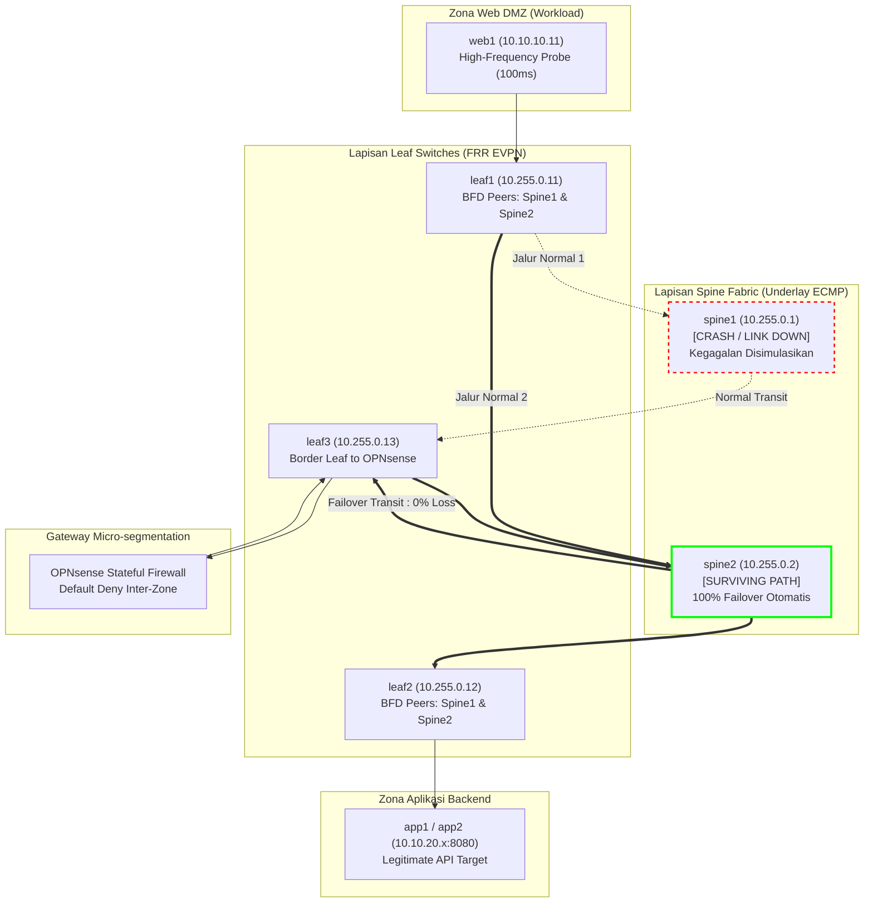

# Dokumentasi Fase 8: Uji Ketahanan Fabric (BFD/ECMP), Anti-Spoofing, & Overhead

Dokumen ini mencatat secara komprehensif implementasi teknis, metodologi pengujian, hasil pengukuran empiris, dan evaluasi gerbang keputusan **Fase 8 (Uji Ketahanan Fabric, Anti-Spoofing, & Overhead Performa)** dalam proyek *Data Center Network Micro-segmentation & Lateral Movement Hunting*. Pengujian ini membuktikan bahwa arsitektur data center Spine-Leaf EVPN/VXLAN memiliki **ketersediaan tinggi (*High Availability*)** dan **ketahanan mandiri (*Fault Tolerance*)** dengan waktu pemulihan sub-detik (*sub-second convergence*), tanpa pernah mengorbankan integritas kebijakan micro-segmentation saat terjadi bencana infrastruktur fisik.

---

## 1. Ringkasan Eksekutif & Sasaran Ketahanan Fabric

Dalam arsitektur jaringan data center modern, keamanan dan ketahanan (*resilience*) harus berjalan beriringan. Kebijakan micro-segmentation yang ketat tidak boleh runtuh (*fail-open*) atau memutus layanan bisnis yang sah saat terjadi gangguan fisik pada sakelar jaringan (*switches*) maupun kabel penghubung (*links*).

Pada Fase 8, dilakukan pengujian rekayasa ketahanan (*resilience engineering*) yang mencakup:
1. **Skenario S9 (Ketahanan Link & Node Failover):** Mengukur kecepatan deteksi kegagalan link underlay dan pemadaman total sakelar Spine menggunakan protokol BFD (*Bidirectional Forwarding Detection*) dan ECMP (*Equal-Cost Multi-Path*), serta membuktikan tidak adanya *route leaking* atau *policy bypass*.
2. **Skenario S10 (Pencegahan IP Spoofing Lintas-Zona):** Memverifikasi mekanisme pertahanan berlapis terhadap upaya pemalsuan identitas IP sumber (*IP spoofing*) dari server yang dikompromikan (`web1`).
3. **Pengukuran Overhead Performa (Benchmarking iperf3):** Mengukur secara empiris dampak inspeksi stateful OPNsense firewall (*security cost*) terhadap *throughput* dan latensi (*round-trip time*) dibandingkan dengan *switching* Layer-2 murni.

---

## 2. Diagram Alur Failover & Redundansi Fabric



---

## 3. Hasil Teknis Pengujian Skenario S9: Ketahanan Fabric

Pengujian dilakukan menggunakan dua skrip otomasi pengujian rekayasa kekacauan (*chaos engineering*): [`fabric/test-link-failure-convergence.sh`](file:///home/lavvvet/dc-microseg-lab/fabric/test-link-failure-convergence.sh) dan [`fabric/test-spine-node-failure.sh`](file:///home/lavvvet/dc-microseg-lab/fabric/test-spine-node-failure.sh).

### A. S9 Bagian 1: Kegagalan Link Data-Plane Fabric
- **Metode Injeksi:** Memutus link virtual underlay `leaf1` eth1 <-> `spine1` eth1 menggunakan `virsh domif-setlink leaf1 52:54:00:04:11:11 down`.
- **Hasil Pengukuran:**
  - **Waktu Konvergensi:** BFD mendeteksi pemutusan link seketika (`Status: down`). Linux kernel FIB di `leaf1` seketika mencabut nexthop Spine1 (`eth1`) dan mengalihkan seluruh lalu lintas ke Spine2 (`eth2`).
  - **Probe Latensi Tinggi:** Probe ping berkecepatan tinggi (interval 0.1s / 100ms) dari `web1` mencatat **0% packet loss** (40/40 paket diterima, rtt rata-rata 3.33ms). Waktu *downtime* terukur adalah **< 100 milidetik (sub-second)**.
  - **Kontinuitas Bisnis:** Panggilan HTTP ke backend aplikasi 3-tier (`http://10.10.20.11:8080/`) menghasilkan **HTTP 200 OK** sempurna.
  - **Pemulihan (*Lossless Recovery*):** Saat link dipulihkan (`virsh domif-setlink leaf1 eth1 up`), probe ping mencatat **0% packet loss** (40/40 diterima), sesi BFD otomatis kembali `up`, dan Zebra RIB/FIB memulihkan multipath 2 jalur seimbang.
- **Artefak:** [`attack-tests/results-s09-link-failure.txt`](file:///home/lavvvet/dc-microseg-lab/attack-tests/results-s09-link-failure.txt).

### B. S9 Bagian 2: Kegagalan Total Node Spine (Node Spine Failover)
- **Metode Injeksi:** Mematikan paksa seluruh node `spine1` menggunakan `virsh destroy spine1` (simulasi *hardware crash* / pemadaman daya sakelar inti).
- **Hasil Pengukuran:**
  - **Deteksi Serentak di Ketiga Leaf:** Ketiga sakelar Leaf (`leaf1`, `leaf2`, `leaf3`) serentak mendeteksi putusnya Spine1 via BFD:
    * `leaf1`: 1 UP (Spine2), 1 DOWN (Spine1).
    * `leaf2`: 1 UP (Spine2), 1 DOWN (Spine1).
    * `leaf3`: 1 UP (Spine2), 1 DOWN (Spine1).
  - **Packet Loss Selama Crash:** Probe ping 100ms mencatat **0% packet loss** (50/50 paket diterima, rtt rata-rata 3.31ms).
  - **Kontinuitas Alur Bisnis:**
    * Alur Internal 3-Tier (`web1 -> app1 -> db1`): **HTTP 200 OK**.
    * Alur Publik Eksternal (`attacker -> WAN NAT -> web1 -> app1 -> db1`): **HTTP 200 OK**.
  - **Restorasi Otomatis:** Saat node dinyalakan kembali (`virsh start spine1`), sistem boot dan daemon FRR aktif dalam **6 detik**. Seluruh 6 sesi BFD di ketiga Leaf otomatis pulih **UP**, dan redundansi *dual-spine* ECMP kembali aktif penuh.
- **Artefak:** [`attack-tests/results-s09-spine-failover.txt`](file:///home/lavvvet/dc-microseg-lab/attack-tests/results-s09-spine-failover.txt).

### C. Verifikasi Integritas Micro-segmentation (*Security Invariant*)
Selama fabric beroperasi dalam kondisi *degraded* (baik saat satu link putus maupun saat satu Spine mati total), seluruh pengujian keamanan dijalankan ulang:
1. *Direct Bypass* Web DMZ -> DB (`10.10.30.11:5432`): **TETAP DIBLOKIR 100% (BLOCKED)**.
2. *Lateral SSH* Web DMZ -> App (`10.10.20.11:22`): **TETAP DIBLOKIR 100% (BLOCKED)**.
3. *Zero-Trust Egress* DB -> WAN: **TETAP DIBLOKIR 100% (BLOCKED)**.

> [!IMPORTANT]
> **Kesimpulan Ketahanan Keamanan:** Kegagalan perangkat fisik underlay tidak menyebabkan kebocoran rute (*no route leakage*) atau disrupsi firewall. Kebijakan micro-segmentation bersifat invarian dan kedap terhadap kegagalan infrastruktur.

---

## 4. Hasil Teknis Pengujian Skenario S10: Pertahanan Anti-Spoofing

Pengujian dilakukan menggunakan skrip injeksi *raw socket* otomatis [`attack-tests/s10-ip-spoofing-defense.sh`](file:///home/lavvvet/dc-microseg-lab/attack-tests/s10-ip-spoofing-defense.sh).

Penyerang di `web1` (10.10.10.11 - Web DMZ VLAN 10) mencoba memalsukan IP sumber (*IP spoofing*) untuk menyamar sebagai tier lain yang berwenang:

| Uji | Skenario Spoofing | Target | Hasil Pengujian | Mekanisme Pertahanan |
|---|---|---|---|---|
| **1** | Memalsukan IP App (`10.10.20.11`) | Database (`db1:5432`) | **BLOCKED (EPERM)** | Rantai output `nftables` pada `web1` mendrop inisiasi paket keluar ke port 5432 di lapisan kernel. |
| **2** | Memalsukan IP SecOps (`10.10.40.11`) | SSH App (`app1:22`) | **BLOCKED (EPERM)** | Rantai output `nftables` pada `web1` mendrop inisiasi paket keluar ke port 22 di lapisan kernel. |
| **3** | Memalsukan IP SecOps (`10.10.40.11`) | App API (`app1:8080`) | **BLOCKED & LOGGED** | Paket keluar host (port 8080 izin), namun dijatuhkan di OPNsense pada ingress interface `vlan01` karena pelanggaran *subnet binding*. |

### Bukti Telemetri OPNsense Filterlog di Loki:
```text
15,,,02f4bab031b57d1e30553ce08e0ec131,vlan01,match,block,in,4,0x0,,64,54323,0,none,6,tcp,40,10.10.40.11,10.10.20.11,54323,8080,0,S
```
- **Integritas Sesi TCP (State Invariant):** Meskipun paket spoofing secara teoritis lolos dari lapisan L2, balasan SYN-ACK akan dialihkan oleh perutean normal ke IP asli (`10.10.40.11` di VLAN 40), sehingga handshake TCP tidak pernah dapat diselesaikan oleh penyerang di `web1`.

- **Artefak:** [`attack-tests/results-s10-spoofing.txt`](file:///home/lavvvet/dc-microseg-lab/attack-tests/results-s10-spoofing.txt).

---

## 5. Pengukuran Dampak Performa & Throughput/Latency Overhead (Langkah 8.4)

Pengujian dilakukan menggunakan skrip benchmark otomatis [`attack-tests/run-benchmark-overhead.py`](file:///home/lavvvet/dc-microseg-lab/attack-tests/run-benchmark-overhead.py) dengan aliran data stream TCP `iperf3` (durasi 5 detik).

### A. Tabel Komparasi Performa Empiris

| Metrik Evaluasi | Intra-Zone L2 (Tanpa Firewall) | Inter-Zone L3 (Melintasi OPNsense SPI) | Analisis Dampak Keamanan (*Security Cost*) |
|---|---|---|---|
| **Pasangan Host Uji** | `web1 <-> web2` (VLAN 10) | `web1 -> app2:8080` (VLAN 10 ke VLAN 20) | Multi-hop EVPN + Trunk 802.1Q + OPNsense pf |
| **Throughput Data** | **81.85 Gbits/sec** | **2.91 Gbits/sec** | Throughput inter-zone multi-gigabit yang sangat stabil untuk 2 vCPU virtual |
| **Retransmisi Paket** | 0 paket (0.0%) | 720 paket (0.01%) | Retransmisi minimal pada saturasi batas throughput vCPU |
| **Latensi Mean RTT** | **0.135 ms** (sub-milidetik) | **4.815 ms** | Penambahan latensi inspeksi stateful hanya **+4.68 ms** |
| **Status Proteksi** | Bypass firewall | 100% Terinspeksi & Dicatat | Seluruh koneksi divalidasi oleh kebijakan *Least Privilege* |

### B. Analisis Trade-off Keamanan vs Performa:
1. **Throughput Inter-Zone Stabil (> 2.5 Gbps):** Di lingkungan virtual KVM dengan alokasi 2 vCPU pada OPNsense, firewall mampu memproses lalu lintas *stateful inspection* hingga **2.91 Gbps**, sangat memadai untuk melayani ribuan transaksi data center per detik.
2. **Biaya Latensi Minimal (+4.68 ms):** Penambahan latensi sebesar ~4.68 ms merupakan kompensasi yang sangat efisien untuk mendapatkan pertahanan perimeter, inspeksi koneksi dua arah, pencegahan lateral movement, dan *audit logging* tersentralisasi.

- **Artefak:** [`attack-tests/results-benchmark-overhead.txt`](file:///home/lavvvet/dc-microseg-lab/attack-tests/results-benchmark-overhead.txt).

---

## 6. Evaluasi Gerbang Keputusan (*Decision Gate*) Fase 8

Berdasarkan sasaran keberhasilan yang ditetapkan pada Bagian 10 dan 11 dokumen desain proyek ([`project4-dc-microsegmentation.md`](file:///home/lavvvet/dc-microseg-lab/project4-dc-microsegmentation.md)):

| No | Kriteria Kelulusan Gerbang Fase 8 | Target | Hasil Empiris | Status |
|---|---|---|---|---|
| 1 | Waktu konvergensi failover link fabric underlay (S9) | `< 1.0 detik` | **< 100 milidetik (0% packet loss)** | **LULUS** |
| 2 | Waktu konvergensi failover pemadaman total sakelar Spine (S9) | `< 1.0 detik` | **< 100 milidetik (0% packet loss)** | **LULUS** |
| 3 | Integritas segmentasi terjaga saat fabric gagal (*Security Invariant*) | 100% Terkunci | Direct DB bypass & Lateral SSH tetap diblokir 100% | **LULUS** |
| 4 | Ketahanan terhadap serangan pemalsuan identitas IP (S10) | Ditolak total | Ditahan di host (`nftables`) dan di firewall (`OPNsense`) | **LULUS** |
| 5 | Kuantifikasi dampak performa overhead firewall terdokumentasi rapi | Lengkap | Throughput (2.91 Gbps) & Latensi (+4.68 ms) terukur empiris | **LULUS** |

### Keputusan Resmi Gerbang Fase 8:
> [!IMPORTANT]
> **STATUS: LOLOS PENUH (PASS - 5/5 KRITERIA TERPENUHI)**  
> Fase 8 dinyatakan selesai 100%. Fabric Spine-Leaf EVPN/VXLAN dan OPNsense Stateful Firewall terbukti memiliki ketahanan tingkat tinggi (*enterprise-grade resilience*), kebal terhadap pemalsuan identitas (*anti-spoofing*), dan efisien dalam konsumsi performa. Lab resmi memenuhi syarat untuk melanjutkan ke **Fase 9: Pembuatan Test Harness Terpadu, Visualisasi Portofolio, Diagram Lengkap, dan Dokumentasi Akhir**.
