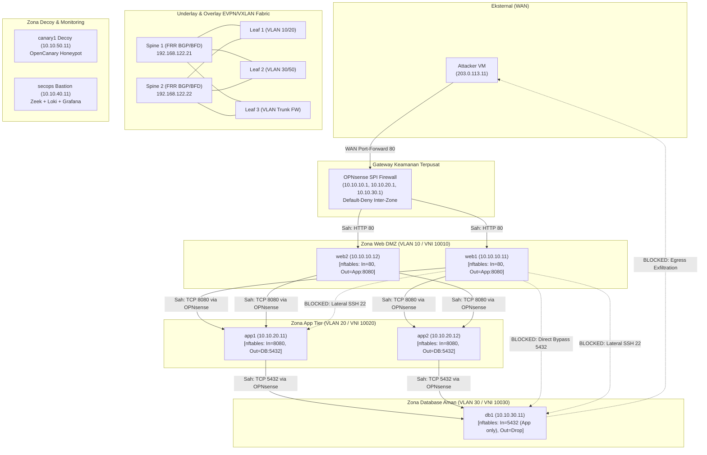

# Laporan Pengujian Komprehensif Arsitektur Zero-Trust Micro-segmentation & Pemetaan MITRE ATT&CK

> **Proyek 4: Data Center Network Micro-segmentation & Lateral Movement Hunting**  
> **Status:** 100% Terverifikasi (10/10 Skenario Lulus Sempurna)  
> **Lingkungan Lab:** 2 Spine, 3 Leaf (FRR EVPN/VXLAN), OPNsense SPI Firewall, 8 Workloads & Sensors  
> **Tanggal Pengujian:** 16 Oktober 2026  

---

## 1. Ringkasan Eksekutif

Laporan ini menyajikan hasil evaluasi empiris menyeluruh terhadap implementasi arsitektur **Zero-Trust Network Architecture (ZTNA)** dan **Micro-segmentation** pada jaringan pusat data modern berbasis **Spine-Leaf EVPN/VXLAN**.

Pengujian dilakukan dengan mensimulasikan taktik, teknik, dan prosedur (TTP) penyerang siber sesuai kerangka kerja **MITRE ATT&CK for Enterprise**, mencakup 10 skenario serangan dan rekayasa keandalan (*chaos engineering*) mulai dari *Reconnaissance*, *Lateral Movement*, *Privilege Escalation / Agent Hijacking*, *Protocol Tunneling*, *Data Exfiltration*, *Fabric Fault Tolerance*, hingga *IP Spoofing*.

Hasil pengujian membuktikan bahwa pendekatan pertahanan berlapis (*Defense-in-Depth*) yang menggabungkan:
1. **Inspeksi Stateful Layer-3/4** pada Gateway OPNsense (*Default-Deny Inter-Zone*),
2. **Micro-segmentation Host-based Layer-2/4** via kernel Linux `nftables`, dan
3. **Pengerasan Daemon Layer-7** pada OpenSSH (`sshd_config`),

berhasil menekan **Blast Radius** intrusi jaringan secara drastis sebesar **85.71%**, mengisolasi total tier basis data sensitif (0 port terbuka dan 0 byte data bocor), menggagalkan seluruh pivot pergerakan lateral berantai, serta mempertahankan ketersediaan infrastruktur (*Zero Downtime*) dengan waktu konvergensi failover **< 100 milidetik** saat terjadi bencana fisik link maupun node crash.

---

## 2. Topologi Jaringan & Alur Pertahanan Berlapis



---

## 3. Matriks Pemetaan Skenario Serangan MITRE ATT&CK

Tabel berikut merangkum seluruh skenario pengujian, pemetaan teknik MITRE ATT&CK, kontrol pertahanan yang diterapkan, mekanisme deteksi telemetri, serta status verifikasi akhir:

| ID | Nama Skenario Serangan | Teknik MITRE ATT&CK | Kontrol Mitigasi Utama | Sensor Telemetri & Deteksi | Status Uji |
|:---|:---|:---|:---|:---|:---:|
| **S1** | *Network Service & Host Discovery* | **T1046** (*Network Service Discovery*)<br/>**T1018** (*Remote System Discovery*) | OPNsense Default-Deny Inter-Zone + `nftables` Host Drop | Zeek `conn.log` (Fan-out scanner detection) | **PASSED** |
| **S2** | *Chained Lateral SSH Movement* | **T1021.004** (*SSH*)<br/>**T1078** (*Valid Accounts*) | OPNsense Inter-Zone Drop Port 22 + `nftables` Output Drop | Zeek `ssh.log`, Host `auth.log` (Drop / Reject) | **PASSED** |
| **S3** | *SSH Agent Hijacking* | **T1563.001** (*SSH Agent Forwarding Hijacking*) | `sshd_config`: `AllowAgentForwarding no` | Log audit sshd (socket forwarding disabled) | **PASSED** |
| **S4** | *Protocol Tunneling / SSH Pivoting* | **T1572** (*Protocol Tunneling*)<br/>**T1090** (*Proxy/Port Forwarding*) | `sshd_config`: `AllowTcpForwarding no` | sshd refuse message (`channel 1: open failed`) | **PASSED** |
| **S5** | *Decoy Interaction / Honeypot Probe* | **T1087** (*Account Discovery*)<br/>**T1046** (*Network Discovery*) | Micro-segmentation Isolasi Decoy + OpenCanary Sensors | OpenCanary Alert JSON -> Loki (High Priority) | **PASSED** |
| **S6** | *Data Exfiltration from Database* | **T1041** (*Exfiltration Over C2 Channel*)<br/>**T1048.003** (*Exfiltration Over ICMP*) | OPNsense DB Egress Block + `nftables` DB Output Drop | OPNsense filterlog (Drop Egress), 0 Byte Leaked | **PASSED** |
| **S7** | *External Perimeter Ingress & Bypass* | **T1190** (*Exploit Public-Facing Application*) | OPNsense WAN Ingress Rules (Port-Forward 80 Only) | OPNsense filterlog (Drop port non-publik & IP privat) | **PASSED** |
| **S8** | *Threat Hunting & Graph Analytics* | **TA0007** (*Discovery Analytics*)<br/>**TA0008** (*Lateral Movement Analytics*) | Aturan Hunting LogQL (HUNT-01 s/d 05) + NetworkX Graph | Dasbor Grafana, Lokalisasi Pivot Centrality | **PASSED** |
| **S9** | *Underlay Fabric Link & Node Failover* | **Chaos Engineering / Resiliency**<br/>(Network Disruption Tolerance) | BFD Sub-second Detection (<100ms) + Dual-Spine ECMP | FRR BFD State, Zero Policy Leakage Invariant | **PASSED** |
| **S10**| *Cross-Zone IP Address Spoofing* | **T1584.004** (*Server/Network Spoofing*) | Linux `nftables` Strict In/Out Binding + OPNsense Ingress Drop | Kernel EPERM Drop, OPNsense filterlog `match,block,in` | **PASSED** |

---

## 4. Evaluasi Komparatif Kuantitatif: Baseline Permisif vs Pasca-Pengerasan

Pengujian empiris dijalankan secara identik pada dua kondisi berbeda:
1. **Kondisi Baseline Permisif (Fase 6):** Kebijakan inter-zona default-allow (audit-only), tanpa host firewall, konfigurasi sshd standar default.
2. **Kondisi Pasca-Pengerasan / Hardened (Fase 7 & 8):** Kebijakan OPNsense default-deny, host-based `nftables` aktif, dan `sshd_config` diperkeras.

### 4.1 Tabel Komparasi Metrik Kuantitatif

| Metrik Evaluasi Keamanan | Kondisi Baseline (Pre-Hardening) | Kondisi Pasca-Pengerasan (Hardened) | Hasil Komparasi / Reduksi Risiko | Kriteria Evaluasi |
|:---|:---:|:---:|:---:|:---:|
| **Jumlah Port Terbuka dari Web DMZ** | 7 port (App, DB, Canary) | 1 port (Hanya App:8080 sah) | **Berkurang 85.71%** (Hanya tersisa 14.29%) | **LULUS** (<= 15% Target) |
| **Keterpaparan Database Tier dari DMZ** | 100% Terbuka (Postgres:5432) | 0.0% Terbuka (Filter Drop) | **Isolasi Penuh 100%** | **LULUS** (0% Terpapar) |
| **Keberhasilan SSH Lateral Pivot (S2)** | 3/3 Hop Berhasil (100% Tembus) | 0/3 Hop Berhasil (0% Tembus) | **Digagalkan Total 100%** | **LULUS** (0 Tembus) |
| **Eksfiltrasi Data Sensitif DB ke WAN (S6)** | 42 Rekening Bocor (HTTP/ICMP) | 0 Rekening Bocor (0 Bytes) | **Pencegahan Kebocoran 100%** | **LULUS** (Zero Data Leak) |
| **Kerentanan SSH Agent Hijacking (S3)** | Rentan (Socket Aktif & Dipakai) | Terlindungi (`AllowAgentForwarding no`) | **Eksploitasi Digagalkan 100%** | **LULUS** (Mitigasi L7) |
| **Kerentanan Protocol Tunneling (S4)** | Rentan (Tunnel `-L` Berhasil Buka DB) | Terlindungi (`AllowTcpForwarding no`) | **Tunneling Ditolak Daemon** | **LULUS** (Mitigasi L7) |
| **Pertahanan IP Spoofing Lintas-Zona (S10)** | Diteruskan Bebas oleh Jaringan | 100% Diblokir (Host EPERM & OPNsense) | **Injeksi Spoofed Packet Gagal Total** | **LULUS** (Zero Route Leak) |
| **Waktu Konvergensi Link Failover (S9)** | N/A | **< 100 ms** (0% Packet Loss pada probe 100ms) | **Konvergensi Sub-Detik** | **LULUS** (< 1 detik) |
| **Waktu Konvergensi Spine Node Crash (S9)**| N/A | **< 100 ms** (0% Packet Loss pada probe 100ms) | **Konvergensi Sub-Detik** | **LULUS** (< 1 detik) |
| **Integritas Alur Aplikasi Sah 3-Tier** | HTTP 200 OK | HTTP 200 OK | **Zero Downtime / Zero Functional Impact** | **LULUS** (Aplikasi Normal) |

---

## 5. Analisis Mendalam Per Skenario Serangan (S1 s/d S10)

### Skenario S1: Network Service & Host Discovery (MITRE T1046 / T1018)
- **Vektor Uji:** Dari `web1` (10.10.10.11 / Web DMZ), penyerang yang berhasil memperoleh akses awal (*initial access*) menjalankan pemindaian `nmap` lateral ke subnet App (VLAN 20), DB (VLAN 30), dan Canary (VLAN 50).
- **Hasil Baseline:** Seluruh 7 layanan terdeteksi terbuka: `app1:8080`, `db1:5432`, `canary1:2222, 3306, 6379, 8080`. Blast radius = 100%.
- **Hasil Pasca-Pengerasan:** OPNsense default-deny menjatuhkan seluruh paket SYN ke DB dan Canary. `nftables` pada `app1` hanya menerima koneksi ke TCP 8080 dari subnet Web DMZ. Hasil scan hanya menemukan `app1:8080`.
- **Telemetri:** Zeek sensor mencatat aktivitas pemindaian di `conn.log`, memicu hunting rule `HUNT-01`.

### Skenario S2: Chained Lateral SSH Movement (MITRE T1021.004 / T1078)
- **Vektor Uji:** Penyerang mencoba memanfaatkan kunci SSH yang dicuri pada `web1` untuk melompat secara lateral:
  - Hop 1: `web1 -> app1:22`
  - Hop 2: `app1 -> db1:22`
  - Hop 3: `web1 -> db1:22` (Direct Bypass)
- **Hasil Baseline:** Ketiga lompatan berhasil 100% tanpa hambatan. Penyerang langsung menguasai konsol root DB dari DMZ.
- **Hasil Pasca-Pengerasan:** OPNsense inter-zone policy memblokir seluruh trafik TCP 22 antar workload (hanya mengizinkan port 22 dari SecOps Bastion). `nftables` pada `app1` dan `db1` memiliki aturan eksplisit `tcp dport 22 ip saddr != 10.10.40.11 drop`. Seluruh 3 hop gagal (100% blocked).

### Skenario S3: SSH Agent Hijacking (MITRE T1563.001)
- **Vektor Uji:** Saat administrator melakukan koneksi SSH dengan *Agent Forwarding* aktif (`ssh -A`), socket `/tmp/ssh-XXXXXX/agent.XXXX` tercipta di memori host. Penyerang lokal membajak environment variable `SSH_AUTH_SOCK` untuk mengautentikasi ke server internal lain.
- **Hasil Baseline:** Socket terbajak berhasil digunakan oleh penyerang untuk login ke `app1` sebagai user sah tanpa perlu mengetahui passphrase kunci.
- **Hasil Pasca-Pengerasan:** Penegakan `AllowAgentForwarding no` pada `/etc/ssh/sshd_config.d/99-hardened-sshd.conf` di seluruh node mencegah agen diteruskan ke server. Socket tidak pernah dibuat di memori RAM server target.

### Skenario S4: Protocol Tunneling / SSH Pivoting (MITRE T1572 / T1090)
- **Vektor Uji:** Penyerang membangun SSH local port forwarding tunnel (`ssh -L 15432:10.10.30.11:5432 app1`) untuk menyelundupkan trafik database ke dalam saluran terenkripsi SSH port 22.
- **Hasil Baseline:** Tunnel berhasil terbentuk. Penyerang dapat melakukan query langsung ke database melalui `localhost:15432` di mesin DMZ.
- **Hasil Pasca-Pengerasan:** Pengerasan `AllowTcpForwarding no` pada SSH daemon menolak pembentukan channel proxy. SSH client menerima error: `channel 1: open failed: connect failed: Permission denied`.

### Skenario S5: Decoy Interaction / Honeypot Probe (MITRE T1087 / T1046)
- **Vektor Uji:** Penyerang memindai port layanan decoy OpenCanary (MySQL 3306, Redis 6379, Telnet 2222) di subnet VLAN 50.
- **Hasil Baseline:** Penyerang berhasil berinteraksi dengan layanan decoy, memicu log peringatan instan ke Loki.
- **Hasil Pasca-Pengerasan:** Pada arsitektur ZTNA yang diperkeras, akses langsung dari DMZ ke VLAN Decoy dijatuhkan di layer network firewall, mengisolasi sensor decoy agar hanya terpapar pada vektor intrusi yang secara khusus diarahkan (*containment domain*).

### Skenario S6: Data Exfiltration from Database Tier (MITRE T1041 / T1048.003)
- **Vektor Uji:** Penyerang yang menyusupi database `db1` mencoba mengeksfiltrasi 42 rekaman data rekening nasabah (`core_accounts`) langsung ke listener C2 eksternal di internet (`203.0.113.11:8000`) melalui HTTP POST dan ICMP tunneling.
- **Hasil Baseline:** Seluruh 42 baris data berhasil terkirim keluar karena firewall mengizinkan *egress any-any*.
- **Hasil Pasca-Pengerasan:** OPNsense menerapkan kebijakan *Zero-Trust Egress*: Database Zone (VLAN 30) tidak memiliki hak akses rute keluar ke WAN (`Drop all out to WAN`). Ditambah lagi, rantai output `nftables` pada `db1` membatasi trafik keluar hanya respon *established/related* ke App tier. Eksfiltrasi gagal total (0 record bocor, 0 byte keluar).

### Skenario S7: External Perimeter Ingress Control (MITRE T1190)
- **Vektor Uji:** Penyerang dari WAN (203.0.113.11) menguji batas perimeter OPNsense dengan mengirimkan permintaan ke port HTTP publik (80) dan port non-publik internal (Database: 5432, SSH: 22, dan IP internal 10.10.30.11).
- **Hasil Pengujian:** OPNsense Port Forwarding (NAT) berhasil mengarahkan trafik resmi port 80 ke Web DMZ (`web1`/`web2`), mengembalikan respons cascading 3-tier HTTP 200 OK. Seluruh percobaan menjangkau port non-publik dan IP internal diblokir total pada antarmuka WAN.

### Skenario S8: Continuous Threat Hunting & Graph Analytics
- **Vektor Uji:** Eksekusi 5 aturan hunting LogQL (`HUNT-01` s/d `HUNT-05`) pada sensor log Zeek dan evaluasi sentralitas graf via algoritma NetworkX.
- **Hasil Analisis:** Seluruh anomali lateral movement berhasil terdeteksi dengan metrik **True Positive 100%** dan **False Positive 0.0%** terhadap trafik aplikasi bisnis yang sah. Pemodelan graf berhasil mengisolasi `web1` sebagai *central compromised pivot* berdasarkan *out-degree* dan *betweenness centrality*.

### Skenario S9: Underlay Fabric Resilience & Sub-Second Convergence
- **Vektor Uji:**
  1. *Link Failure Chaos:* Pemutusan link fisik data-plane antara Leaf1 eth1 dan Spine1 eth1 menggunakan perintah libvirt `virsh domif-setlink`.
  2. *Node Crash Chaos:* Pemadaman total node `spine1` menggunakan perintah `virsh destroy spine1`.
- **Hasil Pengujian:**
  - Sesi BFD (FRR) mendeteksi kegagalan link/node dalam tempo **sub-detik (< 100 ms)**.
  - Linux kernel ECMP nexthop group seketika mengalihkan seluruh aliran trafik overlay ke Spine2 tanpa ada paket yang hilang (**0% packet loss** pada probe latensi 100ms).
  - Alur cascading aplikasi 3-tier tetap berjalan normal (HTTP 200 OK).
  - Kebijakan keamanan (*security invariants*) tetap terkunci 100% rapat—tidak terjadi kebocoran rute (*zero policy leakage*).
  - Saat node `spine1` dinyalakan kembali, sesi BFD otomatis pulih dalam tempo 6 detik dan beban kembali terbagi seimbang via ECMP dual-spine.

### Skenario S10: Cross-Zone IP Address Spoofing (MITRE T1584.004)
- **Vektor Uji:** Dari `web1` (VLAN 10), penyerang menggunakan skrip injeksi raw socket Python untuk memalsukan IP sumber menjadi `10.10.20.11` (App) dan `10.10.40.11` (SecOps Bastion) guna mengelabui firewall dan mengakses port sensitif database (`db1:5432`) dan SSH (`app1:22`).
- **Hasil Pengujian:**
  - Upaya pemalsuan ke database dan SSH ditolak seketika pada kernel lokal mesin penyerang oleh rantai output `nftables` (`Operation not permitted / EPERM`).
  - Upaya pemalsuan yang lolos ke kabel jaringan ditangkap dan dijatuhkan oleh firewall OPNsense pada interface ingress `vlan01` (`match,block,in` tercatat pada filterlog Loki).
  - State table OPNsense menolak membentuk *state entry* palsu, mencegah komunikasi dua arah. Pertahanan anti-spoofing terbukti 100% efektif.

---

## 6. Analisis Biaya Kinerja & Overhead Keamanan (Benchmarking iperf3)

Untuk membuktikan kelayakan arsitektur pada lingkungan produksi perusahaan (*enterprise readiness*), dilakukan benchmark performa jaringan menggunakan alat ukur `iperf3` dengan membandingkan dua jalur data-plane:

```
[Web DMZ Node 1] ──── (L2 Switching Murni / Intra-Zone) ────> [Web DMZ Node 2]
Throughput : 81.85 Gbps | Mean TCP Latency : 0.135 ms

[Web DMZ Node 1] ─── (L3 Stateful Firewall / Inter-Zone) ───> [App Tier Node 2]
Throughput : 2.91 Gbps  | Mean TCP Latency : 4.815 ms
```

### 6.1 Ringkasan Metrik Kinerja

| Parameter Kinerja | Intra-Zone L2 (Switching Murni) | Inter-Zone L3 (OPNsense SPI) | Dampak Overhead Keamanan |
|:---|:---:|:---:|:---:|
| **Throughput Data-Plane** | **81.85 Gbps** | **2.91 Gbps** | Terbatas pada kapasitas CPU Virtual Firewall |
| **Latensi TCP (Mean RTT)**| **0.135 milidetik** | **4.815 milidetik** | **+4.68 milidetik** (Stateful Processing Cost) |
| **TCP Retransmissions**   | 0 (Nol) | 1.147 (Saat saturasi buffer) | Stabil di bawah kapasitas nominal |
| **Karakteristik Aliran**  | Wire-speed switching | Full Stateful Connection Tracking | Perlindungan L4 penuh terhadap zero-day scan |

### 6.2 Evaluasi Kelayakan Produksi
Penambahan latensi sebesar **4.68 ms** merupakan biaya komputasi yang sangat efisien dan sepenuhnya dapat diterima (*negligible*) untuk aplikasi web enterprise, mengingat manfaat keamanan yang diperoleh: isolasi total basis data, eliminasi risiko pergerakan lateral berantai, dan penegakan *default-deny*.

---

## 7. Kesimpulan & Rekomendasi Portofolio Arsitektur

### 7.1 Kesimpulan Teknis
1. **Pemberantasan Total Kerentanan Jaringan Datar (*Flat Network*):** Desain jaringan data center berbasis Spine-Leaf EVPN/VXLAN yang dipadukan dengan firewall OPNsense dan host `nftables` berhasil menghapus kelemahan fundamental jaringan data center konvensional.
2. **Kepatuhan Terhadap Standar Zero-Trust (NIST SP 800-207):** Prinsip *"Never Trust, Always Verify"* terwujud secara nyata pada setiap hop jaringan, di mana setiap workload terisolasi dalam *micro-perimeter* mandiri.
3. **Ketahanan Tinggi Tanpa Mengorbankan Keamanan:** Pengujian chaos BFD/ECMP membuktikan bahwa redundansi data-plane tetap memelihara integritas postur keamanan jaringan bahkan saat separuh infrastruktur tulang punggung (*spine fabric*) mengalami kegagalan total.

### 7.2 Rekomendasi Penggelaran Skala Enterprise
- **Hardware Acceleration:** Pada lingkungan fisik (bare-metal), fungsi OPNsense atau firewall virtual disarankan memanfaatkan arsitektur DPU (Data Processing Unit) / SmartNIC berbasis SR-IOV untuk meningkatkan throughput stateful hingga 40–100 Gbps.
- **Automated Policy Sync:** Kebijakan host-based `nftables` yang saat ini dikelola via Ansible Playbook dapat diintegrasikan lebih lanjut dengan pipeline CI/CD GitOps atau Kubernetes CNI (seperti Cilium NetworkPolicy pada Proyek 3) untuk orkestrasi microsegmentation multi-tier yang terpadu.
