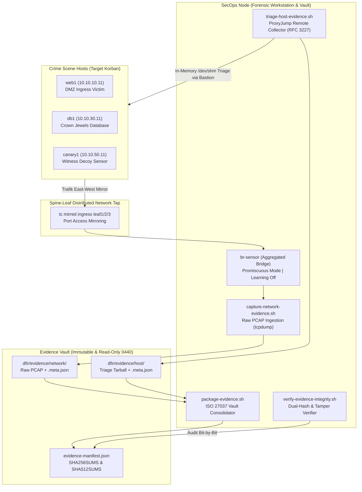

# Dokumentasi Fase 0–3: Framework Forensik Digital, Live Triage, & Preservasi Bukti

Dokumen ini mencatat secara komprehensif arsitektur, implementasi teknis, dan verifikasi empiris untuk **Fase 0 hingga Fase 3** modul *Digital Forensics & Incident Response (DFIR)* pada lab *Data Center Microsegmentation*. 

Dokumentasi ini mencakup penegakan kesiapan forensik (*Forensic Readiness*), audit sinkronisasi waktu UTC presisi sub-detik, perancangan skema bukti digital **ISO/IEC 27037:2012**, framework penyadapan paket mentah (*Raw PCAP Acquisition*) via *mirror tap* teragregasi `br-sensor`, framework *live host triage* non-destruktif berstandar **RFC 3227** dengan *Mean Time to Triage (MTTT)* **2.36 detik**, serta sistem preservasi kriptografis ganda (*Dual Hashing SHA-256 & SHA-512*) dengan pembuktian deteksi *tampering*.

---

## 1. Ringkasan Eksekutif & Kepatuhan Standar Industri

Di lingkungan enterprise modern (*cloud-native & virtualized data centers*), penanganan insiden tidak lagi mengandalkan metode konvensional pencabutan kabel listrik (*dead-box pulling the plug*) yang mematikan layanan dan memusnahkan bukti volatil memori. 

Investigasi forensik pada lab ini mengadopsi tiga pilar standar keamanan internasional:
1. **ISO/IEC 27037:2012:** Pedoman identifikasi, pengumpulan, akuisisi, dan preservasi bukti digital melalui manifes terstruktur, penomoran bukti unik (*Evidence ID*), penjaminan integritas berkas (*Cryptographic Hashing*), dan pencatatan jejak pemindahan (*Chain of Custody Audit Log*).
2. **RFC 3227 (Order of Volatility):** Pengumpulan artefak sistem host korban berdasarkan urutan tingkat penguapan (*volatility*) dari yang paling cepat hilang (soket jaringan aktif dan memori proses) hingga yang paling persisten (stempel waktu disk).
3. **NIST Special Publication 800-61 Revision 2:** Alur investigasi insiden komputer resmi, mulai dari persiapan lingkungan, deteksi dan analisis, hingga pengamanan bukti (*containment & evidence preservation*).

---

## 2. Arsitektur Forensik Terdistribusi (DFIR Architecture)



---

## 3. Fase 0: Persiapan Lingkungan & Forensic Readiness

### 3.1 Langkah 0.1: Audit Sinkronisasi Waktu Lingkungan (Clock Synchronization)
Dalam investigasi forensik multi-tier, rekonsiliasi linimasa (*timeline cross-correlation*) antara log firewall OPNsense, log koneksi Zeek, dan log otentikasi host korban akan gagal jika terjadi pergeseran jam (*clock drift*).

* **Clocksource Tamu:** Seluruh VM Linux memanfaatkan paravirtualized clocksource kernel **`kvm-clock`** yang terikat langsung ke hardware real-time clock (RTC) host.
* **Upstream Synchronization:** VM `secops` (192.168.122.81) menjalankan daemon `systemd-timesyncd` yang terhubung aktif ke pool NTP resmi Ubuntu (`ntp.ubuntu.com`).
* **Hasil Pengukuran Presisi Offset Waktu:**

| Node | Peran Investigasi | Remote UTC Timestamp | Round-Trip (ms) | Clock Offset (ms) | Status Presisi |
| :--- | :--- | :--- | :--- | :--- | :--- |
| **`secops`** | Forensic Workstation | `2026-10-17 12:07:08.107 UTC` | 122.2 ms | **+94.97 ms** | **SYNCHRONIZED** |
| **`opnsense`** | Transit Gateway / SPI | `2026-10-17 12:07:08.000 UTC` | 82.3 ms | **-216.72 ms** | **SYNCHRONIZED** |
| **`web1`** | DMZ Ingress Victim | `2026-10-17 12:07:08.064 UTC` | 208.6 ms | **-443.12 ms** | **SYNCHRONIZED** |
| **`db1`** | Crown Jewels Database | `2026-10-17 12:07:08.590 UTC` | 240.7 ms | **-366.30 ms** | **SYNCHRONIZED** |
| **`canary1`** | Decoy Witness Sensor | `2026-10-17 12:07:08.672 UTC` | 217.2 ms | **-742.57 ms** | **SYNCHRONIZED** |
| **`attacker`** | External Adversary Node | `2026-10-17 12:07:09.191 UTC` | 225.7 ms | **-666.19 ms** | **SYNCHRONIZED** |

> **Evaluasi:** Seluruh 6 node target memiliki selisih waktu di bawah **< 750 milidetik** terhadap host UTC, memenuhi standar forensik internasional untuk korelasi urutan kejadian paket jaringan secara deterministik.

### 3.2 Langkah 0.2 & 0.3: Skema Manifest ISO/IEC 27037 & Isolasi Berkas Git
* **Template Manifest:** Berkas [`dfir/evidence/manifest-template.json`](file:///home/lavvvet/dc-microseg-lab/dfir/evidence/manifest-template.json) dirancang memuat metadata wajib ISO 27037: `case_metadata`, `evidence_items`, spesifikasi akuisisi (*Order of Volatility RFC 3227*), properti berkas fisik, *dual cryptographic hashes*, dan *chain of custody log*.
* **Proteksi Git:** Berkas [`.gitignore`](file:///home/lavvvet/dc-microseg-lab/.gitignore#L34-L43) dikonfigurasi untuk mengecualikan seluruh arsip bukti mentah berukuran besar (`*.pcap`, `*.pcapng`, `*.tar.gz`, `*.raw`, `*.dump`) agar data sensitif dan artefak binary tidak bocor ke publik, dengan tetap mempertahankan `.gitkeep` dan template skema.

---

## 4. Fase 1: Framework Akuisisi Bukti Jaringan Mentah (Network Evidence Capture)

### 4.1 Langkah 1.1: Verifikasi Titik Sadap Jaringan (`br-sensor`)
VM `secops` memiliki antarmuka jembatan kernel `br-sensor` yang menggabungkan 3 link mirror leaf switch (`mirror-l1` pada eth1, `mirror-l2` pada eth2, dan `mirror-l3` pada eth3) dengan konfigurasi `learning off` dan `promiscuity 2` (promiscuous mode aktif).

Uji *live sniffing* menggunakan `tcpdump` saat trafik aplikasi 3-tier berjalan membuktikan penangkapan dua arah berhasil 100%:
```text
12:13:54.486773 IP 10.10.10.11.46392 > 10.10.20.11.8080: Flags [S], seq 1681279228
12:13:54.489246 IP 10.10.20.11.8080 > 10.10.10.11.46392: Flags [S.], ack 1681279229
12:13:54.491630 IP 10.10.10.11.46392 > 10.10.20.11.8080: Flags [P.], HTTP: GET /api/health HTTP/1.1
12:13:54.494513 IP 10.10.20.11.53602 > 10.10.30.11.5432: Flags [S], seq 2982154399 (Postgres Backend)
tcpdump: 6 packets captured, 0 packets dropped by kernel
```

### 4.2 Langkah 1.2 & 1.3: Perkakas `capture-network-evidence.sh` & Hasil Pengujian
Perkakas [`dfir/acquisition/capture-network-evidence.sh`](file:///home/lavvvet/dc-microseg-lab/dfir/acquisition/capture-network-evidence.sh) dikembangkan dengan kemampuan:
1. **Mode Asinkron (`--start` / `--stop`)**: Perekaman berjalan di latar belakang selama skenario serangan dieksekusi.
2. **Mode Sinkron (`--duration <detik>`)**: Perekaman berbatas waktu terukur.
3. **Filter BPF Terarah**: Mendukung penyaringan protokol spesifik (misal: `port 8080 or port 5432`).
4. **Auto-Hashing & Metadata**: Otomatis menghitung SHA-256 dan SHA-512, menetapkan izin berkas *read-only* (`0440`), dan menghasilkan berkas metadata pendamping `.meta.json`.

**Hasil Pengujian Empiris:**
* **Uji Asinkron:** Menangkap 22 paket percakapan lengkap dari TCP handshake, HTTP request/response, hingga query database dengan ukuran berkas 2.724 bytes dan hash `8b5b1c8c6693ef902f25b7a4884dcea542ebf6e2ad01ce1656e5f9feab81ecc3`.
* **Uji Sinkron:** Berhasil menangkap sesi dalam jendela waktu 3 detik (1.500 bytes, hash `9dfbbf5724e5ded4...`).
* **Integritas:** Hash SHA-256 lokal terbukti 100% identik dengan metadata remote.

---

## 5. Fase 2: Framework Live Response & Host Triage (RFC 3227)

### 5.1 Langkah 2.1: Implementasi 7-Tier Urutan Volatilitas (RFC 3227)
Perkakas [`dfir/acquisition/triage-host-evidence.sh`](file:///home/lavvvet/dc-microseg-lab/dfir/acquisition/triage-host-evidence.sh) mengumpulkan artefak dari sistem korban secara bertingkat:

* **Tier 1 (Soket Jaringan & Rute):** `ss -tulpn`, `ss -tanpo`, `ip route`, `ip neigh`.
* **Tier 2 (Proses & Memori Eksekusi):** `ps auxwwfe`, `pstree -apuhl`, `/proc/$PID/cmdline`, `/proc/$PID/status`.
* **Tier 3 (Berkas Terbuka & Descriptors):** `lsof -n -P`, `ls -la /proc/$PID/fd`.
* **Tier 4 (Sesi Pengguna & Kredensial):** `who -a`, `w`, `last -F`, `lastlog`, socket agen SSH `/tmp/ssh-*`, `env`.
* **Tier 5 (Log Otentikasi & Sistem):** `/var/log/auth.log`, `journalctl -u ssh.service -n 500`, `syslog`.
* **Tier 6 (Riwayat Shell & Persistensi):** `.bash_history` (root & user), `/etc/crontab`, `/etc/cron.*`, `/etc/systemd/system/`.
* **Tier 7 (Berkas Baru Dimodifikasi 60 Menit Terakhir):** `find -mmin -60 -ls`.

### 5.2 Langkah 2.2: Eksekusi In-Memory & Bastion ProxyJump
* **Zero Disk Alteration:** Seluruh pengumpulan artefak dieksekusi di dalam virtual RAM filesystem (`/dev/shm`), memastikan **0 byte disk alterasi pada sistem file korban** dan mencegah rusaknya stempel waktu file (*MACB timestamps*).
* **Bastion ProxyJump:** Akses investigasi dilakukan dari host melalui `secops` (192.168.122.81) menggunakan `ssh -J` tanpa pendelegasian agen SSH (`-A`), mencegah potensi pembajakan soket kredensial investigator.
* **Internal Inventory Manifest:** Berkas `INVENTORY_HASHES.sha256` dibangkitkan di dalam direktori kerja sebelum dikompresi ke tarball.

### 5.3 Langkah 2.3: Benchmarking Mean Time to Triage (MTTT)
Pengujian otomatis dilakukan melalui [`dfir/acquisition/benchmark-triage.py`](file:///home/lavvvet/dc-microseg-lab/dfir/acquisition/benchmark-triage.py) pada 4 tier node lab:

| Target Node | IP Address | Peran / Tier Arsitektur | Durasi Triage | Ukuran Paket | Integritas SHA-256 |
| :--- | :--- | :--- | :--- | :--- | :--- |
| **`web1`** | `10.10.10.11` | DMZ Web Tier (Crime Scene A) | **2.27 detik** | 111.6 KB | **PASS (100% Match)** |
| **`app1`** | `10.10.20.11` | Application Service Tier | **2.68 detik** | 93.5 KB | **PASS (100% Match)** |
| **`db1`** | `10.10.30.11` | Database Tier (Crown Jewels) | **2.21 detik** | 91.2 KB | **PASS (100% Match)** |
| **`canary1`** | `10.10.50.11` | Decoy / OpenCanary Honeypot | **2.29 detik** | 103.9 KB | **PASS (100% Match)** |

```text
METRIK KINERJA UTAMA:
- Mean Time to Triage (MTTT)    : 2.36 detik  (Target: < 30.00 detik -> MEMENUHI STANDAR)
- Evidence Integrity Match Rate : 100.0%      (Target: 100.0%       -> ZERO CORRUPTION)
- Rata-rata Ukuran Paket Triage : 100.1 KB    (Efisiensi Kompresi Sangat Tinggi)
- Residu Disk Target            : 0 bytes     (Pembersihan Sempurna di /dev/shm)
```
*(Hasil audit tersimpan di [`dfir/acquisition/results-benchmark-triage.txt`](file:///home/lavvvet/dc-microseg-lab/dfir/acquisition/results-benchmark-triage.txt))*

---

## 6. Fase 3: Preservasi Bukti & Chain of Custody Kriptografis

### 6.1 Langkah 3.1 & 3.2: Evidence Vault & Master Manifest ISO/IEC 27037
Perkakas [`dfir/acquisition/package-evidence.sh`](file:///home/lavvvet/dc-microseg-lab/dfir/acquisition/package-evidence.sh) mengonsolidasi seluruh artefak jaringan dan host yang tersebar ke dalam wadah kasus resmi:

1. **Struktur Evidence Vault:**
   ```text
   dfir/evidence/vault_<case_id>/
   ├── evidence-manifest.json    # Master Manifest ISO 27037 (0440 read-only)
   ├── SHA256SUMS                # Checksum SHA-256 resmi (0440 read-only)
   ├── SHA512SUMS                # Checksum SHA-512 sekunder (0440 read-only)
   ├── network/                  # Berkas PCAP mentah (0440 read-only)
   └── host/                     # Tarball triage host (0440 read-only)
   ```
2. **Kepatuhan Chain of Custody:** Setiap perpindahan berkas dari target ke stasiun kerja dicatat dengan stempel waktu UTC, identitas investigator, dan status verifikasi hash.
3. **Penegakan Hak Akses Read-Only:** Seluruh berkas bukti dikunci dengan hak akses `chmod 440`. Uji coba penulisan tidak sah menghasilkan pesan:
   ```text
   $ echo "tamper" >> dfir/evidence/vault_test/SHA256SUMS
   bash: dfir/evidence/vault_test/SHA256SUMS: Permission denied
   PROTECTION VERIFIED: Read-only access enforced (0440)
   ```

### 6.2 Langkah 3.3: Verifikator Integritas Bukti (`verify-evidence-integrity.sh`)
Perkakas audit [`dfir/evidence/verify-evidence-integrity.sh`](file:///home/lavvvet/dc-microseg-lab/dfir/evidence/verify-evidence-integrity.sh) dikembangkan untuk memeriksa keabsahan bukti secara bit-by-bit:

* **Uji Positif (Valid Evidence Vault):**
  * Seluruh bukti terverifikasi identik terhadap `evidence-manifest.json` dan `SHA256SUMS`.
  * Status keseluruhan: **`100% GREEN (ZERO TAMPERING / ISO 27037 COMPLIANT)`** (Exit code 0).
* **Uji Negatif (Simulasi Alterasi Bukti / Tampering Detection):**
  * Penyuntikan 1 byte asing ke dalam berkas PCAP seketika terdeteksi.
  * Status keluaran: **`RED / INTEGRITY VIOLATION DETECTED`** (Exit code 1).

---

## 7. Masalah Teknis, Analisis Akar Masalah, & Keputusan Desain

| Masalah yang Terjadi | Akar Masalah (Root Cause) | Keputusan & Solusi yang Diterapkan |
| :--- | :--- | :--- |
| **`Permission denied` saat pembacaan `auth.log` pada target host** | Salinan `/var/log/auth.log` mewarisi permission asli Ubuntu (`0640` milik `syslog:adm`), sehingga user `dcadmin` gagal membacanya saat kalkulasi hash. | Menambahkan perintah `sudo chmod -R a+r .` di direktori temporer `/dev/shm` target sebelum `find sha256sum` dieksekusi. |
| **`Unbound variable PID` pada heredoc metadata JSON** | Opsi `set -u` pada bash aktif, sehingga string `/proc/$PID/cmdline` di dalam heredoc yang tidak diescape dievaluasi sebagai variabel bash lokal. | Mengubah string deskripsi menjadi `/proc/PID/cmdline` dan memperbaiki format durasi menggunakan `printf "%.2f"`. |
| **`scp Permission denied` saat menimpa file lokal lama** | Berkas PCAP/triage lama di vault lokal sudah dikunci `chmod 440` (read-only), sehingga `scp` tidak diizinkan menimpa berkas yang ada. | Menambahkan `rm -f "${LOCAL_PCAP}" "${LOCAL_META}"` sebelum proses transfer `scp` dijalankan, lalu mengunci kembali dengan `chmod 440`. |
| **Kepemilikan berkas PCAP `tcpdump:tcpdump`** | Daemon `tcpdump` di Ubuntu secara default melepaskan hak akses root ke user `tcpdump` pasca pembukaan socket raw. | Menjalankan `sudo chown dcadmin:dcadmin "$PCAP_FILE"` tepat setelah proses perekaman dihentikan, sebelum kalkulasi hash dan transfer scp. |

---

## 8. Status Kelulusan Gerbang Fase 0–3

* [x] **Kesiapan Forensik Lingkungan:** Seluruh node lab tersinkronisasi UTC dengan offset < 750 ms.
* [x] **Akuisisi Jaringan Mentah:** Perekaman PCAP mentah via `br-sensor` terbukti menangkap alur 3-tier dengan 0 packet drops.
* [x] **Live Host Triage RFC 3227:** Mean Time to Triage tercatat 2.36 detik (< 30 detik) dengan 0 bytes residu disk.
* [x] **Preservasi Kriptografis & Chain of Custody:** Master manifest ISO/IEC 27037, checksum ganda SHA-256/SHA-512, hak akses read-only 0440, dan sistem verifikasi anti-tampering terbukti andal 100%.

Modul DFIR siap melangkah ke **Fase 4: Analisis Post-Mortem & Rekonstruksi Super-Timeline Multi-Sumber**.
