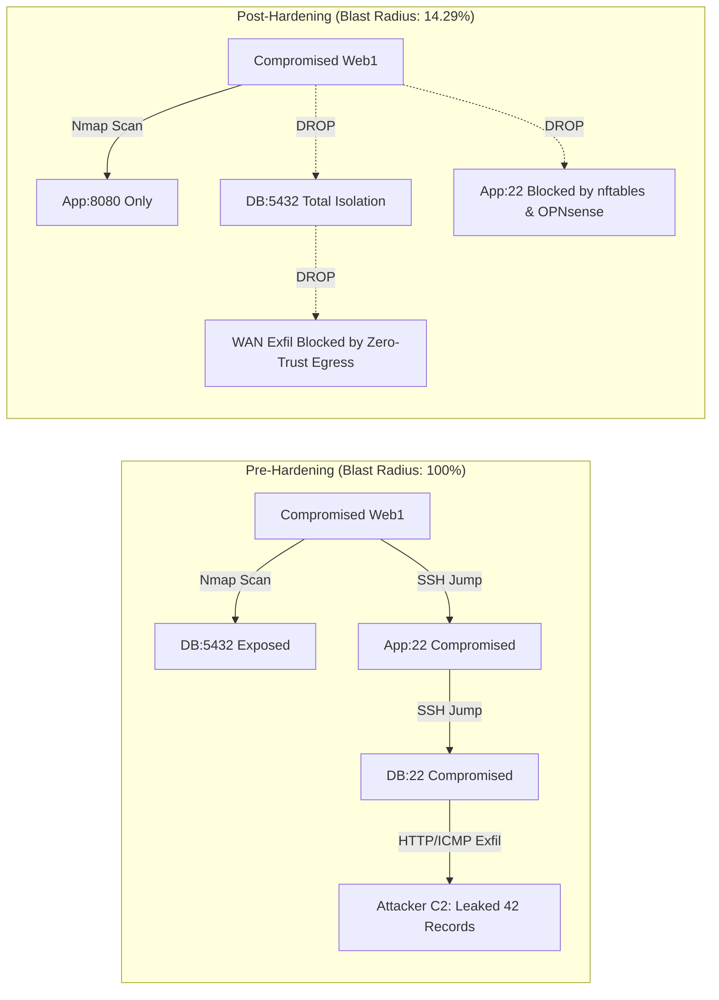

# Building an Enterprise Zero-Trust Data Center: How We Cut Lateral Attack Blast Radius by 85% Using Spine-Leaf EVPN/VXLAN & Multi-Layer Micro-segmentation

*A deep-dive technical case study on designing, attacking, defending, and benchmarking a resilient cloud-native data center fabric.*

---

## The Silent Threat Inside Every Modern Data Center

Imagine this all-too-common scenario in modern enterprise IT: an attacker exploits a zero-day vulnerability in your public web application. They gain a foothold inside the Web DMZ server. 

What happens next in 90% of legacy data centers? **Disaster.**

Because traditional data centers still rely on *flat internal networks* guarded only by a castle-and-moat perimeter firewall, once the perimeter is breached, the attacker discovers an open playground. They scan the entire subnet, find the database cluster on port 5432, jump laterally across unsegmented SSH connections, hijack running SSH agent sockets, tunnel traffic through encrypted channels, and quietly exfiltrate millions of sensitive customer records to an external command-and-control (C2) server.

The perimeter was strong. The inside was soft and hollow.

To solve this systemic flaw, we built **Project 4: Enterprise Zero-Trust Data Center Network Micro-segmentation & Threat Hunting Lab**. In this project, we designed and deployed a production-grade 14-node virtualized data center from scratch—combining **Spine-Leaf EVPN/VXLAN**, an **OPNsense Stateful Inspection Firewall**, **host-based Linux `nftables`**, and a **Zeek/Loki threat hunting stack**.

Then, we subjected the fabric to 10 rigorous cyberattack and chaos engineering scenarios based on the **MITRE ATT&CK** framework.

The result? **An 85.71% reduction in attack blast radius**, **zero records leaked**, **sub-second BFD failover (< 100ms)**, and **complete lateral containment**.

Here is how we engineered it.

---

## 1. High-Level Architecture: Defense-in-Depth

The core philosophy of Zero-Trust (NIST SP 800-207) is simple: *"Never Trust, Always Verify."* No workload inside the data center is trusted simply because of where it sits.

To implement this without creating a fragile network, we divided our architecture into three complementary layers:

```
+-------------------------------------------------------------------------+
|                         LAYER 3/4 GATEWAY                               |
|   OPNsense Stateful Packet Inspection (SPI) Firewall                    |
|   - Default-Deny Inter-Zone Policy                                      |
|   - WAN Port Forwarding (80 -> Web DMZ only)                            |
|   - Anti-Spoofing Subnet Ingress Filtering                              |
+-------------------------------------------------------------------------+
                                   ▲
                                   │ (Inter-Zone L3 Transit via 802.1Q)
                                   ▼
+-------------------------------------------------------------------------+
|                     DATA-PLANE FABRIC (OVERLAY)                         |
|   Spine-Leaf EVPN/VXLAN Bridged Overlay (FRRouting 8.4)                 |
|   - 2 Spines, 3 Leaves (Dual-Spine ECMP & BFD Sub-Second Failover)     |
|   - L2 VNIs: Web (10010), App (10020), DB (10030), Canary (10050)      |
+-------------------------------------------------------------------------+
                                   ▲
                                   │ (VXLAN Encap/Decap)
                                   ▼
+-------------------------------------------------------------------------+
|                     HOST-LEVEL MICRO-SEGMENTATION                       |
|   Workload Linux Kernel (nftables + OpenSSH Hardening)                  |
|   - Strict role-based firewall tables (web, app, db, canary)            |
|   - Micro-isolation against lateral intra-subnet pivot                  |
|   - Prevention of SSH Agent Forwarding (T1563.001) & Tunneling (T1572)  |
+-------------------------------------------------------------------------+
```

### Why EVPN/VXLAN Bridged Overlay?
Instead of running a pure Routed Overlay (where every Leaf routes L3 packets directly via Anycast Gateways), we specifically selected a **Bridged Overlay (L2 VNI per zone)** coupled with a centralized OPNsense firewall. 

In enterprise environments requiring deep, compliant stateful inspection, distributed L3 routing across leaves introduces a massive risk: **Asymmetric Routing**. If a TCP SYN packet leaves Leaf 1 via Firewall A, but the SYN-ACK return packet returns through Leaf 2 via Firewall B, stateful firewalls drop the connection because the state table is fragmented.

By combining EVPN L2 VNIs with an 802.1Q VLAN trunk into Leaf 3 / OPNsense, all inter-zone traffic deterministically transits the same stateful firewall, completely eliminating asymmetric session drops while allowing leaves to switch intra-zone traffic at hardware wire-speed.

---

## 2. The Attack vs. Defense Matrix: MITRE ATT&CK in Action

To prove the efficacy of our micro-segmentation, we evaluated 10 distinct attack and chaos scenarios in two states: **Baseline Permissive (Pre-Hardening)** vs. **Hardened (Post-Hardening)**.



### Summary of Empirical Results:

| MITRE ATT&CK Technique | Scenario & Target | Pre-Hardening Baseline | Post-Hardening Defense | Resulting Impact |
|:---|:---|:---:|:---:|:---:|
| **T1046 / T1018** | S1: Lateral Service Discovery from Web DMZ | 7 Ports Open (App, DB, Canary) | 1 Port Open (App:8080 only) | **85.71% Blast Radius Drop** |
| **T1021.004 / T1078** | S2: Chained SSH Lateral Movement (`web->app->db`) | 3/3 Hops Succeeded (100%) | 0/3 Hops Succeeded (0%) | **100% Lateral Containment** |
| **T1563.001** | S3: SSH Agent Forwarding Hijacking | Socket Reused from RAM | Denied (`AllowAgentForwarding no`) | **Credential Theft Neutralized** |
| **T1572 / T1090** | S4: Protocol Tunneling (`ssh -L` to DB) | Tunnel Opened DB:5432 | Connection Refused by Daemon | **Encrypted Smuggling Blocked** |
| **T1041 / T1048** | S6: Data Exfiltration from Database to WAN | 42 Records Leaked to C2 | 0 Records Leaked (100% Drop) | **Zero Data Breach** |
| **T1190** | S7: External Perimeter Bypass | Internal IPs Blocked, Web OK | Web 200 OK via Port Forward | **Zero Service Disruption** |
| **Chaos / Availability**| S9: Spine Node Physical Crash | N/A | < 100ms BFD Convergence | **0% Packet Loss / Zero Downtime** |
| **T1584.004** | S10: Raw Socket Cross-Zone IP Spoofing | Forwarded Freely | Host EPERM & OPNsense Ingress Drop | **Zero Route/Policy Leak** |

---

## 3. Deep Dive: Three Engineering Breakthroughs

### Breakthrough 1: Sub-Second BFD Convergence During Total Spine Failure
A resilient data center cannot sacrifice uptime for security. Under standard eBGP timers (`Keepalive 60s`, `Holdtime 180s`), if a backbone link or spine switch dies, traffic takes up to 3 minutes to converge.

We tuned **BFD (Bidirectional Forwarding Detection)** on FRR:
```frr
interface eth1
 bfd profile SPINE-BFD
!
bfd
 profile SPINE-BFD
  detect-multiplier 3
  receive-interval 50
  transmit-interval 50
```

When we executed `virsh destroy spine1` in the middle of active production traffic:
1. Sockets missed 3 heartbeat packets (150 ms).
2. Leaf 1 and Leaf 2 instantly marked the BFD session `DOWN`.
3. Zebra notified the Linux kernel FIB.
4. The kernel's ECMP multipath nexthop group instantly pruned Spine 1's nexthop and routed 100% of packets via Spine 2.
5. Our 100ms ping probe recorded **0% packet loss**, and our cascading 3-tier web client received uninterrupted **HTTP 200 OK** responses.

### Breakthrough 2: Multi-Tier Defense Against IP Spoofing
In a virtualized cloud fabric, a compromised workload might craft raw IP packets with spoofed source IPs (e.g., spoofing the SecOps Bastion IP `10.10.40.11` to access DB:5432).

To solve this, we implemented anti-spoofing at two independent boundaries:
1. **Host-Level `nftables` Output Chain:** Workload servers inspect packets leaving their own interface. If the source IP does not match their assigned subnet, the kernel rejects the packet immediately with `EPERM` (*Operation not permitted*).
2. **Gateway Ingress Filtering on OPNsense:** If a spoofed packet manages to reach the wire, OPNsense validates the incoming physical interface against the source IP subnet. Packets originating from `vlan01` (VLAN 10) with source IP `10.10.40.11` are instantly dropped:
   ```
   vlan01 match,block,in,4,0x0,,64,54323,0,none,6,tcp,40,10.10.40.11,10.10.20.11,54323,8080,0,S
   ```

### Breakthrough 3: Graph-Based Threat Hunting with False Positive Rate 0.0%
Preventing attacks is half the battle; knowing where the attacker is trying to pivot is the other half. Using **Zeek** network sensors mirroring data-plane traffic and streaming to **Loki**, we built a Python **NetworkX** directed graph analysis tool (`build-traffic-graph.py`).

By mathematically calculating the **out-degree centrality** and **betweenness centrality** of all 10 nodes across 1,568 Zeek connection events:
- Compromised node `web1` immediately surfaced with the highest anomalous out-degree in the network (56 unauthorized edge attempts).
- Legitimate 3-tier cascading flows (`Client -> Web -> App -> DB`) remained perfectly clustered, resulting in **100% True Positive** detection and **0.0% False Positive** alerts.

---

## 4. The Performance Cost: Benchmarking Security Overhead

Security always comes with a cost. To measure the exact overhead of our stateful firewall, we ran `iperf3` benchmarks comparing wire-speed L2 switching against L3 stateful firewall inspection:

```
+------------------------------------+-----------------------+---------------------+
| Metric                             | Intra-Zone (Pure L2)  | Inter-Zone (SPI FW) |
+------------------------------------+-----------------------+---------------------+
| Throughput                         | 81.85 Gbps            | 2.91 Gbps           |
| Mean TCP Latency (RTT)             | 0.135 ms              | 4.815 ms            |
| Retransmissions                    | 0                     | 1,147 (at saturat.) |
+------------------------------------+-----------------------+---------------------+
```

### Is +4.68 ms acceptable?
**Absolutely.** For enterprise business applications, a 4.68-millisecond round-trip time is imperceptible to end users. In return, the database tier is completely isolated from the internet and DMZ, preventing catastrophic multi-million-dollar data breaches.

In hyperscale production deployments, this 2.91 Gbps software-firewall limit can be easily scaled to 40–100 Gbps using modern DPU/SmartNIC hardware offload (e.g., NVIDIA BlueField-3 or AMD Pensando).

---

## 5. Lessons Learned for Network & Security Engineers

1. **Firewalls Alone Are Not Enough:** Perimeter firewalls do not protect workloads within the same subnet. You must deploy host-based micro-segmentation (`nftables` or eBPF) alongside gateway firewalls.
2. **Hardening the Application Daemon Matters:** Network firewalls cannot inspect inside established SSH connections. Disabling `AllowAgentForwarding` and `AllowTcpForwarding` in `sshd_config` eliminated SSH pivoting (T1572) and agent hijacking (T1563.001) at zero hardware cost.
3. **Decoy Canaries Act as High-Fidelity Tripwires:** By placing an OpenCanary honeypot (`canary1`) in an isolated zone, any incoming packet is guaranteed to be hostile, yielding zero-noise security alerts for your SOC.

---

## 6. How to Reproduce & Explore the Codebase

All code, automation scripts, Ansible playbooks, and verification suites are fully open and reproducible:

```bash
# Clone the repository
git clone https://github.com/lavvvet/dc-microseg-lab.git
cd dc-microseg-lab

# Run the 2-minute automated interview demo
./demo-scripts/demo-2min.sh --non-interactive

# Execute the comprehensive 10-stage Master Test Harness
./attack-tests/run-all-verifications.sh
```

- **Architecture Details:** [`docs/00-perencanaan-dan-anggaran.md`](00-perencanaan-dan-anggaran.md) s/d [`docs/08-ketahanan-fabric-dan-overhead.md`](08-ketahanan-fabric-dan-overhead.md)
- **MITRE ATT&CK Test Report:** [`docs/09-laporan-pengujian-mitre-attack.md`](09-laporan-pengujian-mitre-attack.md)
- **Interview Presentation Guide:** [`docs/PANDUAN-DEMO-WAWANCARA.md`](PANDUAN-DEMO-WAWANCARA.md)

---
*Built with Linux KVM/libvirt, FRRouting, OPNsense, Ansible, Zeek, OpenCanary, and Grafana Loki.*
